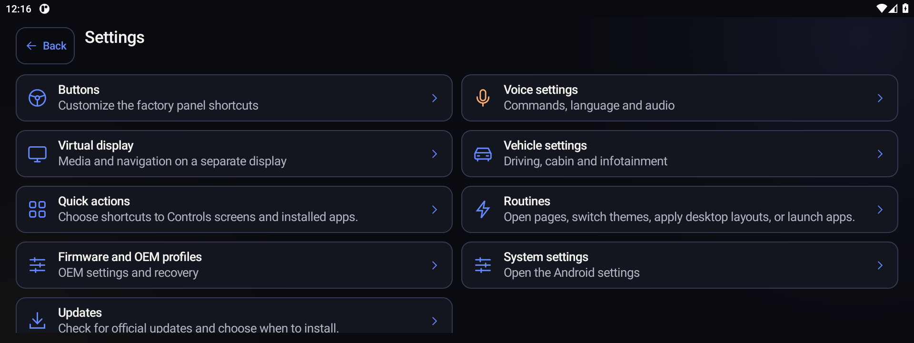

# Open Voyah Controls

Open Voyah Controls is an Android app for Voyah head units. It opens directly to installed apps, with one tile for its own settings. Assign launcher and hardware buttons, use offline English or Russian voice commands, and access driver seat/mirror memory and translations. Every vehicle and root action is allowed by default; **Settings → System → Allowed actions** marks any of them unverified or forbids it. The root channel still checks the exact firmware identity and the APK pins of the hooked OEM packages ([what changed and what stays](android/open-voyah-controls/docs/PRODUCTION.md#allowed-actions-and-what-still-guards-the-root-channel)).

## Tested on

The app has been tested on a Voyah Free 318 head unit with firmware 6.1.0, in guest mode.

## Projects

- [Open Voyah Controls for Android](android/open-voyah-controls/README.md) — source, build instructions, and feature guides.
- [Voyah Radio](android/voyah-radio/README.md) for internet radio.
- [Voyah Music and Voyah Music Transfer](android/voyah-music/README.md) for sending music from an Android phone to the car over local Wi-Fi and playing it offline.
- [YouTube Web for Android](android/open-voyah-controls/docs/YOUTUBE.md) for the head unit's system WebView.
- [Windows installer](installer/README.md) — USB and Wi-Fi setup, one-button installation with the restarts and the final check, other apps, head unit maintenance, and diagnostics. [How Install works](installer/README.md#how-install-works) shows each setup step and what it writes where.

## Screenshots

| App grid | Settings |
| --- | --- |
|  |  |

Screenshots are from Android emulators. See [Head unit qualification and recovery](android/open-voyah-controls/docs/PRODUCTION.md) for the device evidence required before enabling a production build.

## Android structure

Normal screens share `MainActivity` with Compose destinations and ViewModels exposing StateFlow. `core` owns portable rules and ports; app data adapters own persistence and Frida, while platform adapters handle Android permissions and external services. The voice popup and first-run/installer handshake use their own permission-protected Activities. See [Compose routes and motion](android/open-voyah-controls/docs/COMPOSE_UI.md). The diagram in [Where Frida runs](android/open-voyah-controls/README.md#where-frida-runs) shows the root channel, the injector and the injected processes.

Choose **Driver 1**, **Driver 2**, or **Driver 3** to open the corresponding seat and mirror memory workflow. See the [driver memory guide](android/open-voyah-controls/docs/DRIVER_MEMORY.md).

The [account-record recovery appendix](android/open-voyah-controls/docs/ACCOUNT_RECOVERY.md) explains OEM account limits.

[GNU General Public License v3.0 or later](LICENSE)
