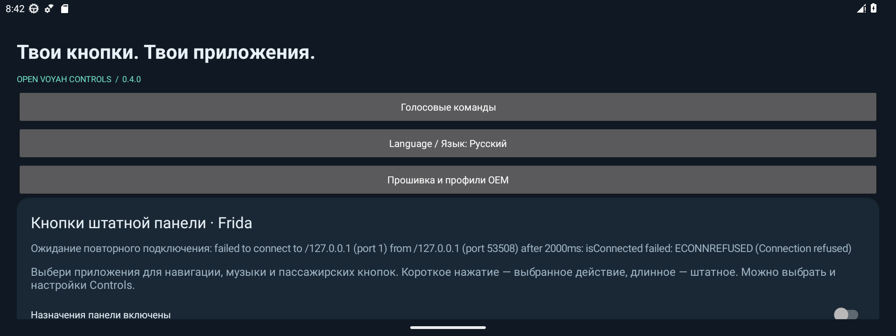
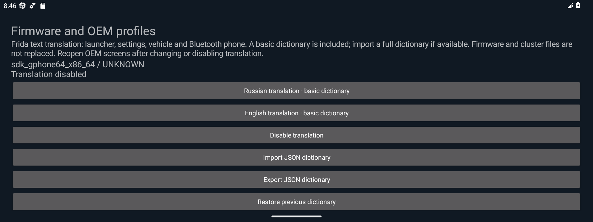

# Open Voyah Controls

Open Voyah Controls is an Android app for Voyah head units. It lets you assign launcher and hardware buttons, use offline voice commands in English or Russian, and manage supported vehicle profiles and translations.

## Projects

- [Android](android/README.md) — source, build instructions, and feature guides.

## Screenshots

| Launcher button settings | Firmware and profile settings |
| --- | --- |
|  |  |

Screenshots are from version 0.4.0 on an Android emulator. Vehicle compatibility remains unverified.

[MIT license](LICENSE)
