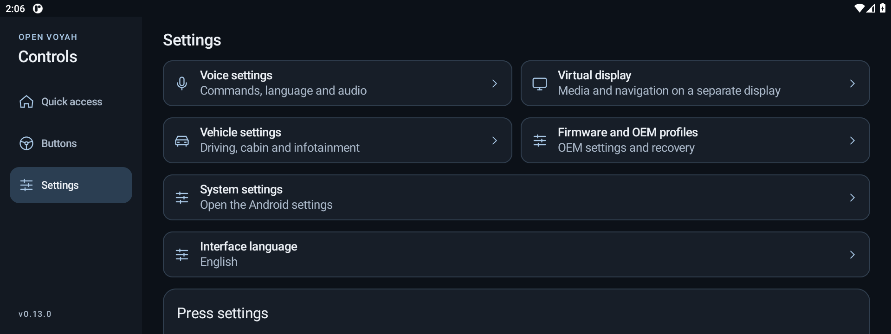

# Open Voyah Controls

Open Voyah Controls is an Android app for Voyah head units. It lets you assign launcher and hardware buttons, use offline voice commands in English or Russian, and manage supported vehicle profiles and translations.

## Projects

- [Android](android/README.md) — source, build instructions, and feature guides.
- [Windows installer](installer/README.md) — USB and Wi-Fi setup, APK installation, head unit maintenance, and diagnostics.

## Screenshots

| Quick access | Settings |
| --- | --- |
|  |  |

Screenshots are from Android emulators. See [Head unit qualification and recovery](android/docs/PRODUCTION.md) for the device evidence required before enabling a production build.

[MIT license](LICENSE)
