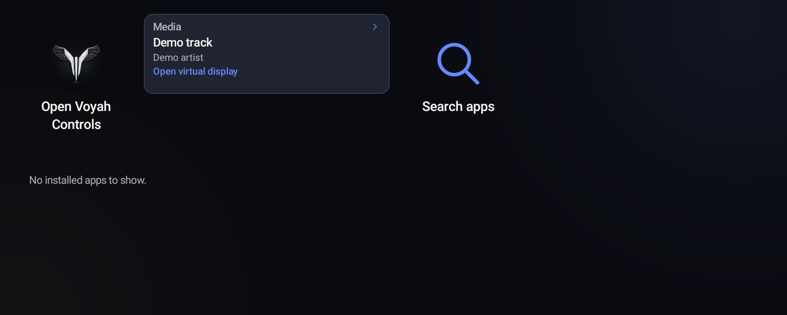
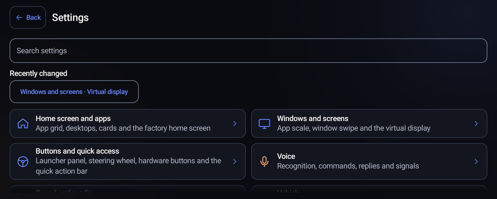

# Open Voyah Controls

**Языки интерфейса — русский, английский и казахский.** [English README](README_EN.md)

Open Voyah Controls настраивает главный экран, меню приложений и управление мультимедиа на головном устройстве Voyah.

| Стартовый экран | Цветовой акцент |
| --- | --- |
|  |  |

## Что умеет

- Настраивать виджеты на главном экране OVC. Можно выбрать карточки навигации, музыки и контактов, менять их размер и назначать источник музыки для каждого рабочего стола.
- Сохранять раскладки, обои и избранные приложения, а также назначать ярлыки на кнопки и панель быстрого доступа.
- Распознавать голос без интернета. Русская модель встроена на ARM64. Английскую, казахскую и резервную русскую модели можно скачать заранее.
- Показывать обложку и управление воспроизведением на виртуальном дисплее. На поддерживаемых головных устройствах можно также настроить карточки навигации и погоды на штатном экране Voyah.

| Главный экран с виджетом музыки | Настройки |
| --- | --- |
|  |  |

## Приложения-компаньоны

Репозитории можно открыть из OVC в разделе **Настройки → Система → Приложения-компаньоны**.

- **YouTube Web** открывает мобильный YouTube на головном устройстве через системный WebView. [Репозиторий YouTube Web](https://github.com/siarheisinelnikau/youtube-web)
- **Voyah Music** воспроизводит музыку из локальных папок без интернета. Приложение **Voyah Music Transfer** на телефоне отправляет треки по Wi-Fi после сопряжения по QR-коду. [Репозиторий Voyah Music](https://github.com/siarheisinelnikau/voyah-music)
- **Voyah Radio** воспроизводит интернет-радио и позволяет выбрать регион, чтобы найти нужную станцию. [Репозиторий Voyah Radio](https://github.com/siarheisinelnikau/voyah-radio)

[Релизы](https://github.com/siarheisinelnikau/open-voyah-controls/releases) · [Версия для Android](android/open-voyah-controls/README.md) · [Установщик для Windows](installer/README.md) · [GPLv3](LICENSE)
