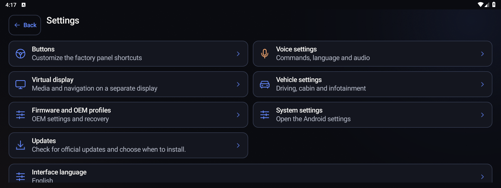

# Open Voyah Controls

Open Voyah Controls is an Android app for Voyah head units. It opens directly to installed apps, with one tile for its own settings. Assign launcher and hardware buttons, use offline English or Russian voice commands, and access driver seat/mirror memory and translations on reviewed firmware.

## Projects

- [Android](android/README.md) — source, build instructions, and feature guides.
- [Windows installer](installer/README.md) — USB and Wi-Fi setup, APK installation, head unit maintenance, and diagnostics. [How Prepare and install works](installer/README.md#how-prepare-and-install-works) shows each setup step and what it writes where.

## Screenshots

| App grid | Settings |
| --- | --- |
|  |  |

Screenshots are from Android emulators. See [Head unit qualification and recovery](android/docs/PRODUCTION.md) for the device evidence required before enabling a production build.

## Android structure

Normal screens share `MainActivity` with Compose destinations and ViewModels exposing StateFlow. `core` owns portable rules and ports; app data adapters own persistence and Frida, while platform adapters handle Android permissions and external services. The voice popup and first-run/installer handshake use their own permission-protected Activities. See [Compose routes and motion](android/docs/COMPOSE_UI.md). The diagram in [Where Frida runs](android/README.md#where-frida-runs) shows the root channel, the injector and the injected processes.

Choose **Driver 1**, **Driver 2**, or **Driver 3** to open the corresponding seat and mirror memory workflow. See the [driver memory guide](android/docs/DRIVER_MEMORY.md).

The [account-record recovery appendix](android/docs/ACCOUNT_RECOVERY.md) explains OEM account limits.

[GPLv3](LICENSE)
