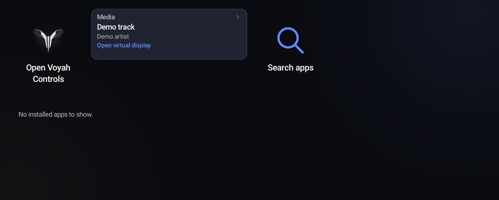
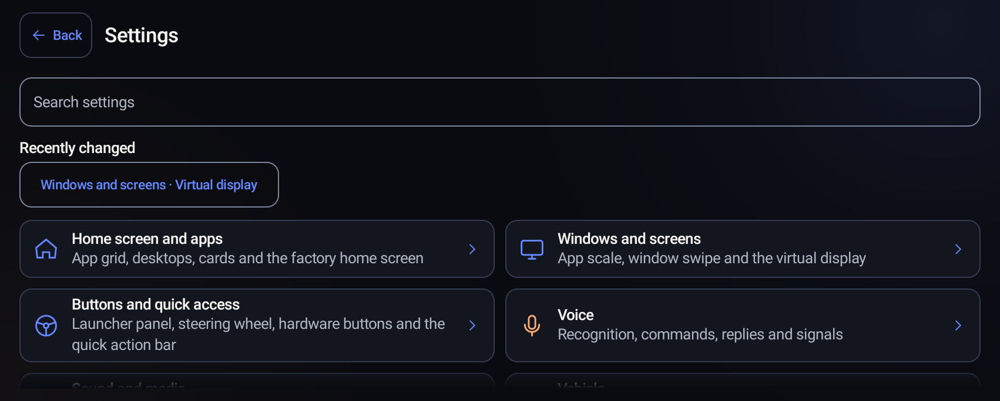

# Open Voyah Controls

**Interface languages — English, Russian and Kazakh.** [README на русском](README.md)

Open Voyah Controls customizes the home screen, app grid, and media controls on Voyah head units.

| Startup screen | Accent color |
| --- | --- |
|  |  |

## Features

- Customize the widgets on OVC Home. Choose navigation, music, and contact cards, resize them, and set a music source for each desktop.
- Save layouts, wallpapers, and favorite apps. Assign shortcuts to buttons and the quick action bar.
- Recognize speech offline. Russian recognition is built in on ARM64. Download the English, Kazakh, or backup Russian model in advance.
- Show album artwork and playback controls on a virtual display. Supported head units can also customize the navigation and weather cards on Voyah's factory home screen.

| Home with the music widget | Settings |
| --- | --- |
|  |  |

## Companion apps

Open the repositories from **Settings → System → Companion apps** in OVC.

- **YouTube Web** opens the mobile YouTube site on the head unit using the system WebView. [YouTube Web repository](https://github.com/siarheisinelnikau/youtube-web)
- **Voyah Music** plays music from local folders offline. Its phone companion, **Voyah Music Transfer**, sends tracks over Wi-Fi after QR pairing. [Voyah Music repository](https://github.com/siarheisinelnikau/voyah-music)
- **Voyah Radio** plays internet radio and lets you choose a region to find the stations you want. [Voyah Radio repository](https://github.com/siarheisinelnikau/voyah-radio)

[Releases](https://github.com/siarheisinelnikau/open-voyah-controls/releases) · [Android app](android/open-voyah-controls/README_EN.md) · [Windows installer](installer/README.md) · [GPLv3](LICENSE)
