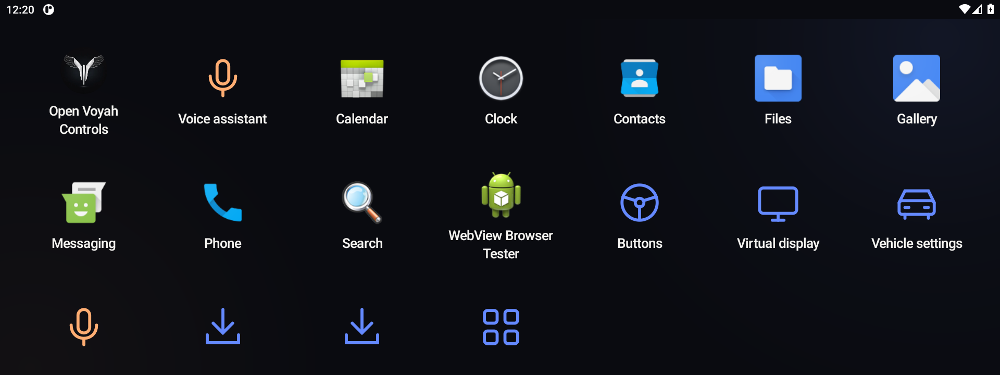
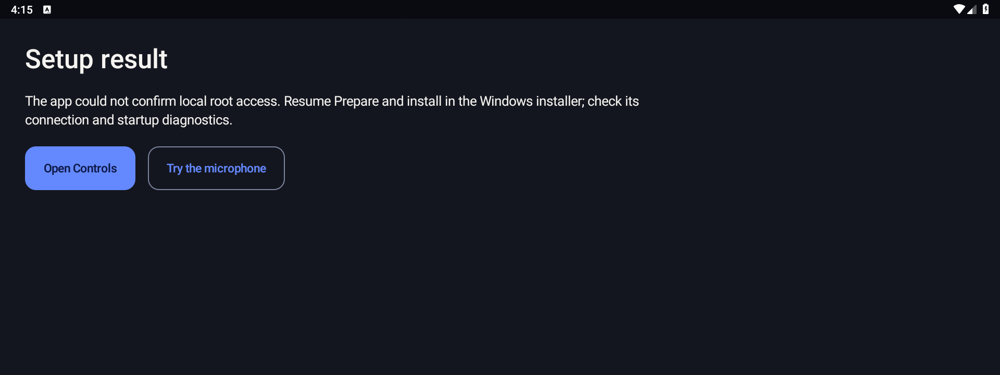
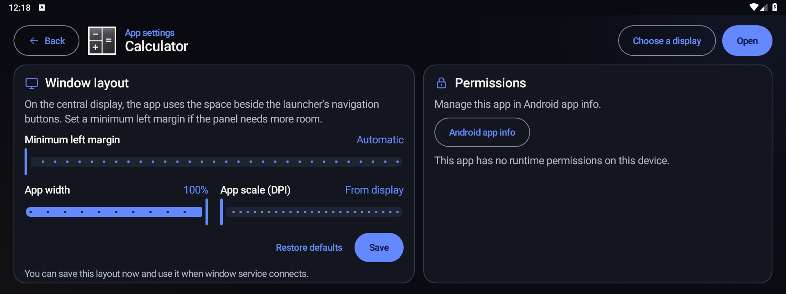
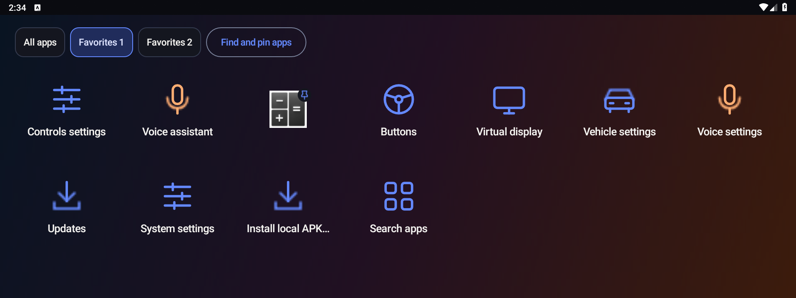
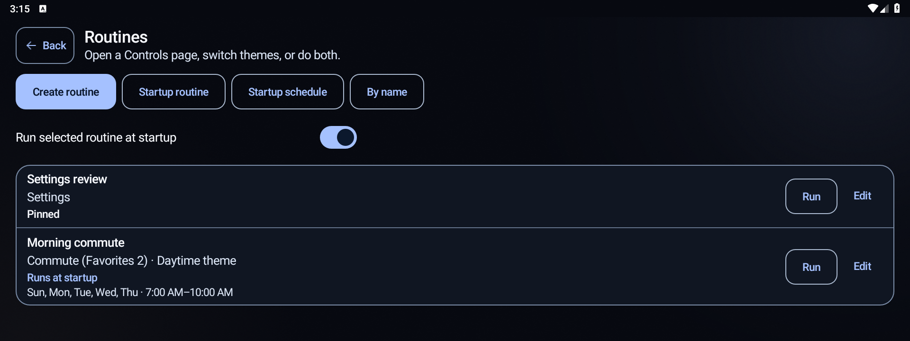
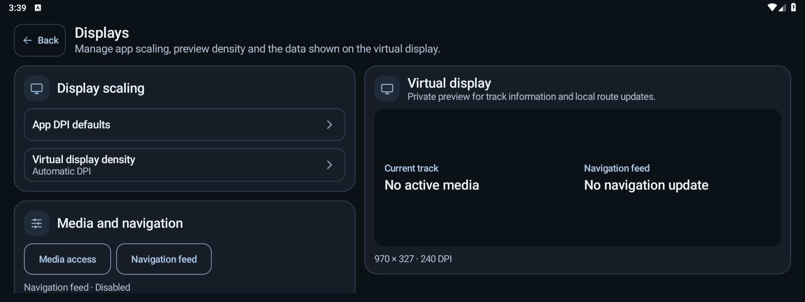
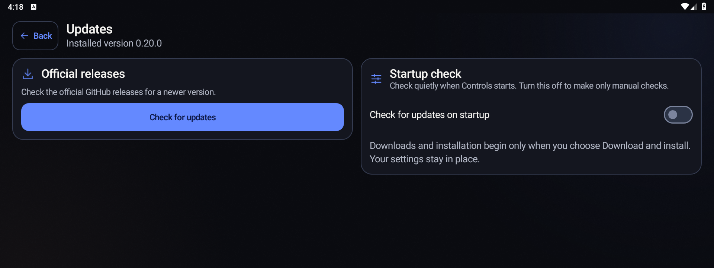
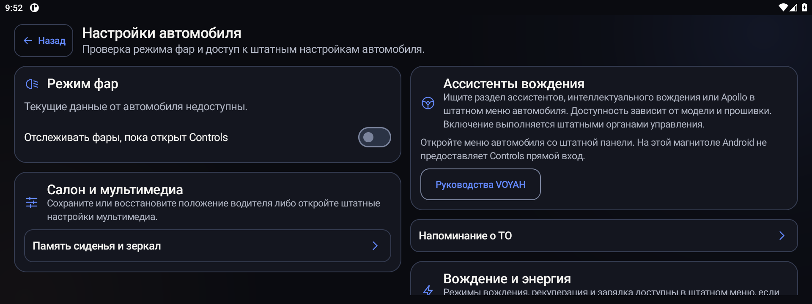
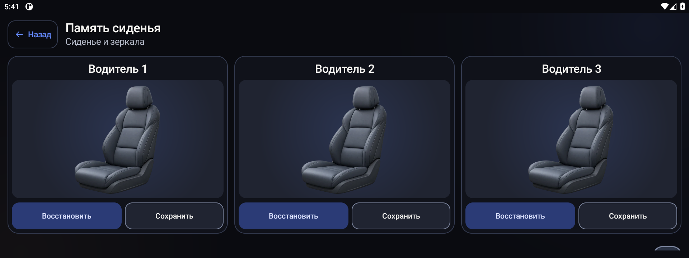
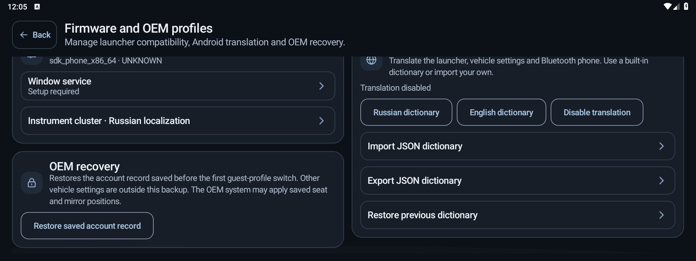

# Open Voyah Controls for Android

Open Voyah Controls is an offline-first utility for Voyah head units. It opens directly to an app grid with installed apps and Controls shortcuts. Use an assigned **Voice assistant** button for one voice request, or **Virtual display** for media and navigation. The app also supports button assignments, factory seat and lighting shortcuts, translation, and instrument cluster backup and recovery.

The APK requires Android 9 (API 28) or newer. The firmware adapters require a reviewed head unit build running Android 9 or 11. See [Head unit qualification and recovery](docs/PRODUCTION.md) for release signing, firmware evidence, and PC rollback.

## Screenshots




## Build

Use JDK 17 or 21, Android SDK Platform 35 and Build Tools 35.0.0, Node.js with npm, and Python 3. From this directory, set `JAVA_HOME` and `ANDROID_HOME` to your local installations and run the following commands.

```powershell
python tools/prepare_voice_model.py --language ru
python tools/prepare_voice_model.py --language en
npm ci
.\gradlew.bat :app:assembleDebug :app:lintDebug :core:test
npm test
```

The APK is written to `app/build/outputs/apk/debug/app-debug.apk`. On Linux or macOS, use `./gradlew`. The Gradle wrapper pins Gradle 8.11.1. The hook build bundles the pinned Frida Java bridge, and the voice preparation scripts verify the upstream Vosk archives. Both voice models and all agents are bundled for offline use.

## Button assignments

- For Android hardware keys, enable the accessibility service and capture the desired key. Assign a tap action before adding a hold action. A missing target or a hold-only mapping leaves the whole gesture to Android. When only a tap is assigned, releasing a held key runs that action.
- Use **Prepare and install** in the Windows installer. It verifies the signed APK and runtime, saves the original startup script on the PC, and provisions authenticated local Telnet through the OEM logcat startup entry. Android uses that channel to start Frida; `su` is not required. The first-run screen checks the app connection, offline speech model, microphone permission, Accessibility connection, and each enabled reviewed handler.
- In the app, choose an app for a panel button and select **Connect Frida**. On the supported panel, the selected app supplies the icon and opens on a tap. On launchers with the foreground callback, the assigned icon highlights when its activity is active on that display. Hold the button to open its original action. Clear an assignment to restore the factory icon and tap action. The radio button is passenger position 4 on the inspected layout.
- With reviewed panel assignments enabled, a short press on the central lower-left menu button opens the Controls app grid by default. Holding it keeps the native launcher action. The grid opens without a Back button, sidebar or page header; Settings and other Controls tools are tiles.
- **OEM steering wheel buttons** supports reviewed Android 9/11 QG callbacks, with separate press and hold assignments for voice, custom and camera keys. A separately reviewed CAN service can supply either short/long terminal events or down/up gestures. The down/up mode requires both targets to be available before capture and never replays a consumed physical gesture after a late failure. **Restore factory buttons** clears the assignments. Android hardware key bindings remain available through Accessibility. See the [adapter limits](docs/FIRMWARE.md#steering-and-display-adapters) and [JavaScript agent guide](docs/FRIDA_AGENTS.md).

The worker waits for Android and a stable system process before attaching. It reattaches when the target changes and can be stopped from the app. Connection status shows panel, voice, and optional hook readiness separately. The [boot and firmware guide](docs/FIRMWARE.md) covers the optional init entry and rollback.




## Apps and displays

- Tap an app tile in the root grid to open it. Touch and hold to open **App settings**, which contains width, DPI, permissions, and display selection. Use the **Settings**, **Buttons**, **Voice settings** and other Controls tiles to open their pages in the same app window. On supported Android 9 and 11 firmware, the window service leaves room for the navigation panel on central display launches, including apps without saved settings. The [firmware guide](docs/FIRMWARE.md#steering-and-display-adapters) describes the launch and display scope.
- Select **Pin to app grid** in **App settings** to keep an app ahead of the other installed apps. Pinned apps retain their order and appear in search results.
- **Settings → App grid** controls tile size, columns, shortcuts, app visibility, icon colors, captions and ordering. Select **Manual order** to arrange ordinary apps. The grid can add two named Favorites desktops with independent pins and a saved default. Choose a wallpaper, navigation and other information cards, phone favorites and a preferred media-card source for each desktop. **Desktop layouts** saves and reapplies the grid, cards and wallpapers together. Back can return from Favorites to **All apps**.
- **Settings → Appearance** controls transitions, text sizes, spacing, corner style, day or dark palette, contrast and the start screen. Navigation labels and page titles can use separate sizes. An optional limit can lower the media volume when you open Controls from its icon.
- **Settings → Quick actions** configures the optional navigation dock. It reserves space in the Controls window and can keep the page width fixed as the side bar folds. Add **Seat memory**, **Routines**, or installed app shortcuts and choose where **Apps** opens. Use **Larger shortcuts** to give selected Controls buttons more room to tap. **Routine shortcut** runs a chosen routine in one tap. The headlight badge can show its source report over the current page. The Virtual display screen can use the full window.
- **Settings → Routines** can apply a saved desktop layout, select a Controls page, use a temporary theme, and open an installed app. Pin routines you use often and choose when they run from the launcher icon. Pause automatic launches while keeping the schedule.
- **Install local APK** opens Android's local file picker. Controls verifies a bounded private copy before submitting the selected package to Android for confirmation. The Controls APK itself must use Updates or the Windows installer.
- The **Permissions** section shows supported runtime permissions for installations verified by Controls. The authorized local channel can apply and verify an individual grant or revocation. Android stores effective permissions across normal reboots. Installations from Windows or another app use **Android app info**. Supported special accesses open their Android settings screens.
- **Virtual display** creates a private display with its own DPI. Grant media access to show the current track and configure album art, progress and playback controls. Choose the pane arrangement, preferred player and seek interval. Route options include current and next roads, Latin lettering and distance units. Instrument cluster media sharing and navigation require the matching OEM cluster service.











## App updates

Open **Settings → Updates** to check official releases, see the installed version, or disable the default startup check. Downloads and installation require **Download and install**. Controls verifies the APK and positively checks that its runtime is paused before Android asks for installation approval. Interrupted attempts remain recoverable without automatic resubmission. See [App updates](docs/UPDATES.md) for the verification and recovery behavior.



## Vehicle settings and maintenance

Open **Settings → Vehicle settings** for the original driving, cabin and infotainment menus. A shortcut appears when Android offers a public launcher entry from the matching built-in app. Use the factory panel when a shortcut is unavailable. The driver uses the original controls to enable and use driving assistance, including Apollo on applicable models. The page also links to the [VOYAH owner manuals](https://www.voyah-global.com/service).

**Firmware and OEM profiles** groups compatibility, translation and recovery. The cluster screen separates package inspection, backup, and confirmed installation or restoration. See [Instrument cluster localization](docs/CLUSTER.md).

**Vehicle settings → Seat and mirror memory** shows three cards for **Driver 1** through **Driver 3**. Each card has a large seat illustration with **Restore** and **Save** below it. An optional switch opens the dedicated factory Seats screen in one tap where the shortcut is available. Save through the factory seat controls and wait for the car's confirmation. On firmware without reviewed direct recall, saying a driver number opens the instructions for that slot. Direct recall requires individually reviewed firmware, Park and zero speed. See [Driver seat and mirror memory](docs/DRIVER_MEMORY.md).

The **Headlight mode** card in **Vehicle settings** opens the factory lighting screen where the shortcut is available. Controls can show the selector and its last confirmation. On Android Automotive with the manufacturer's read permission, it also shows and remembers the separate headlamp and high-beam readings. Choose either set of readings for the headlight desktop card. Enable **Monitor while Controls is open** to keep observing on other Controls pages. See [Headlight mode](docs/HEADLIGHT_STATUS.md).

**Vehicle settings → Service reminder** calculates the next service odometer reading and the remaining distance from the mileage and interval you enter. Choose how many kilometers before service to show the reminder. Settings backups include the service plan and readings.

The [OEM account-record recovery limits](docs/ACCOUNT_RECOVERY.md) describe account A/B/C and the narrower saved-record recovery scope.








## Settings backup

Use **Export app settings** to save button assignments, voice options and contacts, display settings, app window profiles, desktops and named layouts, appearance, reminders, quick actions, routines and vehicle preferences in one file. **Import app settings** validates the file before applying it and accepts earlier full or button-only exports. Preferences introduced after the file was created keep their current values. If a restore is interrupted, the app restores the previous local settings at the next start. The vehicle stores seat and mirror positions. The app keeps the last confirmed lamp observation in private local storage. See the [saved settings inventory](docs/SETTINGS.md).

## Code layout

The existing Gradle modules contain logical MVVM and Clean Architecture layers. `core` owns Android-free command rules, button timing, typed display events and ports. Within `app`, presentation ViewModels expose immutable StateFlow state, data adapters own preferences, document serialization and Frida gateways, and platform adapters handle Android intents, permissions, media, input, audio and job events.

`MainActivity` hosts the app grid and normal Compose routes for Settings, Buttons, voice settings, display, vehicle, firmware, cluster and updates. `QuickVoiceActivity` is the foreground popup; `SetupActivity` handles the installer and first-run handshake. Both have permission-protected external entry points. Android owns file pickers, permission and installation dialogs, system settings and the native virtual-display surface. The injected Qinggan bus adapter lives under `hooks`. See [Compose routes and motion](docs/COMPOSE_UI.md) for lifecycle and rendering boundaries.

## Documentation

- [Voice commands and settings](docs/VOICE.md)
- [Driver seat and mirror memory](docs/DRIVER_MEMORY.md)
- [Firmware, profiles, and text localization](docs/FIRMWARE.md)
- [Head unit qualification and recovery](docs/PRODUCTION.md)
- [Injection targets, screens and button mappings](docs/INJECTION_MAP.md)
- [JavaScript agents and the root boundary](docs/FRIDA_AGENTS.md)
- [Compose screens and motion](docs/COMPOSE_UI.md)
- [Instrument cluster packages, backup, and recovery](docs/CLUSTER.md)
- [OEM account-record recovery limits — technical appendix](docs/ACCOUNT_RECOVERY.md)
- [Third-party dependencies and licenses](THIRD_PARTY.md)
