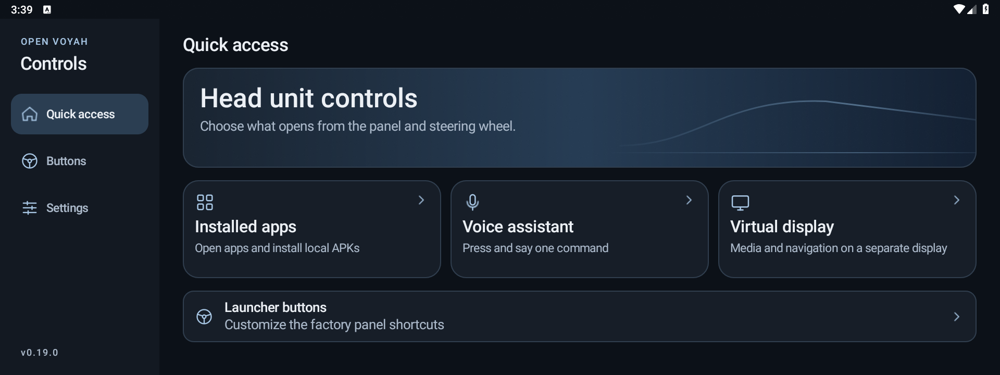
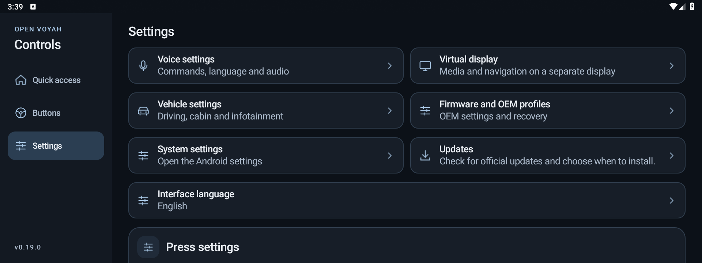
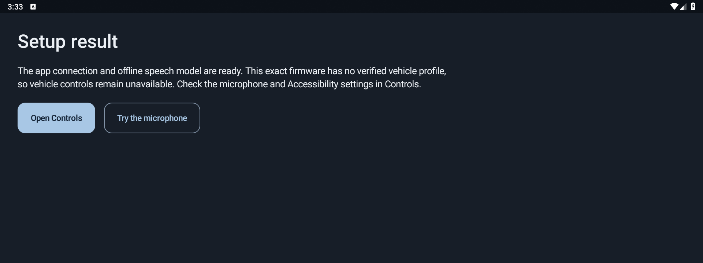
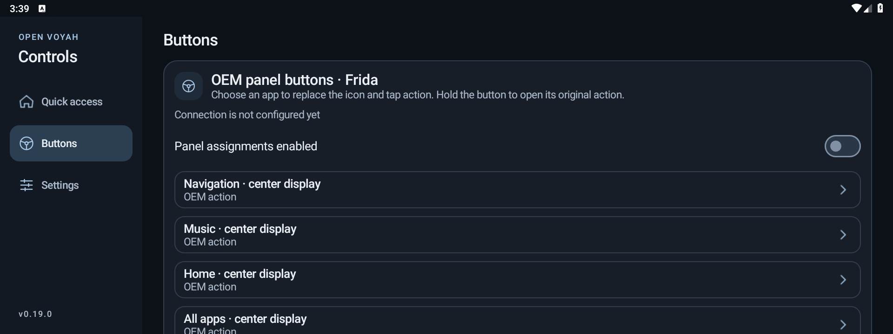
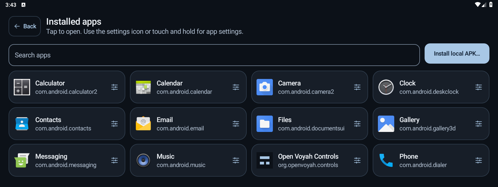
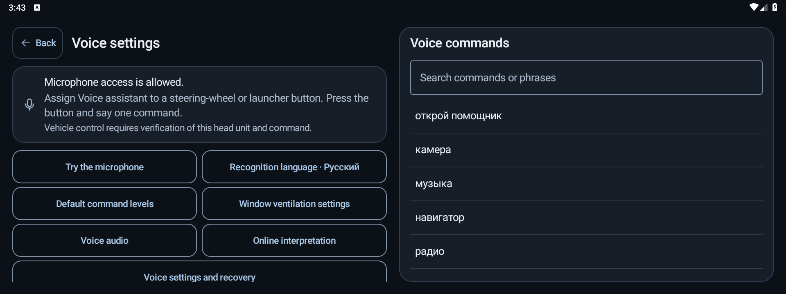
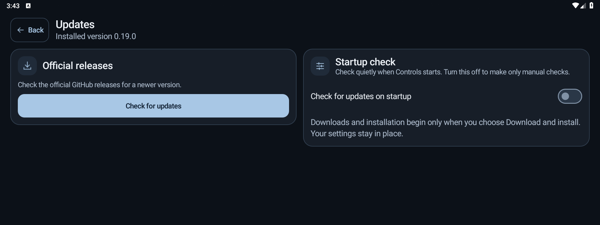
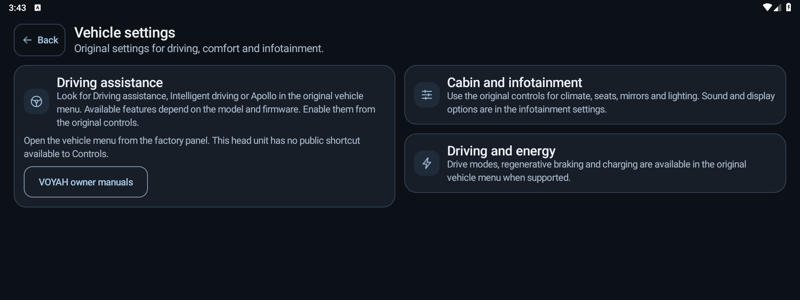

# Open Voyah Controls for Android

Open Voyah Controls is an offline-first utility for Voyah head units. Use an assigned **Voice assistant** button for a single voice request, **Installed apps** to open an app or install an APK from a file, and **Virtual display** to view media and navigation. The app also supports button assignments, guest profiles on supported firmware, and instrument cluster backup and recovery.

The APK requires Android 9 (API 28) or newer. The firmware adapters require a reviewed head unit build running Android 9 or 11. See [Head unit qualification and recovery](docs/PRODUCTION.md) for release signing, firmware evidence, and PC rollback.

## Screenshots





## Build

Use JDK 17 or 21, Android SDK Platform 35 and Build Tools 35.0.0, Node.js with npm, and Python 3. From this directory, set `JAVA_HOME` and `ANDROID_HOME` to your local installations and run the following commands.

```powershell
python tools/prepare_voice_model.py --language ru
python tools/prepare_voice_model.py --language en
npm ci
.\gradlew.bat :app:assembleDebug :app:lintDebug :core:test
npm test
```

The APK is written to `app/build/outputs/apk/debug/app-debug.apk`. On Linux or macOS, use `./gradlew`. The Gradle wrapper pins Gradle 8.11.1. The hook build bundles the pinned Frida Java bridge, and the voice preparation scripts verify the upstream Vosk archives. Both voice models and all agents are bundled for offline use.

## Button assignments

- For Android hardware keys, enable the accessibility service and capture the desired key. Assign a tap action before adding a hold action. A missing target or a hold-only mapping leaves the whole gesture to Android. When only a tap is assigned, releasing a held key runs that action.
- Use **Prepare and install** in the Windows installer. It verifies the signed APK and runtime, saves the original startup script on the PC, and provisions authenticated local Telnet through the OEM logcat startup entry. Android uses that channel to start Frida; `su` is not required. The first-run screen checks the app connection, offline speech model, microphone permission, Accessibility connection, and each enabled reviewed handler.
- In the app, choose an app for a panel button and select **Connect Frida**. On the supported panel, the selected app supplies the icon and opens on a tap. On launchers with the foreground callback, the assigned icon highlights when its activity is active on that display. Hold the button to open its original action. Clear an assignment to restore the factory icon and tap action. The radio button is passenger position 4 on the inspected layout.
- **OEM steering wheel buttons** supports reviewed Android 9/11 QG callbacks, with separate press and hold assignments for voice, custom and camera keys. A separately reviewed CAN service can supply either short/long terminal events or down/up gestures. The down/up mode requires both targets to be available before capture and never replays a consumed physical gesture after a late failure. **Restore factory buttons** clears the assignments. Android hardware key bindings remain available through Accessibility. See the [adapter limits](docs/FIRMWARE.md#steering-and-display-adapters) and [JavaScript agent guide](docs/FRIDA_AGENTS.md).

The worker waits for Android and a stable system process before attaching. It reattaches when the target changes and can be stopped from the app. Connection status shows panel, voice, and optional hook readiness separately. The [boot and firmware guide](docs/FIRMWARE.md) covers the optional init entry and rollback.





## Apps and displays

- Tap a tile in **Installed apps** to open it. Use the settings icon or touch and hold to open **App settings**, which contains width, DPI, permissions, and display selection. On supported Android 9 and 11 firmware, the window service leaves room for the navigation panel on central display launches, including apps without saved settings. The [firmware guide](docs/FIRMWARE.md#steering-and-display-adapters) describes the launch and display scope.
- **Install local APK** opens Android's local file picker. Controls verifies a bounded private copy before submitting the selected package to Android for confirmation. The Controls APK itself must use Updates or the Windows installer.
- The **Permissions** section shows supported runtime permissions for installations verified by Controls. The authorized local channel can apply and verify an individual grant or revocation. Android stores effective permissions across normal reboots. Installations from Windows or another app use **Android app info**. Supported special accesses open their Android settings screens.
- **Virtual display** creates a private display with its own DPI. Grant media access to show the current track. Instrument cluster media sharing and the navigation feed are separate opt-in features. The firmware needs the matching OEM cluster service.






## App updates

Open **Settings → Updates** to check official releases, see the installed version, or disable the default startup check. Downloads and installation require **Download and install**. Controls verifies the APK and positively checks that its runtime is paused before Android asks for installation approval. Interrupted attempts remain recoverable without automatic resubmission. See [App updates](docs/UPDATES.md) for the verification and recovery behavior.



## Vehicle settings and maintenance

Open **Settings → Vehicle settings** for the original driving, cabin and infotainment menus. A shortcut appears when Android offers a public launcher entry from the matching built-in app. Use the factory panel when a shortcut is unavailable. The driver uses the original controls to enable and use driving assistance, including Apollo on applicable models. The page also links to the [VOYAH owner manuals](https://www.voyah-global.com/service).

**Firmware and OEM profiles** groups compatibility, translation and recovery. The cluster screen separates package inspection, backup, and confirmed installation or restoration. See [Instrument cluster localization](docs/CLUSTER.md).




The [0.19.1 validation record](dist/VALIDATION_0.19.1.json) covers account-record recovery, native Android 9/11 failure cases, portable account evidence and Windows installer 0.6.2. See the [local change notes](docs/releases/0.19.1.md) and [account recovery boundaries](docs/ACCOUNT_RECOVERY.md). The previous [0.19.0 record](dist/VALIDATION_0.19.0.json) retains the broader Compose, motion, startup and root-channel checks. Injected JavaScript retains its target process UID. Exact OEM boot permissions, ARM64 injection, physical CAN behavior and complete Oversea account restoration remain unqualified; no vehicle was used.

## Settings backup

Use **Export app settings** to save button assignments, voice options and contacts, interface language, display preferences, app window profiles, and the localization dictionary in one file. **Import app settings** validates the file before applying it and also accepts earlier button-only exports. If a restore is interrupted, the app rolls back to the previous local settings at the next start. Firmware backups, Android permissions, and Frida connection state are managed separately.

## Code layout

The existing Gradle modules contain logical layers. `core` owns portable command rules, button timing, typed display events, and integration ports. All app-owned screen and dialog content uses Kotlin and Jetpack Compose with lifecycle-aware StateFlow for asynchronous state, including the home controls and private display content. Android provides its file pickers, system settings, permission dialogs, and the native virtual-display surface. See [Compose coverage and motion](docs/COMPOSE_UI.md) for the boundaries and checks. Within `app`, `presentation` holds screen models, `data` holds preferences and Frida gateways, and `platform` adapts Android media, input, audio, and job events. Android entry points retain their component names across updates. The injected Qinggan bus adapter lives under `hooks`.

## Documentation

- [Voice commands and settings](docs/VOICE.md)
- [Firmware, profiles, and text localization](docs/FIRMWARE.md)
- [Head unit qualification and recovery](docs/PRODUCTION.md)
- [Injection targets, screens and button mappings](docs/INJECTION_MAP.md)
- [JavaScript agents and the root boundary](docs/FRIDA_AGENTS.md)
- [Compose screens and motion](docs/COMPOSE_UI.md)
- [Instrument cluster packages, backup, and recovery](docs/CLUSTER.md)
- [Third-party dependencies and licenses](THIRD_PARTY.md)
