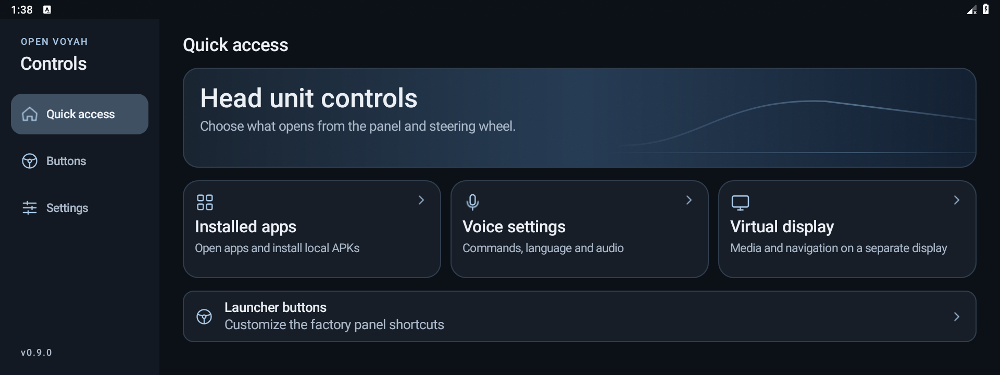
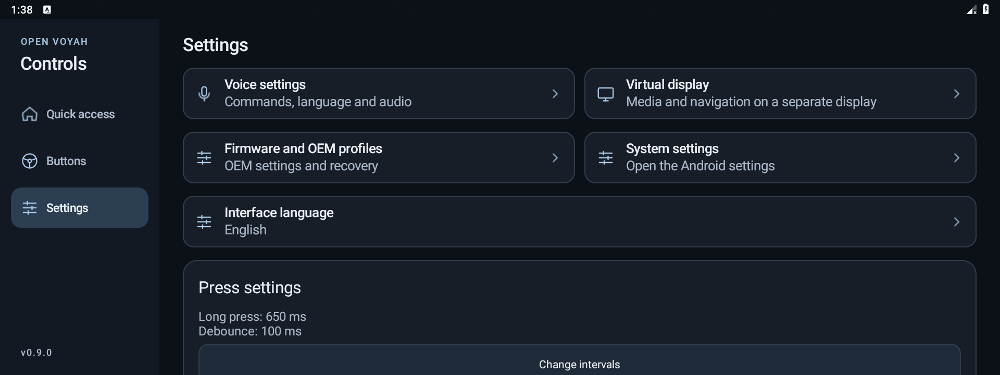
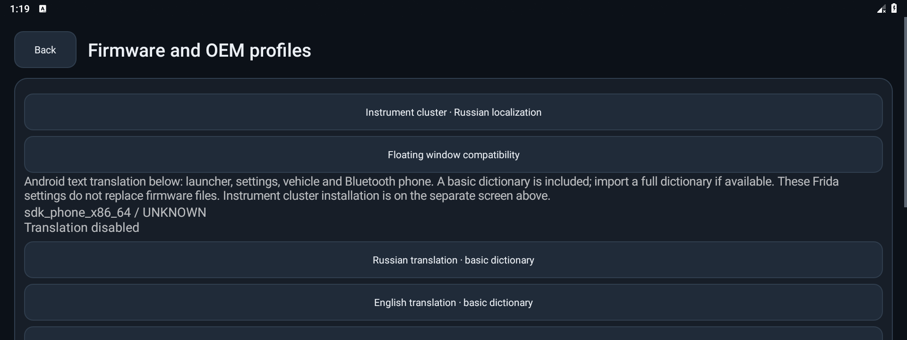
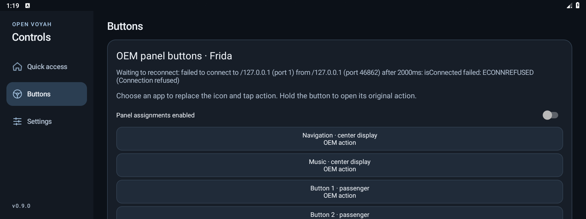
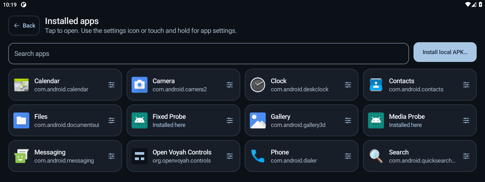
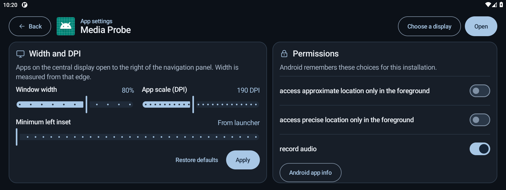

# Open Voyah Controls for Android

Open Voyah Controls is an offline-first utility for Voyah head units. Use an assigned **Voice assistant** button for a single voice request, **Installed apps** to open an app or install an APK from a file, and **Virtual display** to view media and navigation. The app also supports button assignments, guest profiles on supported firmware, and instrument cluster backup and recovery.

The APK requires Android 9 (API 28) or newer. The firmware adapters target compatible Voyah head units running Android 9 or 11.

## Screenshots







## Build

Use JDK 17 or 21, Android SDK Platform 35 and Build Tools 35.0.0, Node.js with npm, and Python 3. From this directory, set `JAVA_HOME` and `ANDROID_HOME` to your local installations and run the following commands.

```powershell
python tools/prepare_voice_model.py --language ru
python tools/prepare_voice_model.py --language en
npm ci
.\gradlew.bat :app:assembleDebug :app:lintDebug :core:test
npm test
```

The APK is written to `app/build/outputs/apk/debug/app-debug.apk`. On Linux or macOS, use `./gradlew`. The Gradle wrapper pins Gradle 8.11.1. The hook build bundles the pinned Frida Java bridge, and the voice preparation scripts verify the upstream Vosk archives. Both voice models and all agents are bundled for offline use.

## Button assignments

- For Android hardware keys, enable the accessibility service and capture the desired key. Short and long presses can have separate assignments.
- For the OEM launcher, use a prepared Android head unit with an existing root shell on `127.0.0.1:23`. Run `python tools/prepare_runtime.py` to fetch and verify the pinned ARM64 injector. Run `./tools/install-runtime.ps1 -Serial <ADB-serial>` to copy it to an explicitly selected device.
- In the app, choose an app for a panel button and select **Connect Frida**. On the supported panel, the selected app supplies the icon and opens on a tap. On launchers with the foreground callback, the assigned icon highlights when its activity is active on that display. Hold the button to open its original action. Clear an assignment to restore the factory icon and tap action. The radio button is passenger position 4 on the inspected layout.
- **OEM steering wheel buttons** is available on Android 11. Where the head unit delivers the supported Qinggan events, assign separate press and hold actions to the voice, custom, and surround-camera keys. **Restore factory buttons** clears the overrides. Android hardware key bindings remain available through Accessibility.

The worker waits for Android and a stable system process before attaching. It reattaches when the target changes and can be stopped from the app. Connection status shows panel, voice, and optional hook readiness separately. The [boot and firmware guide](docs/FIRMWARE.md) covers the optional init entry and rollback.



## Apps and displays

- Tap a tile in **Installed apps** to open it. Use the settings icon or touch and hold to open **App settings**, which contains width, DPI, permissions, and display selection. On supported Android 9 and 11 firmware, the window service leaves room for the navigation panel on central display launches, including apps without saved settings. The [firmware guide](docs/FIRMWARE.md#steering-and-display-adapters) describes the launch and display scope.
- **Install local APK** opens Android's local file picker. Android controls the permission to request installations and confirms the selected package.
- The **Permissions** section shows the supported runtime permissions requested by apps marked **Installed here**. The local root connection can apply and verify an individual grant or revocation. Android stores the effective permissions for the current user and keeps them across normal reboots. **Android app info** opens system-managed settings. Older installations may need to be installed from the app again for Android to record the source.
- **Virtual display** creates a private display with its own DPI. Grant media access to show the current track. Instrument cluster media sharing and the navigation feed are separate opt-in features. The firmware needs the matching OEM cluster service.





The app has been tested on an Android emulator. Real head unit compatibility is tracked separately.

## Settings backup

Use **Export app settings** to save button assignments, voice options and contacts, interface language, display preferences, app window profiles, and the localization dictionary in one file. **Import app settings** validates the file before applying it and also accepts earlier button-only exports. If a restore is interrupted, the app rolls back to the previous local settings at the next start. Firmware backups, Android permissions, and Frida connection state are managed separately.

## Code layout

The existing Gradle modules contain logical layers. `core` owns portable command rules, button timing, typed display events, and integration ports. The cockpit, app grid, and voice screens use Kotlin and Jetpack Compose with lifecycle-aware StateFlow where the screen has asynchronous state. Android-owned dialogs and display surfaces use native views with the same palette. Within `app`, `presentation` holds screen models, `data` holds preferences and Frida gateways, and `platform` adapts Android media, input, audio, and job events. Android entry points retain their component names across updates. The injected Qinggan bus adapter lives under `hooks`.

## Documentation

- [Voice commands and settings](docs/VOICE.md)
- [Firmware, profiles, and text localization](docs/FIRMWARE.md)
- [Instrument cluster packages, backup, and recovery](docs/CLUSTER.md)
- [Third-party dependencies and licenses](THIRD_PARTY.md)
