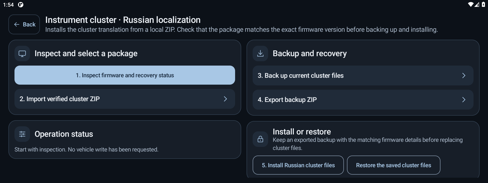

# Instrument cluster localization

The app installs a Russian translation package for the QNX instrument cluster. The firmware identifier must match exactly.

| Supported firmware identifier |
| --- |
| `H97CSA8155-DAILY-20260104134234-USR` |
| `H97CSA8155-DAILY-20260530180446-USR` |

A package replaces the `gauge`, `light`, and `point` binaries and the `point_normal.kzb` theme. The app checks each file's size and SHA-256 against the [profile catalog](../app/src/main/assets/cluster/profiles.json) before allowing it to be installed.

## Prepare a package

Place the required local firmware files under the names listed in the profile catalog. From the Android directory, run:

```powershell
python tools/build_cluster_packs.py path/to/local/cluster-files
```

The tool writes the packages and their checksums to `dist/`.

## Install and recover

Open **Firmware and OEM profiles → Instrument cluster localization**.



1. Check the exact firmware and recovery status.
2. Import the ZIP for that firmware.
3. Save a backup. The app retains one copy on the cluster and another in Android storage.
4. Export the backup ZIP and save it outside the vehicle.
5. Start installation while parked with continuous power.

The installer verifies both backups before writing, stages all four files before the first replacement, and records progress in a recovery journal. If the operation is interrupted, check the status and use **Restore saved cluster files**. Recovery preserves the saved copy. An exported backup ZIP is intended for manual recovery if the cluster copy is lost.

The Android side requires a reviewed head unit and the existing owner-authorized local privilege broker. The cluster connection and each write require separate qualification for that firmware. Check the journal after a failed or interrupted connection. Reboot is a separate operator decision. See [Head unit qualification and recovery](PRODUCTION.md).

## Local checks

Run `python tools/test_cluster_transaction.py` to exercise the shell transaction in a temporary filesystem. The Android `ClusterTest` covers the catalog, ZIP validation, checksums, and transport. Tests that import real packages require the two local ZIPs in the app-specific files directory of an isolated emulator.
