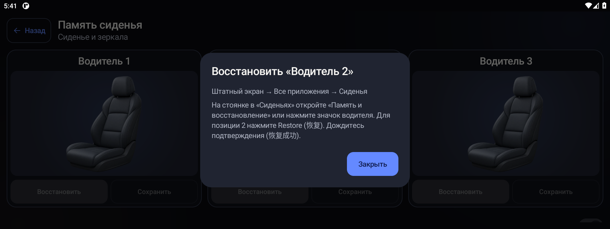

# Driver seat and mirror memory

**Driver 1**, **Driver 2** and **Driver 3** correspond to the vehicle's three driver seat and mirror memory slots.

## Use the car's memory on screen

Open **Vehicle settings → Seat and mirror memory**. **Driver 1**, **Driver 2**, and **Driver 3** each have a three-quarter seat illustration with **Restore** and **Save** below it. The buttons sit side by side when their labels fit. The cards adapt to narrow windows and large text. The same numbers identify the vehicle's memory slots and voice commands.

1. Park and adjust the driver seat and mirrors. Press **Save** on the desired card. The app shows the numbered slot and offers **Open Seats** when the factory app exposes that action. Wait for confirmation in the factory controls.
2. Press **Restore** on a card to recall its position. On firmware with reviewed recall, Controls can show whether the factory service accepted the request. Other head units use the factory seat controls. The instructions show **Factory home → All apps → Seats** when the direct Seats shortcut is unavailable.

The vehicle stores the physical seat and mirror positions. Controls stores the last driver slot used in its own interface.

The numbered factory instructions stay open if you switch to another app temporarily or Android recreates the Controls screen. Leaving the seat page clears them. A direct recall confirmation closes when Controls loses the foreground and requires a fresh tap.

On head units that use the factory handoff, enable **Open factory seat controls directly** below the cards. Save or Restore then opens the dedicated Seats screen when the shortcut is available. Choose the driver slot and complete the action there. The app shows the numbered instructions if the shortcut is unavailable or Android cannot open it.

The H97C owner guide shows **All apps → Seats** on the central display. Tap the driver icon to open memory for the three seat and mirror positions. The inspected factory shortcut opens the **Seats** app. The quick-control panel also offers short presses to recall a saved position and long presses to open memory settings. See the guides for [H97C seats](https://m.dsmp.voyah.com.cn/userguide/h97c/h97c-20.html), [H97C quick controls](https://m.dsmp.voyah.com.cn/userguide/h97c/h97c-43.html), [VOYAH FREE](https://voyah.nl/hubfs/User%20manual%20VOYAH%20Free%20EN-20240614.pdf?hsLang=nl) and [VOYAH DREAM](https://voyah.ru/media/download/docs/4vzwjh__rkovodstvo-pol-zovatela-voyah-dream.pdf#page=60).

The VOYAH FREE 318 manual places **Driver memory and restore** (`主驾记忆与恢复`) in **All apps → Seats**. It documents three presets for the driver seat and both exterior mirrors. A new save replaces the chosen preset. The manual lists front-seat initialization as a prerequisite for memory and says to power on the vehicle for recall. VOYAH also documents a named Rest position for its own voice assistant. [FREE 318 Seats manual](https://m.dsmp.voyah.com.cn/userguide/h97d/h97D-20.html) · [FREE 318 voice assistant](https://m.dsmp.voyah.com.cn/userguide/h97d/h97D-8.html)

The FREE 318 factory quick controls also offer three numbered seat and mirror shortcuts. While parked, swipe right from the far-left edge of the factory center screen. A short press on a preset starts recall. A long press opens position memory settings. [FREE 318 quick controls](https://m.voyah.com.cn/userguide/h97d/h97D-43.html#中控屏右滑负一屏)

In the inspected factory app, `com.qinggan.app.vehicle` 1.0 (version code 1), **Open Seats** selects the front-seat tab when available. Tap the driver memory button on that tab. A guest may see the factory sign-in screen there. The three cards are **Driving** (1), **Rest** (2) and **Other** (3), from left to right. On other firmware, follow the preset order shown in **Seats**.

| Action in Controls | Button on the factory card | Factory confirmation for Driver 2 |
| --- | --- | --- |
| Save | **Memory** (记忆) | **Rest saved** (休息位置 记忆成功) |
| Restore | **Restore** (恢复) | **Rest Restore successful** (休息位置 恢复成功) |

The same build can show **Failed to save Rest** or **Failed to restore Rest** for that card. **Restoring to default position** (正在恢复到默认位置) can appear when the card has no saved position. To verify a personal preset, first confirm the named save. After recalling it, check the final position of the driver seat and each exterior mirror.

Android Automotive defines standard write-only seat-memory properties for Save and Restore. The Cockpit firmware report can read the driver's seat area and each property's configured index range. **Lighting sources → Copy report** records whether the installed app requests the seat-control permission and whether Android grants it. The standard Android permission controls access to the seat configuration. The factory presets on FREE 318 also cover the mirrors. Verify that behavior and the mapping to the numbered slots on the vehicle before using a direct interface. [Cockpit firmware report](PRODUCTION.md#review-a-firmware-candidate) · [Android Automotive seat-memory properties](https://developer.android.com/reference/android/car/VehiclePropertyIds#SEAT_MEMORY_SELECT)

## Voice shortcuts

Press your assigned **Voice assistant** button and say the phrase for the saved position:

| Memory slot | English | Russian |
| --- | --- | --- |
| Driver 1 | “driver one” | “водитель один” |
| Driver 2 | “driver two” | “водитель два” |
| Driver 3 | “driver three” | “водитель три” |

If the final transcript uses digits, `driver 1` through `driver 3` and `водитель 1` through `водитель 3` select the same positions.

When the exact firmware has reviewed recall for the spoken slot, Controls can send the request after checking **P (Park)** and zero speed. It stops the direct request if the vehicle-state readings are unavailable or too slow. On builds without reviewed recall, the same phrase opens the corresponding numbered **Restore** instructions in Controls. Finish the recall in the factory seat controls. The shipped approval catalog is currently empty.

A new driver command switches the instructions to that number. Close the instructions and go back to return to the Controls page you were using.

For hardware qualification, record the exact head unit and vehicle package. **Vehicle settings → Lighting sources → Copy report** records the visible factory package versions and whether the dedicated Seats panel resolves. The factory APK inspected for the labels above has SHA-256 `c4d83fdd45613661999d5920c8f5fafe2f5f42b69e38437358b78dba2a0a93ec`. The `driver_memory_handoff` log records the slot, Save or Restore, and the result of requesting the factory screen. A `requested` outcome means Android accepted the launch request. On the intended parked vehicle, confirm the three numbered slots and their results in the factory controls. For a direct route, separately verify each supported slot, the resulting seat and mirror position, and the behavior when the vehicle state or completion feedback is unavailable. The local Android tests cover the public shortcut, slot routing and guidance with synthetic package discovery. [Record firmware evidence](PRODUCTION.md#review-a-firmware-candidate)

For a verified direct recall, a successful response confirms that the factory service accepted the request. Check the final position of the driver seat and both mirrors when movement finishes. An unknown response ends the request.

The separate **Driver A/B/C** commands concern OEM accounts. They do not select these numbered memory slots. Account-record restoration does not restore or undo seat/mirror movement; its narrower technical limits are described in [OEM account-record recovery limits](ACCOUNT_RECOVERY.md).
