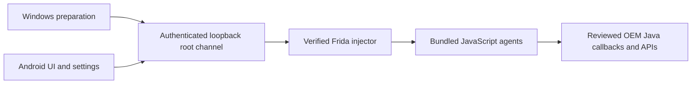

# What the JavaScript agents do

The Kotlin/Java app owns screens, settings, permissions and speech recognition. The Windows installer prepares the authorized local root channel and boot recovery. Frida loads the bundled JavaScript agents into the reviewed OEM processes so they can call the vehicle's Java APIs and replace specific callbacks.

The agents use the Java bridge, not a browser. Their entry points are bundled into `app/src/main/assets/hooks/*.bundle.js` during the Android build. Source modules in `hooks/` are the editable implementation; generated bundles include their dependencies. The APK carries these local bundles and pinned runtime metadata. The Windows kit supplies the verified ARM64 Frida executable. The APK does not download arbitrary scripts at startup.

## Where the privileges come from

The OEM init service must already run `/system/etc/init.logcat.sh` as root. Windows verifies its available ADB preparation access, saves the original script off-device, and installs the guarded access/boot entries. The script inherits root from that OEM service; neither Telnet nor Frida grants root to an otherwise unprivileged boot script. An unavailable preparation path is reported instead of requesting `su`.

The access entry starts authenticated Telnet on `127.0.0.1:2323`. Its login helper checks root identity, SELinux enforcement, the installed app identity and the installer-provisioned secret. The ordinary Android app authenticates through `AuthorizedRootChannel`; it does not run as UID 0 and never calls `su`. First-run diagnostics verify UID 0 in the prepared channel; the OEM boot service's SELinux domain and cold-boot behavior require separate qualification.

After exact firmware, package and runtime verification, `ProductionRootAccess` and `FridaBridge` use that root shell to deploy and start the supervised injector. The injector runs as root. An injected JavaScript agent runs **inside its target process with that process's UID and SELinux context**; it does not automatically make the target root. OEM API calls use the target's available APIs and permissions. Root file and process operations go through the authenticated root shell. SELinux remains Enforcing.

The process-by-process scope and button mappings are listed in [Injection targets and controls](INJECTION_MAP.md). Local tests establish the app/channel/injector boundary on an emulator; the actual OEM boot service, ARM64 deployment and vehicle effects still need head unit qualification.

| Modules in `hooks/` | Responsibility |
| --- | --- |
| `entry.js`, `launcher-buttons.js`, `navbar-oversea.js` | Select the launcher layout and replace assigned panel clicks. Unassigned actions and unsupported layouts keep their native path. |
| `panel-state.js`, `panel-icons.js` | Apply assigned icons, react to themes, and restore original panel state. |
| `steering-android11.js` | Handle observed QG key callbacks on Android 9 and 11. It delegates when a reviewed direct CAN route is selected. The filename is historical. |
| `can-entry.js`, `can-steering.js`, `can-keys.js`, `can-edges.js` | Hook the CAN service callback. One reviewed protocol handles terminal short/long events; the other owns a complete down/up gesture with preflight, bounded hold timing and no physical replay. |
| `action-preflight.js`, `java-types.js` | Check whether an activity is currently launchable and initialize Java constant classes before reading their fields. |
| `voice-commands.js`, `voice-engine.js`, `voice-safety.js`, `qinggan-bus.js`, `voice-plans.json` | Validate fixed command requests, enforce firmware and Park/telemetry gates, and call observed OEM vehicle APIs. Microphone capture and Vosk recognition remain in Android code. |
| `window-*.js` | Apply per-app size/DPI policies through separately verified Android 9/11 window-service interfaces. |
| `localization*.js` | Replace selected labels using the configured dictionaries. |
| `navigation-entry.js`, `display-events.js` | Observe navigation data and route supported navigation/media information to the relevant displays. |
| `oversea-profiles*.js`, `account-state.js` | Inspect the overseas driver API and classify a bounded observation of the account backing file. They never select or restore an account and never log its fields. |

The boot and supervisor files ending in `.sh` are shell scripts. They verify the deployment, wait for the right process, start the corresponding agent and monitor its readiness. Each optional agent has its own process/package checks and recovery. Frida execution in a fixture proves the adapter can run; exact OEM compatibility and physical behavior still require vehicle qualification.

## CAN edge ownership

The `can-steering-edges` profile is distinct from `can-steering-terminal`; a firmware cannot select both. Both require an exact CAN-service package pin. The edge route requires assigned, currently launchable tap and hold actions. Otherwise the full gesture stays native from its down event. Hold timing and debounce use the existing button settings.

After capture, the agent consumes that key's down/up sequence, launches at most once, and never synthesizes CAN or Android key events. A settings change, a chord, an unexpected terminal event or a late target failure cancels further custom execution. The agent cannot restore a down that OEM never received: already captured combinations and late failures do not get native replay. An unmapped key in a later chord still receives its own native sequence. A lost release cancels the captured action and retains ownership until an up arrives. These conditions must be qualified explicitly before enabling the edge profile.

## Overseas account observation

The locally inspected OEM account library reads `/private/configs/token/accountInfo`, outside the login app's data directory. The observer uses read-only, no-follow file access, a size bound, file identity checks and two matching reads. It distinguishes an explicit guest record, an identified-format record, a changing file and an unavailable observation. Names, phone numbers, account IDs and file contents are not emitted.

An observed record is neither a complete backup nor proof that it corresponds to slot A, B or C. The login implementation, other write locations, slot mapping and complete restore contract remain unavailable. Account switching stays closed until those are verified. Missing or malformed state is never silently treated as a guest account.
