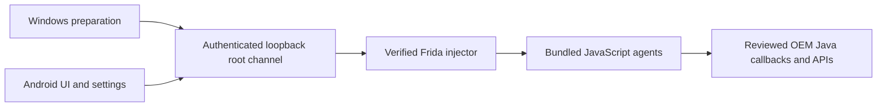

# What the JavaScript agents do

The Kotlin/Java app owns screens, settings, permissions and speech recognition. The Windows installer prepares the authorized local root channel and boot recovery. Frida loads the bundled JavaScript agents into the reviewed OEM processes so they can call the vehicle's Java APIs and replace specific callbacks.

The agents use the Java bridge, not a browser. Their entry points are bundled into `app/src/main/assets/hooks/*.bundle.js` during the Android build. Source modules in `hooks/` are the editable implementation; generated bundles include their dependencies. The APK carries these local bundles and pinned runtime metadata. The Windows kit supplies the verified ARM64 Frida executable. The APK does not download arbitrary scripts at startup.



## Where the privileges come from

The OEM init service must already run `/system/etc/init.logcat.sh` as root. Windows verifies its available ADB preparation access, saves the original script off-device, and installs the guarded access/boot entries. The script inherits root from that OEM service; neither Telnet nor Frida grants root to an otherwise unprivileged boot script. An unavailable preparation path is reported instead of requesting `su`.

The access entry starts authenticated Telnet on `127.0.0.1:2323`. Its login helper checks root identity, SELinux enforcement, the installed app identity and the installer-provisioned secret. The ordinary Android app authenticates through `AuthorizedRootChannel`; it does not run as UID 0 and never calls `su`. First-run diagnostics verify UID 0 in the prepared channel; the OEM boot service's SELinux domain and cold-boot behavior require separate qualification.

After exact firmware, package and runtime verification, `ProductionRootAccess` and `FridaBridge` use that root shell to deploy and start the supervised injector. The injector runs as root. An injected JavaScript agent runs **inside its target process with that process's UID and SELinux context**; it does not automatically make the target root. OEM API calls use the target's available APIs and permissions. Root file and process operations go through the authenticated root shell. SELinux remains Enforcing.

The process-by-process scope and button mappings are listed in [Injection targets and controls](INJECTION_MAP.md). Local tests establish the app/channel/injector boundary on an emulator; the actual OEM boot service, ARM64 deployment and vehicle effects still need head unit qualification.

| Modules in `hooks/` | Responsibility |
| --- | --- |
| `entry.js`, `launcher-buttons.js`, `navbar-oversea.js` | Select the launcher layout and replace assigned panel clicks. Unassigned actions and unsupported layouts keep their native path. |
| `panel-state.js`, `panel-icons.js` | Apply assigned icons, react to themes, and restore original panel state. |
| `steering-qg.js` | Handle observed QG key callbacks on Android 9 and 11. It delegates when a reviewed direct CAN route is selected. |
| `can-entry.js`, `can-steering.js`, `can-keys.js`, `can-edges.js` | Hook the CAN service callback. One reviewed protocol handles terminal short/long events; the other owns a complete down/up gesture with preflight, bounded hold timing and no physical replay. |
| `action-preflight.js`, `java-types.js` | Check whether an activity is currently launchable and initialize Java constant classes before reading their fields. |
| `voice-commands.js`, `voice-engine.js`, `voice-safety.js`, `qinggan-bus.js`, `voice-plans.json` | Validate fixed command requests, enforce firmware and Park/telemetry gates, and call observed OEM vehicle APIs. Microphone capture and Vosk recognition remain in Android code. |
| `window-*.js` | Apply per-app size/DPI policies through separately verified Android 9/11 window-service interfaces. |
| `window-reserve*.js` | Experimental: make Android itself keep the launcher's left panel clear, instead of moving each launched task beside it. See [The reserved panel strip](#the-reserved-panel-strip-experimental). |
| `localization*.js` | Replace selected labels using the configured dictionaries. |
| `navigation-entry.js`, `display-events.js` | Observe navigation data and route supported navigation/media information to the relevant displays. |
| `oversea-profiles*.js`, `account-state.js` | Inspect the overseas driver API and classify a bounded observation of the account backing file. They never select or restore an account and never log its fields. |

The boot and supervisor files ending in `.sh` are shell scripts. They verify the deployment, wait for the right process, start the corresponding agent and monitor its readiness. Each optional agent has its own process/package checks and recovery. Frida execution in a fixture proves the adapter can run; exact OEM compatibility and physical behavior still require vehicle qualification.

## Agent error lines

Every agent reports a failure through `hooks/report.js` as one line in its worker's `hook.log`:

```text
OVC_PANEL_ERROR stage=click kind=SecurityException slot=navbar01
OVC_STEERING_ERROR stage=launch kind=ActivityNotFoundException key=voice gesture=Long repeated=10
```

| Marker | Agent | Stages |
| --- | --- | --- |
| `OVC_PANEL_ERROR` | Panel buttons, both launcher adapters | `install`, `rollback`, `click`, `hold`, `selection`, `restore` |
| `OVC_PANEL_ICONS_ERROR` | Panel icons and selection state | `theme`, `track`, `refresh`, `icon`, `apply`, `selection`, `restore`, `release` |
| `OVC_STEERING_ERROR` | Steering keys in the launcher | `config`, `event`, `launch`, `restore` |
| `OVC_CAN_ERROR` | Steering keys in the CAN service | the install phase (`process`, `constants`, `callback`, `launcher`, `install`), `route`, `gesture` |
| `OVC_LOCALIZATION_ERROR` | Interface translation | `install`, `settings`, `config`, `convert`, `refresh` |
| `OVC_CLUSTER_MEDIA_ERROR`, `OVC_NAVIGATION_ERROR` | Cluster media and navigation events | `install`, `settings`, `parse`, `publish`, `event`, `distance` |
| `OVC_VOICE_ERROR` | Voice command executor | `install`, `settings` |
| `OVC_WINDOW_ERROR` | Window service | see below |

`kind` is an outcome code, a Java exception class or a JavaScript error type, and never the exception message: messages quote package names, resource ids and user text. A problem is printed when it first happens and again at 10, 100, 1000… occurrences, because most of these hooks run on every click, key event or text change. A reporter is kept across installation retries, so an agent that can never install does not add a line every 30 seconds. Readiness and result markers are a separate contract with the supervisor and are not rate-limited.

## Window service diagnostics

Each explicit profile apply or reset, display defaults sync, and window-service toggle that reaches `FridaBridge` emits one `event=window_service` entry under the `OpenVoyahControls` Logcat tag. The entry contains an allowlisted operation, the last stage reached, an outcome, and monotonic elapsed time in milliseconds. The elapsed time includes any wait for the bridge lock.

Inside `system_server` the agent reports through `OVC_WINDOW_ERROR stage=<step> kind=<code>` lines in its `hook.log`. An installation failure names the step that did not match the firmware (`unsupported_sdk`, `starter_signature`, `completion_signature`, `framework_api`, `tasks_api`) together with the exception class, removes both start hooks and announces no readiness, so the supervisor reports the worker as not ready instead of leaving a half-installed policy. A rejected profile document (`config_invalid`), failures inside the start hooks and an exception in the reserved-strip timer (`stage=reserve`) are reported when they first happen and then only at 10, 100, 1000… occurrences. A line carries a code or an exception class and never an exception message, because messages can quote package names. Deferred layouts run on the agent's own timer thread rather than through Frida's main-thread scheduler, which would attach a permanent `epoll_wait` interceptor to every thread of `system_server`.

`agent_reply` records the validated receipt, including `density_only`, `no_task`, and `rollback_failed`. Invalid receipts are recorded as `invalid_reply` and shown as unconfirmed in the app. `request_round_trip` with `unconfirmed` indicates that no receipt was confirmed. `profiles_published` records settings delivery to Android, and `service_configured` records completion of the service toggle. Check the connection status for worker readiness after enabling the service.

## The reserved panel strip (experimental)

By default the window agent keeps apps clear of the launcher's left panel one task at a time: it puts each managed launch into a freeform window whose bounds start right of the panel. That only reaches activities the agent sees being started, and the app is told nothing about the panel.

With `"systemInsets": true` in the window profile document, the agent instead asks Android to treat the panel the way it treats a system bar. Android then lays out every window of the central display beside it, and `Configuration`, app bounds and window insets say so from the first frame. The option is off by default and has **not been run on a head unit**: it was written against the AOSP sources of the two supported releases and is covered by tests against models of their window managers only.

| | Android 9 (`android-9.0.0_r61`) | Android 11 (`android-11.0.0_r1`, `r48`) |
| --- | --- | --- |
| Mechanism | The panel's `WindowState` joins `PhoneWindowManager.mScreenDecorWindows` with `PRIVATE_FLAG_IS_SCREEN_DECOR`, as the automotive system UI of that release did for its own bars. `layoutScreenDecorWindows()` moves the dock, restricted and content frames in framework code on every layout pass. | Screen decor no longer reaches apps here: frames and client insets come from `InsetsState`. The panel becomes the window behind the `ITYPE_NAVIGATION_BAR` insets source of display 0, the slot a real navigation bar would use. |
| Kept in place by | A hook on `adjustWindowParamsLw`, which would otherwise drop the panel on the launcher's next relayout. | A hook on `InsetsSourceProvider.updateControlForTarget` for that one provider, so an immersive app cannot take control of the panel and hide it. |
| Configuration | Hooks on the non-decor width and insets getters, limited to display 0. | The same getters on the `DisplayPolicy` instance of display 0. |

No hook runs per window per layout pass. The getters run when a configuration is recomputed. On Android 11 the control hook runs when the focused window or the bar control changes. On Android 9 the `adjustWindowParamsLw` hook runs whenever any window is added or relaid out with new layout parameters, for every app and under the window-manager lock; it compares one object reference and calls the original.

**What it refuses.** The agent changes nothing unless all of this holds: the policy class is the AOSP one (`oem_policy`), every method has the reviewed signature (`unsupported_framework`), Android 11 uses the full insets mode (`insets_mode`), there is no system navigation bar (`system_nav_bar`) and no existing left inset (`left_inset_present`), the display is in landscape (`unsupported_display`), and exactly one launcher-owned system window is docked at the left edge over the full height (`no_panel`, `ambiguous_panel`). A panel that is already registered by someone else is left alone (`already_reserved`). After applying, the agent checks the computed configuration at once and the laid-out frames within six seconds, and undoes everything if either differs (`verify_failed`). A panel that moves or resizes ends the reservation (`panel_moved`); one that disappears is waited for and re-adopted, and after 15 seconds the strip is released (`panel_lost`).

**The record that stops a restart loop.** A mistake here could end `system_server`, and the agent is injected again whenever that process starts. Before the first change the agent therefore writes `org.openvoyah.controls.windowInsetsGuard` to `Settings.Global` with the attempt number from the document, the kernel boot id and its own process id, and waits three seconds of uptime, longer than Settings takes to reach the disk. Uptime is used throughout, so a wall clock that is set after boot cannot shorten that wait or postpone the checks.

- If a later `system_server` finds a record of the same attempt that was never confirmed, or one confirmed by another process of the same boot, it reports `blocked` and leaves the layout native on this and every following boot.
- An attempt that was applied, did not hold and was undone (`verify_failed`, `panel_moved`, a registration taken by someone else) is recorded as refused with its reason. Applying and undoing each change the display configuration, which restarts activities, so the same attempt is not repeated on later boots: the agent answers with the recorded reason and leaves the framework alone. A refusal before anything was changed, such as an unsupported policy class, costs nothing and is simply found again.
- An undo that did not complete is final for that process (`rollback_failed`) and blocks the following ones.
- An agent that starts while the option is off removes a registration only if the record shows that an earlier agent of this very process made one. It never rewrites a record from another lifetime, which may be the block of an attempt that ended the process.

The app raises the attempt number only when the driver turns the option on, which is what allows another try. Without a readable boot id or a writable record the strip is never reserved (`guard_unavailable`).

**Status.** Every change of state is one line in the window worker's `hook.log`; the last one is the present state:

```text
OVC_WINDOW_INSETS status=armed width=171
OVC_WINDOW_INSETS status=applied width=171
OVC_WINDOW_INSETS status=verified width=171
```

`inactive` means the option is off, `no_panel` and `waiting_panel` that the launcher panel is awaited, `other_user` that another Android user is in the foreground, and `rollback_failed` that an undo did not complete. That last state is reported until the process ends, also after the option is turned off; a restart of the head unit clears it, and the record keeps the option off afterwards. The supervisor truncates a long `hook.log`, so the app does not read these lines: it sends a window request with the operation `insets` and receives the same state in the receipt, `{"insets":"verified","width":171,"status":"applied"}`. The readiness marker of an agent that understands both ends in `systemInsets=1`.

**What changes for apps.** A managed launch whose profile fills the usable width is no longer moved into a freeform window: it keeps Android's own placement, and only a per-app density is still applied. Narrower profiles and profiles with a wider strip are placed as before, beside the reserved strip. Tasks that were already placed when the option is turned on stay as they are, with their width and density; they are beside the panel either way. Turning the window service off releases the strip before the tasks.

**Known limits.**

- Every window of the central display is laid out beside the panel, including the launcher's own home screen and OEM apps that were drawn to sit under it. Those may show a doubled gap; there is no cheap way to exempt single windows.
- Changing the option changes the display configuration, so Android recreates the activities that do not handle a screen-size change, once.
- On Android 11 regular activities keep full-width frames and receive the strip as a left navigation-bar inset, exactly as with a real bar. An app that ignores window insets still draws under the panel. On Android 9 toasts and some system alerts use the stable frame, which is not moved.
- While the launcher hides its panel, Android lays windows out over the full width again, as it does for a hidden system bar, but the configuration keeps the reduced width until the option is turned off. A panel that is removed keeps the configuration reduced for up to 15 seconds before the strip is released.
- Hooks end with the agent, but a registration made in the framework stays until the next agent removes it. The record is what tells that agent the registration is its own.

## CAN edge ownership

The `can-steering-edges` profile is distinct from `can-steering-terminal`; a firmware cannot select both. Both require an exact CAN-service package pin. The edge route requires assigned, currently launchable tap and hold actions. Otherwise the full gesture stays native from its down event. Hold timing and debounce use the existing button settings.

After capture, the agent consumes that key's down/up sequence, launches at most once, and never synthesizes CAN or Android key events. A settings change, a chord, an unexpected terminal event or a late target failure cancels further custom execution. The agent cannot restore a down that OEM never received: already captured combinations and late failures do not get native replay. An unmapped key in a later chord still receives its own native sequence. A lost release cancels the captured action and retains ownership until an up arrives. These conditions must be qualified explicitly before enabling the edge profile.

## Overseas account observation

The locally inspected OEM account library reads `/private/configs/token/accountInfo`, outside the login app's data directory. The observer uses read-only, no-follow file access, a size bound, file identity checks and two matching reads. It distinguishes an explicit guest record, an identified-format record, a changing file and an unavailable observation. Names, phone numbers, account IDs and file contents are not emitted.

An observed record is neither a complete backup nor proof that it corresponds to slot A, B or C. The login implementation, other write locations, slot mapping and complete restore contract remain unavailable. Account switching stays closed until those are verified. Missing or malformed state is never silently treated as a guest account.
