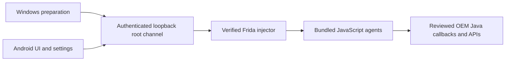

# What the JavaScript agents do

The Kotlin/Java app owns screens, settings, permissions and speech recognition. The Windows installer prepares the authorized local root channel and boot recovery. Frida loads the bundled JavaScript agents into the reviewed OEM processes so they can call the vehicle's Java APIs and replace specific callbacks.

The agents use the Java bridge, not a browser. Their entry points are bundled into `app/src/main/assets/hooks/*.bundle.js` during the Android build. Source modules in `hooks/` are the editable implementation; generated bundles include their dependencies. The APK carries these local bundles and pinned runtime metadata. The Windows kit supplies the verified ARM64 Frida executable. The APK does not download arbitrary scripts at startup.



## Where the privileges come from

The OEM init service must already run `/system/etc/init.logcat.sh` as root. Windows verifies its available ADB preparation access, saves the original script off-device, and installs the guarded access/boot entries. The script inherits root from that OEM service; neither Telnet nor Frida grants root to an otherwise unprivileged boot script. An unavailable preparation path is reported instead of requesting `su`.

The access entry starts authenticated Telnet on `127.0.0.1:2323`. Its login helper checks root identity, SELinux enforcement, the installed app identity and the installer-provisioned secret. The ordinary Android app authenticates through `AuthorizedRootChannel`; it does not run as UID 0 and never calls `su`. First-run diagnostics verify UID 0 in the prepared channel; the OEM boot service's SELinux domain and cold-boot behavior require separate qualification.

After exact firmware, package and runtime verification, `ProductionRootAccess` and `FridaBridge` use that root shell to deploy and start the supervised injector. The injector runs as root. An injected JavaScript agent runs **inside its target process with that process's UID and SELinux context**; it does not automatically make the target root. OEM API calls use the target's available APIs and permissions. Root file and process operations go through the authenticated root shell. SELinux remains Enforcing.

The process-by-process scope and button mappings are listed in [Injection targets and controls](INJECTION_MAP.md). Local tests establish the app/channel/injector boundary on an emulator; the actual OEM boot service, ARM64 deployment and vehicle effects still need head unit qualification.

| Modules in `hooks/` | Responsibility |
| --- | --- |
| `entry.js`, `launcher-buttons.js`, `navbar-oversea.js` | Select the launcher layout and replace assigned panel clicks. Unassigned actions and unsupported layouts keep their native path. |
| `panel-state.js`, `panel-icons.js` | Apply assigned icons, react to themes, add the assigned buttons to the lowered-screen menu, and restore original panel state. |
| `screen-lift.js` | Publish whether the display is lowered (`org.openvoyah.controls.screenLowered`), so the Controls app grid fits the visible band. |
| `home-navi-card.js` | Optional: cover the factory home screen's Baidu navigation card with a Yandex Navigator card. See [Home navigation card](#home-navigation-card). |
| `home-weather-card.js` | Optional: feed the factory home screen's weather card with the weather Controls fetched. See [Home weather card](#home-weather-card). |
| `steering-qg.js` | Handle observed QG key callbacks on Android 9 and 11. It delegates when a reviewed direct CAN route is selected. |
| `can-entry.js`, `can-steering.js`, `can-keys.js`, `can-edges.js` | Hook the CAN service callback. One reviewed protocol handles terminal short/long events; the other owns a complete down/up gesture with preflight, bounded hold timing and no physical replay. |
| `action-preflight.js`, `java-types.js` | Check whether an activity is currently launchable and initialize Java constant classes before reading their fields. |
| `voice-commands.js`, `voice-engine.js`, `voice-safety.js`, `qinggan-bus.js`, `voice-plans.json` | Validate fixed command requests, enforce firmware and Park/telemetry gates, and call observed OEM vehicle APIs. Microphone capture and Vosk recognition remain in Android code. |
| `window-*.js` | Apply per-app size/DPI policies through separately verified Android 9/11 window-service interfaces. |
| `window-gesture.js`, `window-display-move.js` | Android 11: the two- or three-finger swipe that moves an app's task to the cluster's navigation display or the passenger display and back. See [Moving windows between screens](#moving-windows-between-screens). |
| `window-reserve*.js` | Experimental: make Android itself keep the launcher's left panel clear, instead of moving each launched task beside it. See [The reserved panel strip](#the-reserved-panel-strip-experimental). |
| `localization*.js` | Replace selected labels using the configured dictionaries. |
| `navigation-entry.js`, `display-events.js` | Observe navigation data and route supported navigation/media information to the relevant displays. |
| `oversea-profiles*.js`, `account-state.js` | Inspect the overseas driver API and classify a bounded observation of the account backing file. They never select or restore an account and never log its fields. |

The boot and supervisor files ending in `.sh` are shell scripts. They verify the deployment, wait for the right process, start the corresponding agent and monitor its readiness. Each optional agent has its own process/package checks and recovery. Frida execution in a fixture proves the adapter can run; exact OEM compatibility and physical behavior still require vehicle qualification.

## Target crashes, restarts and revocation

A crash or restart of a target process is not a change of the deployment. `supervise.sh` handles it in place, without the PC:

- **Re-attach.** When the target (or `system_server`, Android's framework) restarts after the agent ran healthy for 20 s, the worker logs `OVC_WORKER_NOTICE Target restarted; attaching again restart=<n>.` and attaches to the new process after 3 s × n (at most 30 s). These restarts have their own budget of 10 per boot (`restart.boot`, `restart.count`), reset after 10 minutes of healthy running, so a few crashes of the OEM launcher do not end the retries; more than 10 log `Target restarted too often this boot.` and the channel pauses until the next boot. A translation app that closes after a healthy run is waited for without any budget, as before. A target that dies within 20 s of attachment, or an agent that never confirms readiness, still uses the retry budget (5 tries, 3 for the window channel), because the agent may be the cause. A target that restarts between the deployment check and the attachment is looked up again instead of ending the worker.
- **Visuals.** A process that died or restarted has its original views and code again, so its `visual.session` reads `changed` and is retired. A target that is exiting can fail a read of `/proc` for a moment; the supervisor looks again for up to 2 s before it calls the state `uncertain`. Only a target that still runs while its agent stopped without confirming restoration revokes, with `reason=visual`.
- **Stuck injector.** An injector whose target died can hang with its command line already gone. After 5 s the worker ends it when PID, start time, root owner and executable all still match the child it started (`own_injector`), instead of stopping the channel with `Injector did not stop`.
- **No revocation on one failed query.** Every check that can revoke (`check_runtime`, the app lifetime, the deployment file identities, the installed package paths, the receipt) runs again until it passes or has failed three times, 3 s apart. A package manager that does not answer reads as "unknown, wait", never as an uninstalled app. On boot 211 (2026-11-22) one such sample in the hiboard translation worker, 30 s after boot, logged `App activation lifetime changed.` and revoked the whole deployment while every file and the key were unchanged; the launcher crash 25 s later (an OEM `AppLauncher` NPE) came after that revocation, not before it.

A real revocation still happens for a replaced APK, Frida runtime, agent or script, a reinstalled app or new key, another Android user, a changed receipt and a visual state that cannot be proved original. It writes `recovery.reason` before the markers: `<boot id> <cause> <channels>`, for example `67b9… lifetime main,locale-hiboard,window`. The cause is one of `lifetime`, `deployment`, `package`, `runtime`, `receipt`, `visual`, `user`; the channels are the ones that were enabled. The first worker to revoke in a boot names the cause. `worker.log` gets `OVC_WORKER_NOTICE Activation revoked reason=<cause>.` See [recovery without the PC](PRODUCTION.md#recovery-without-the-pc) for how Controls lifts a revocation by itself.

## Agent error lines

Every agent reports a failure through `hooks/report.js` as one line in its worker's `hook.log`:

```text
OVC_PANEL_ERROR stage=click kind=SecurityException slot=navbar01
OVC_STEERING_ERROR stage=launch kind=ActivityNotFoundException key=voice gesture=Long repeated=10
```

| Marker | Agent | Stages |
| --- | --- | --- |
| `OVC_PANEL_ERROR` | Panel buttons, both launcher adapters | `install`, `rollback`, `click`, `hold`, `selection`, `restore`, `home_card`, `home_weather` |
| `OVC_PANEL_ICONS_ERROR` | Panel icons and selection state | `theme`, `track`, `refresh`, `icon`, `apply`, `selection`, `restore`, `release` |
| `OVC_HOME_CARD_ERROR` | Home navigation card | `install`, `rollback`, `track`, `orphan`, `resolve`, `widget`, `widget_scale`, `refresh`, `apply`, `restore`, `render`, `large_icon`, `remote_views`, `notifications`, `touch`, `tap`, `open`, `onResume`, `onAttachedToWindow`, `doScreenLift` |
| `OVC_HOME_WEATHER_ERROR` | Home weather card | `install`, `rollback`, `track`, `update`, `show`, `air`, `restore`, `refresh` |
| `OVC_STEERING_ERROR` | Steering keys in the launcher | `config`, `event`, `launch`, `restore` |
| `OVC_CAN_ERROR` | Steering keys in the CAN service | the install phase (`process`, `constants`, `callback`, `launcher`, `install`), `route`, `gesture` |
| `OVC_LOCALIZATION_ERROR` | Interface translation | `install`, `settings`, `config`, `convert`, `refresh`, `resource_text`, `attach_text`, `format` |
| `OVC_CLUSTER_MEDIA_ERROR`, `OVC_NAVIGATION_ERROR` | Cluster media and navigation events | `install`, `settings`, `parse`, `publish`, `event`, `distance` |
| `OVC_VOICE_ERROR` | Voice command executor | `install`, `settings` |
| `OVC_WINDOW_ERROR` | Window service | see below |
| `OVC_KEYBOARD_ERROR` | Keyboard policy in the window service | `install`, `update`, `crash_fallback` |

`kind` is an outcome code, a Java exception class or a JavaScript error type, and never the exception message: messages quote package names, resource ids and user text. A problem is printed when it first happens and again at 10, 100, 1000… occurrences, because most of these hooks run on every click, key event or text change. A reporter is kept across installation retries, so an agent that can never install does not add a line every 30 seconds. Readiness and result markers are a separate contract with the supervisor and are not rate-limited.

## Startup intro

The launcher agent decides whether to open the startup intro. Its 30-second window opens at the panel's first refresh after the agent is ready, not when Android boots. Each attachment of the agent writes one `OVC_STARTUP_BRAND` line to the launcher worker's `hook.log`:

| Line | Meaning |
| --- | --- |
| `outcome=requested` | The boot was recorded and `LaunchBrandActivity` was started. The app's diagnostic journal then shows `event=launch_brand` as `shown` or `skipped` with its reason (the app skips with `setup_active` too, when a setup page opened or a first-run check runs), and after a shown intro one `played`, `closed` or `interrupted` line with its frame timing. |
| `outcome=skipped reason=requested_this_boot` | The intro was already requested in this Android boot (`boot_count`). This line appears when the agent attaches again later in the same boot. |
| `outcome=skipped reason=animators_disabled` | The system animator scale is zero. |
| `outcome=skipped reason=other_home` | Android resolves home to a different launcher package. |
| `outcome=skipped reason=boot_count` | Android does not report `boot_count`. |
| `outcome=skipped reason=no_panel_button` | The window closed before an assigned button was enabled and owned on the central display's panel. |
| `outcome=skipped reason=panel_hidden` | The window closed while the assigned button was not shown on display 0. |
| `outcome=skipped reason=setup_active` | The window closed while Controls' setup page (`SetupActivity`) still had a task, even one behind home. Starting the intro's task would make Android drop that hidden task, and with it the page an installer probe waits for. A provisioning boot usually ends with this line. |
| `outcome=skipped reason=home_missing` / `home_unfocused` | The window closed while the factory home activity did not exist, or another window covered it or held focus on display 0. |
| `outcome=failed kind=<code>` / `outcome=unavailable kind=<code>` | Saving the boot record or starting the activity failed, or the agent could not read the launcher state. |

Expect the intro well after the factory home appears. On the reviewed head unit (boot 196, 2026-11-21) home was focused 20 s after boot, the supervisor attached the launcher agent at 37 s, and the agent requested the intro 1 s later. In boot 205 (2026-11-22) the request came 42 s after boot, Controls took 3.7 s to start cold, and the same process spent 6.7 s preparing the speech model while the intro ran, which made it stutter; the load average stays around 13 on this unit even when idle, so it is no measure of a quiet system. The intro therefore starts invisibly, keeps home on screen while the process starts, waits for steady frames and holds back the app's own start-up work; see [Compose UI](COMPOSE_UI.md). The agent is the only thing that requests the intro, once per `boot_count`; `hook.log` is emptied at each attachment, so a provisioning boot's `home_unfocused` line is gone after the next boot. To confirm that it was on screen, read the `wm_on_resume_called` and `wm_finish_activity` lines for `LaunchBrandActivity` in `logcat -b events` and the `played` line in the journal.

The intro can only appear after a boot in which the boot entry actually started the launcher agent. The supervisor treats a replaced Controls APK, Frida runtime or deployment file as a change of the reviewed deployment. When it sees one, it stops its agents and writes `recovery.blocked` and `recovery.visual-pending`, then removes every channel's `enabled` flag. From the next boot on, the boot entry starts nothing until the deployment is re-armed: by Controls itself after a reboot when the sealed files still verify, or from the PC after a real change (see [target crashes, restarts and revocation](#target-crashes-restarts-and-revocation)). Installing a rebuilt APK over ADB is a real change and still needs the PC.

## Home navigation card

With **Yandex Navigator instead of the Baidu map on the home screen** turned on (off by default), the panel configuration carries `homeCard: {package: "ru.yandex.yandexnavi"}` and the launcher agent covers each factory navigation card (`HomeNaviCardView`) with a card of its own. The switch does not depend on the panel assignments switch and is not offered on the overseas launcher.

- **What it shows.** Yandex Navigator's own traffic widget, hosted by the launcher: a Yandex map with traffic around the car, the traffic score and the forecast by hour. The launcher runs as the system uid, so it binds the widget without a prompt. The agent registers one widget host for the launcher package (id `0x4f56`), chooses the tallest of the navigator's widgets whose shape is nearest the card (the 2x2 traffic widget on the reviewed unit) and sizes it to the card. The widget view is created on a configuration context of the card's display, not on the launcher activity: the activity's inflater carries AppCompat's and the skin engine's view factories, which replace the widget's `TextView`s, and Android then shows "Couldn't add widget" (seen on the car with the first build). It reuses a widget it bound earlier, so the settings the driver chose in Navigator (theme, map scale) survive agent restarts, reinstalls and the restore handshake; only turning the setting off deletes the host and its widget, so nothing stays registered. Taps on the widget go to the navigator's own actions.
- **Widget density.** **Navigator widget density** (120 to 240 DPI in steps of 20, default 160, the display's own) scales the widget in the card. Overriding the density of the host context does not reach the widget: Android builds the provider's resources with `createApplicationContext`, which drops the override. So the widget is laid out at the card's size divided by *dpi* / 160, Navigator is told that size in dp (`updateAppWidgetSize`, so it renders its map for it), and the view is scaled back to the card from its top-left corner. Android maps taps through the view's scale. A change applies live, without rebinding the widget (`OVC_HOME_CARD_ERROR stage=widget_scale` if it fails).
- **Widget settings.** The traffic widget keeps its own settings per widget: colour theme (system, dark, light), map scale, traffic layer and update period. **Navigator widget settings** under the switch opens Navigator's `TrafficWidgetConfigurationActivity` for the hosted widget (root `am start` with `appWidgetId`, found in `dumpsys appwidget` by the host id 20310; the activity is not exported). "System" presumably follows Android's night mode, which is off on the reviewed unit (`cmd uimode night`: no), so "dark" is the choice for a dark card. The row of circles under the map is Navigator's traffic forecast: the expected traffic score (0–10) for the next hours, with the hour below each circle; the badge on the map is the current score.
- **Without a widget.** When the navigator has no widget or the binding is refused (`stage=widget`), the card shows the navigator's newest ongoing notification instead: the large icon, title, text and sub-text (during guidance, presumably the manoeuvre, distance and street). A notification without text lines shows its own layout under the navigator icon. Without a notification the card shows the navigator's icon and name. The agent reads active notifications from the notification service itself, every 2 seconds and only while such a card is shown; Controls needs no new permission. If the service refuses, the card keeps the icon and name (`stage=notifications`, reported once).
- **Tap.** A tap outside the widget's own buttons (press and release within 10 px, as on the factory card) opens the navigator's launcher activity on display 0 and sends the same navigation-opened event as the panel's navigation slot. Drags do nothing.
- **Baidu.** The factory map stays in the view tree, paused (`MapWidgetManager.onPause`) and covered. The card's resume, attach and screen-lift paths restart the map, so the agent pauses it again after each of them. The overlay itself is not clickable: taps are taken in the factory `MapWidgetLayout.dispatchTouchEvent`. If the agent disappears without restoring, its hooks go with it and taps open Baidu again.
- **Restore.** Turning the setting off, or any configuration without `homeCard`, removes the overlay and calls the card's own `onResume`. The restore handshake before Controls detaches (`restoreIcons`) restores the card too: `OVC_PANEL_ICONS_RESTORED` is printed only once both the panel and the card are back. Each overlay carries the tag `org.openvoyah.controls.homeCard`, so a later agent removes one left behind and resumes the map.
- **Readiness.** `OVC_HOME_CARD_READY` after the first scan of live cards. A launcher without the factory card logs `OVC_HOME_CARD_ERROR stage=install kind=ClassNotFoundException`, and the panel installs as usual.
- **Not verified on the car:** that the traffic widget draws without its configuration screen (`TrafficWidgetConfigurationActivity`, which the agent does not open) and how it looks stretched to 576 × 652; the content of the navigator's notification. The fallback card is dark in both launcher themes.

## Home weather card

The factory weather card (`HomeWeatherCardView`) gets its data from the OEM weather service, which works only in China; elsewhere it stays at "- -", "_ _" and a question-mark icon. With **Weather on the home screen (Open-Meteo)** turned on (off by default):

- **Controls fetches the weather** (`HomeWeatherSource`, `HomeWeatherJobs`): every 30 minutes and once at once, as Android jobs that wait for a network, so a refresh missed offline runs on reconnection. Android drops an app's jobs when the app is reinstalled or updated, so every process start and the boot and app-update broadcasts put them back (`HomeWeatherJobs.ensure`) and fetch at once when the last reading that reached the launcher is 30 minutes old or more. A reading made while the agents are not running yet (just after boot or an update) is retried with backoff instead of being dropped. It asks Open-Meteo, which needs no account or key, for the current temperature and WMO weather code, and for the US AQI. The position is Android's last known location, else a current fix asked from the enabled providers (Android 11, up to 20 seconds each), rounded to two decimals (about 1 km) before it leaves the car; without location access or a known position it geocodes the city typed in the settings. Controls asks for coarse location access when the setting is turned on.
- **Hand-over.** The reading goes to `Settings.Global` `org.openvoyah.controls.homeWeather` as `{schema, code, text, temperature, aqi, fetchedAt}`: the launcher icon code, the condition text in the app language, whole degrees, the card's air quality level or null. The panel configuration carries `weatherCard: {noData}`, the text the card shows without data. Stopping the agents deletes the reading.
- **The card.** The launcher agent passes the reading to the card's own `updateWeather(WeatherLiveBean)`, so the card keeps its look: icon, condition text, temperature, and the air quality level when known (hidden otherwise). While the setting is on, every update from the factory service, data or error, is replaced. A reading older than 3 hours, a missing one or an invalid one shows the no-data text with the question-mark icon, never stale weather. The agent re-checks every second and re-sends every 5 minutes; cards created later get the reading when they attach.
- **Icons.** WMO codes map to the launcher's icon codes, taken from the packed switch in `WeatherIconUtils.getMediumIcon`: clear 0, cloudy 2, overcast 3, thunderstorm 5, hail 6, rain 7, snow 14, fog 19. A non-numeric code shows the unknown icon and keeps the text, which the agent uses for no data; an empty code would make the card's theme and locale redraw replace the text with "- -".
- **Restore.** Turning the setting off, or the restore handshake before Controls detaches, clears the card's saved reading and redraws it in its factory empty state; factory updates pass through again. `OVC_PANEL_ICONS_RESTORED` waits for this too.
- **Not covered:** the launcher's own weather screen (a tap on the card) still asks the factory service. Not verified on the car.

## Keyboard policy

The window agent also installs `hooks/keyboard-policy.js` in `system_server`, independently of the window policy. It replaces `updateInputMethodsFromSettingsLocked(boolean)` of the central display's input method service: while the secure setting `open_voyah_controls_input_method` names a keyboard that the service lists as installed, that Android lists as enabled and that is not an OEM keyboard, the agent selects it with `setInputMethodLocked` instead of the firmware's fixed keyboard; otherwise the original method runs. The passenger service (`InputMethodManagerServiceExt`) is not hooked. A hook on `onServiceDisconnected` counts disconnects of the chosen package and, at three within a minute, records `crashed <id>` in `open_voyah_controls_input_method_fallback`, clears the choice and makes Android re-read its keyboard settings. At installation a stored keyboard that is gone is dropped with `unavailable <id>`, and a valid one is applied. The agent then prints `OVC_KEYBOARD_READY protocol=1`, which the supervisor copies into the window worker's `ready` file and which the Keyboard page requires before it offers a choice. Results appear as `OVC_KEYBOARD_APPLIED`, `OVC_KEYBOARD_FACTORY` and `OVC_KEYBOARD_FALLBACK` lines. See [Firmware: keyboard of the central display](FIRMWARE.md#keyboard-of-the-central-display).

## Window service diagnostics

Each explicit profile apply or reset, display defaults sync, and window-service toggle that reaches `FridaBridge` emits one `event=window_service` entry under the `OpenVoyahControls` Logcat tag. The entry contains an allowlisted operation, the last stage reached, an outcome, and monotonic elapsed time in milliseconds. The elapsed time includes any wait for the bridge lock.

Inside `system_server` the agent reports through `OVC_WINDOW_ERROR stage=<step> kind=<code>` lines in its `hook.log`. An installation failure names the step that did not match the firmware (`unsupported_sdk`, `starter_signature`, `completion_signature`, `framework_api`, `tasks_api`) together with the exception class, removes both start hooks and announces no readiness, so the supervisor reports the worker as not ready instead of leaving a half-installed policy. A rejected profile document (`config_invalid`), failures inside the start hooks, an exception in the reserved-strip timer (`stage=reserve`) and a failed visibility pass after Home (`stage=home`) are reported when they first happen and then only at 10, 100, 1000… occurrences. A line carries a code or an exception class and never an exception message, because messages can quote package names. Deferred layouts run on the agent's own timer thread rather than through Frida's main-thread scheduler, which would attach a permanent `epoll_wait` interceptor to every thread of `system_server`.

`agent_reply` records the validated receipt, including `density_only`, `no_task`, and `rollback_failed`. Invalid receipts are recorded as `invalid_reply` and shown as unconfirmed in the app. `request_round_trip` with `unconfirmed` indicates that no receipt was confirmed. `profiles_published` records settings delivery to Android, and `service_configured` records completion of the service toggle. Check the connection status for worker readiness after enabling the service.

## The reserved panel strip (experimental)

By default the window agent keeps apps clear of the launcher's left panel one task at a time: it gives each managed launch bounds of its own that start right of the panel. That only reaches activities the agent sees being started, and the app is told nothing about the panel.

A launch starts in freeform mode, the only mode in which Android takes launch bounds. Android 9 keeps the task there. On Android 11 the agent then moves the placed task to `WINDOWING_MODE_MULTI_WINDOW` with the same bounds. In freeform, the app's own window draws a caption bar with maximize and close buttons (`WindowConfiguration.hasWindowDecorCaption()`). Maximize would put the app under the panel and the status bar. Multi-window draws no caption bar and keeps the bounds it is given, without the fitting Android applies to freeform tasks. The app removes its caption bar when the mode changes. A task that is brought to the front again keeps its mode and bounds; only a new task takes the launch mode. The agent stays with freeform when Android does not support multi-window, when a task organizer is registered for that mode (it would take the task over), or when the members described next are missing. With an organizer, multi-window tasks belong to it and are left alone. Releasing a task returns it to the mode and bounds it had before. This was read from the services and framework of the supported Android 11 unit.

In multi-window, Android would size the app's resources as it does for a fullscreen task: the display's smallest width, a height less the display's insets, and app bounds cut to the display's app area. The agent therefore writes into the task's requested override the values Android computes for a freeform task with the same bounds and density: `screenWidthDp`, `screenHeightDp`, `smallestScreenWidthDp` and the app bounds. Android computes only the values that are not set. The agent writes them before the mode changes, so the app sees only a change of windowing mode. Releasing the task removes them again, after the mode change, so a released app may see one extra configuration change. The values are fixed when the agent applies a profile. They do not follow a later change of the display density, or a move of the task out of multi-window by Android itself (picture-in-picture, split screen), until the agent applies or releases that task again. The agent's record of a task's original placement lives in the process. A multi-window task it does not know was therefore left by an earlier agent process, and it is returned to fullscreen at the display density. A task the agent placed stays its own if a task organizer for multi-window appears later, so it can still be released. A new task that an app placed this way starts by itself, such as a browser link, opens fullscreen: Android passes the source's windowing mode only from fullscreen and freeform tasks.

A freeform or multi-window task does not cover the tasks below it, so on Android 11 the launcher's home activity stays resumed behind a placed app. The panel's Home button and the Home key start home again. Android brings the home task to the front, finds its activity already resumed and returns before its visibility pass. The placed app then keeps being drawn over the home screen, because home tasks are layered below application tasks. After a start that ends in home on display 0, the agent runs that pass (`RootWindowContainer.ensureActivitiesVisible`) while home is the focused task, once per burst of starts. It checks the focused task rather than the top one because a picture-in-picture task stays above home without taking focus. The apps home covers are hidden and stopped, and they come back when they are opened again. Android 9 resumes only the focused stack, so its start of home already includes the pass. This was traced in the unit's log: `wm_task_to_front` for home with no `wm_on_paused` or `wm_on_stop` for the app in front.

The other edges of that window follow Android's stable insets of display 0, less any navigation bar that Android reserves without a window providing it. That is `DisplayPolicy.hasNavigationBar()` with no navigation bar window and no window behind the navigation insets source (on Android 9, no screen decor windows either). Its share is the policy's non-decor insets with no cutout. On the supported Android 11 unit `qemu.hw.mainkeys=0` forces such a bar: Android reports a 1920 × 640 app area and 80 px of stable bottom inset, but nothing is drawn there. A full-width window is therefore `[145,50][1920,720]`: the left panel, the 50 px status bar, and the full height below it. A firmware whose framework cannot be read this way keeps the stable insets unchanged. Because of that forced bar, the experimental strip below would be refused on that unit with `system_nav_bar`.

With `"systemInsets": true` in the window profile document, the agent instead asks Android to treat the panel the way it treats a system bar. Android then lays out every window of the central display beside it, and `Configuration`, app bounds and window insets say so from the first frame. The option is off by default and has **not been run on a head unit**: it was written against the AOSP sources of the two supported releases and is covered by tests against models of their window managers only.

| | Android 9 (`android-9.0.0_r61`) | Android 11 (`android-11.0.0_r1`, `r48`) |
| --- | --- | --- |
| Mechanism | The panel's `WindowState` joins `PhoneWindowManager.mScreenDecorWindows` with `PRIVATE_FLAG_IS_SCREEN_DECOR`, as the automotive system UI of that release did for its own bars. `layoutScreenDecorWindows()` moves the dock, restricted and content frames in framework code on every layout pass. | Screen decor no longer reaches apps here: frames and client insets come from `InsetsState`. The panel becomes the window behind the `ITYPE_NAVIGATION_BAR` insets source of display 0, the slot a real navigation bar would use. |
| Kept in place by | A hook on `adjustWindowParamsLw`, which would otherwise drop the panel on the launcher's next relayout. | A hook on `InsetsSourceProvider.updateControlForTarget` for that one provider, so an immersive app cannot take control of the panel and hide it. |
| Configuration | Hooks on the non-decor width and insets getters, limited to display 0. | The same getters on the `DisplayPolicy` instance of display 0. |

No hook runs per window per layout pass. The getters run when a configuration is recomputed. On Android 11 the control hook runs when the focused window or the bar control changes. On Android 9 the `adjustWindowParamsLw` hook runs whenever any window is added or relaid out with new layout parameters, for every app and under the window-manager lock; it compares one object reference and calls the original.

**What it refuses.** The agent changes nothing unless all of this holds: the policy class is the AOSP one (`oem_policy`), every method has the reviewed signature (`unsupported_framework`), Android 11 uses the full insets mode (`insets_mode`), there is no system navigation bar (`system_nav_bar`) and no existing left inset (`left_inset_present`), the display is in landscape (`unsupported_display`), and exactly one launcher-owned system window is docked at the left edge over the full height (`no_panel`, `ambiguous_panel`). A panel that is already registered by someone else is left alone (`already_reserved`). After applying, the agent checks the computed configuration at once and the laid-out frames within six seconds, and undoes everything if either differs (`verify_failed`). A panel that moves or resizes ends the reservation (`panel_moved`); one that disappears is waited for and re-adopted, and after 15 seconds the strip is released (`panel_lost`).

**The record that stops a restart loop.** A mistake here could end `system_server`, and the agent is injected again whenever that process starts. Before the first change the agent therefore writes `org.openvoyah.controls.windowInsetsGuard` to `Settings.Global` with the attempt number from the document, the kernel boot id and its own process id, and waits three seconds of uptime, longer than Settings takes to reach the disk. Uptime is used throughout, so a wall clock that is set after boot cannot shorten that wait or postpone the checks.

- If a later `system_server` finds a record of the same attempt that was never confirmed, or one confirmed by another process of the same boot, it reports `blocked` and leaves the layout native on this and every following boot.
- An attempt that was applied, did not hold and was undone (`verify_failed`, `panel_moved`, a registration taken by someone else) is recorded as refused with its reason. Applying and undoing each change the display configuration, which restarts activities, so the same attempt is not repeated on later boots: the agent answers with the recorded reason and leaves the framework alone. A refusal before anything was changed, such as an unsupported policy class, costs nothing and is simply found again.
- An undo that did not complete is final for that process (`rollback_failed`) and blocks the following ones.
- An agent that starts while the option is off removes a registration only if the record shows that an earlier agent of this very process made one. It never rewrites a record from another lifetime, which may be the block of an attempt that ended the process.

The app raises the attempt number only when the driver turns the option on, which is what allows another try. Without a readable boot id or a writable record the strip is never reserved (`guard_unavailable`).

**Status.** Every change of state is one line in the window worker's `hook.log`; the last one is the present state:

```text
OVC_WINDOW_INSETS status=armed width=171
OVC_WINDOW_INSETS status=applied width=171
OVC_WINDOW_INSETS status=verified width=171
```

`inactive` means the option is off, `no_panel` and `waiting_panel` that the launcher panel is awaited, `other_user` that another Android user is in the foreground, and `rollback_failed` that an undo did not complete. That last state is reported until the process ends, also after the option is turned off; a restart of the head unit clears it, and the record keeps the option off afterwards. The supervisor truncates a long `hook.log`, so the app does not read these lines: it sends a window request with the operation `insets` and receives the same state in the receipt, `{"insets":"verified","width":171,"status":"applied"}`. The readiness marker of an agent that understands both ends in `systemInsets=1`.

**What changes for apps.** A managed launch whose profile fills the usable width is no longer moved into a freeform window: it keeps Android's own placement, and only a per-app density is still applied. Narrower profiles and profiles with a wider strip are placed as before, beside the reserved strip. Tasks that were already placed when the option is turned on stay as they are, with their width and density; they are beside the panel either way. Turning the window service off releases the strip before the tasks.

**Known limits.**

- Every window of the central display is laid out beside the panel, including the launcher's own home screen and OEM apps that were drawn to sit under it. Those may show a doubled gap; there is no cheap way to exempt single windows.
- Changing the option changes the display configuration, so Android recreates the activities that do not handle a screen-size change, once.
- On Android 11 regular activities keep full-width frames and receive the strip as a left navigation-bar inset, exactly as with a real bar. An app that ignores window insets still draws under the panel. On Android 9 toasts and some system alerts use the stable frame, which is not moved.
- While the launcher hides its panel, Android lays windows out over the full width again, as it does for a hidden system bar, but the configuration keeps the reduced width until the option is turned off. A panel that is removed keeps the configuration reduced for up to 15 seconds before the strip is released.
- Hooks end with the agent, but a registration made in the framework stays until the next agent removes it. The record is what tells that agent the registration is its own.

## Moving windows between screens

With `"displayMove": {"fingers": 2}` (or `3`) in the window profile document, the window agent watches pointer events on the central display and on the passenger display. The app sends the object only when the firmware review lists `window-display-move`. Without it, or with the window service off, nothing is watched.

**Input.** The agent hooks `TaskTapPointerEventListener.onPointerEvent(MotionEvent)`, the pointer listener that every `DisplayContent` already registers with its input monitor, and calls the original afterwards. No listener object of its own is registered with the window manager, so an agent that unloads leaves nothing behind that could call into it. The hook is attached when the swipe is turned on and removed when it is turned off or the service is released. It reads the action and pointer count of each event; coordinates are read only while a swipe may be starting or is under way. Monitored events reach the app as usual: the swipe is never taken from it.

**Recognition** (`window-gesture.js`, pure and tested without Android). The configured number of fingers has to land within 400 ms of the first one. They then travel 40 px together, at least 1.6 times more sideways than vertically, each finger in the same direction; a vertical start (a map's tilt), a pinch, a different finger count or Android cancelling the touch ends the attempt. When the first finger lifts, a travel of 22 % of the display width, or 6 % with a release speed of 0.9 px/ms in the same direction, decides the move.

**Target.** When the fingers land, the agent takes the global window lock on its own timer thread and asks `DisplayContent.getTouchableWinAtPointLocked` which window takes a touch at their centre; that window's task is the candidate. It moves only when it is a standard leaf task of the current user, not always-on-top, whose base and top activities belong to one package outside the protected set (Controls, the launcher, system UI, settings, vehicle and cluster apps, the instrument card, the package installer and permission controller). The cluster display is the one named `Cluster-Navi-Display` and owned by `com.qinggan.cluster` as UID 1000; the passenger display must be public and not virtual.

**Feedback.** While the fingers move, the task's root surface is shifted with them and drawn at 85 % opacity through a `SurfaceControl.Transaction`, relative to `WindowContainer.mLastSurfacePosition`; beyond a third of the width it is damped, and it never goes past half. A cancelled swipe, and every move before it happens, puts the surface back at its position and full opacity.

**Move.** Under the global lock the agent checks that the task is still where it was, makes it fullscreen at its own density (dropping only the resource sizes fixed for its place beside the panel; the record of its original placement stays for a later release), and calls `RootWindowContainer.moveStackToDisplay(rootTaskId, displayId, true)` directly, without the binder permission check of the service method. A task already on the target cluster first returns to display 0. After the move the window policy runs as for a launch on display 0 (placement beside the panel). On the passenger display only a reviewed passenger default changes the density; the agent then measures the visible system windows (UID 1000, no activity, type 2000-2999) docked at the top over the full width, such as the OEM clock bar `StatusBar2` that Android gives no inset for, and moves the task into a multi-window frame below them, with its resource sizes fixed to that frame (`OVC_WINDOW_ERROR stage=move_place` on failure, which returns it to fullscreen). The cluster keeps the task fullscreen.

The display a window left then shows something of its own instead of the stopped task below it (a grey screen): with `"reveal": "home"` (the default) the central display starts home through `RootWindowContainer.startHomeOnDisplay`, as the Home key does, so the visibility pass after Home also runs; with `"apps"` the agent starts Controls' `MainActivity` with `org.openvoyah.controls.action.OPEN_APPS` on display 0 outside the global lock. The passenger display brings the launcher's own task (its second home, an ordinary task there) to the front with `ActivityStack.moveToFront`, then runs `ensureActivitiesVisible` and `resumeFocusedStacksTopActivities`. When a window came back from the cluster in exchange, nothing is started over it. A failure is reported as `OVC_WINDOW_ERROR stage=move_reveal` and leaves the move in place. The agent remembers the tasks it moved; turning the swipe off, a window request with the operation `recall` and the service release return those still on their display to display 0. A task Android moved back by itself is left alone.

**Lines.** Each move is one line in the window worker's `hook.log`, without package names:

```
OVC_WINDOW_MOVE from=0 to=6 reason=swipe outcome=moved
OVC_WINDOW_MOVE to=0 reason=swipe outcome=returned count=1
```

`outcome=changed` means the task moved or changed before the fingers lifted, `refused` that Android left it on its display, `failed` that an exception was reported. Errors use `OVC_WINDOW_ERROR` with the stages `display_move` (the members are missing at installation, or the settings could not be applied), `move_input`, `move_target`, `move_feedback`, `move` and `move_recall`. A missing member does not stop the window service: it announces `displayMove=0` instead of `1`, and a `recall` request is answered with `rollback_failed`.

## CAN edge ownership

The `can-steering-edges` profile is distinct from `can-steering-terminal`; a firmware cannot select both. Both require an exact CAN-service package pin. The edge route requires assigned, currently launchable tap and hold actions. Otherwise the full gesture stays native from its down event. Hold timing and debounce use the existing button settings.

After capture, the agent consumes that key's down/up sequence, launches at most once, and never synthesizes CAN or Android key events. A settings change, a chord, an unexpected terminal event or a late target failure cancels further custom execution. The agent cannot restore a down that OEM never received: already captured combinations and late failures do not get native replay. An unmapped key in a later chord still receives its own native sequence. A lost release cancels the captured action and retains ownership until an up arrives. These conditions must be qualified explicitly before enabling the edge profile.

## Overseas account observation

The locally inspected OEM account library reads `/private/configs/token/accountInfo`, outside the login app's data directory. The observer uses read-only, no-follow file access, a size bound, file identity checks and two matching reads. It distinguishes an explicit guest record, an identified-format record, a changing file and an unavailable observation. Names, phone numbers, account IDs and file contents are not emitted.

An observed record is neither a complete backup nor proof that it corresponds to slot A, B or C. The login implementation, other write locations, slot mapping and complete restore contract remain unavailable. Account switching stays closed until those are verified. Missing or malformed state is never silently treated as a guest account.
