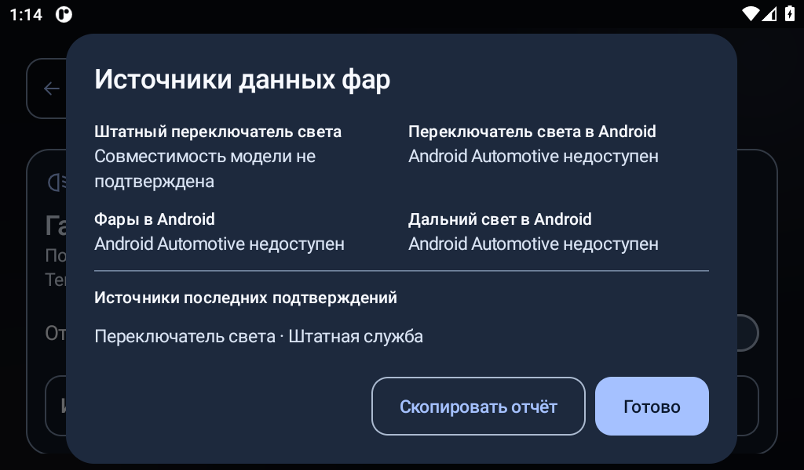
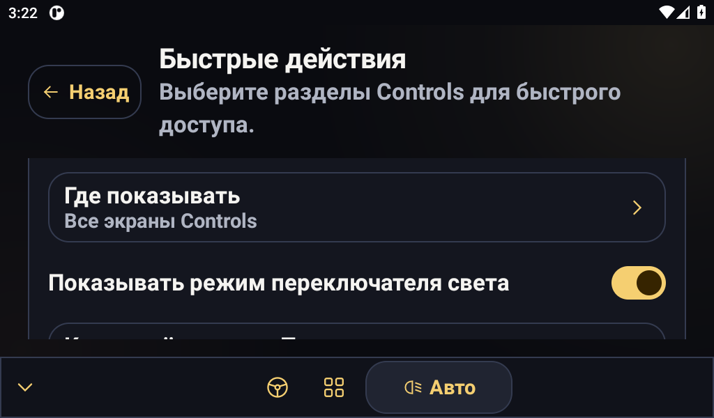
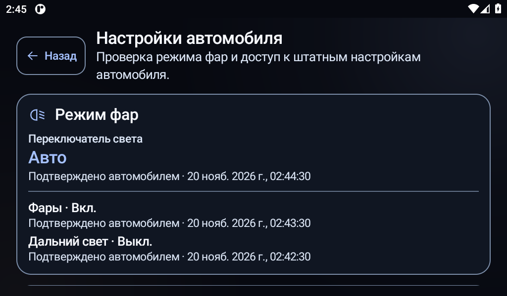
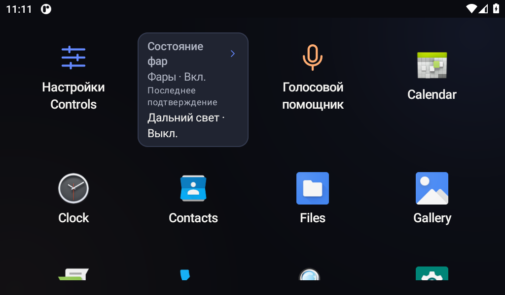
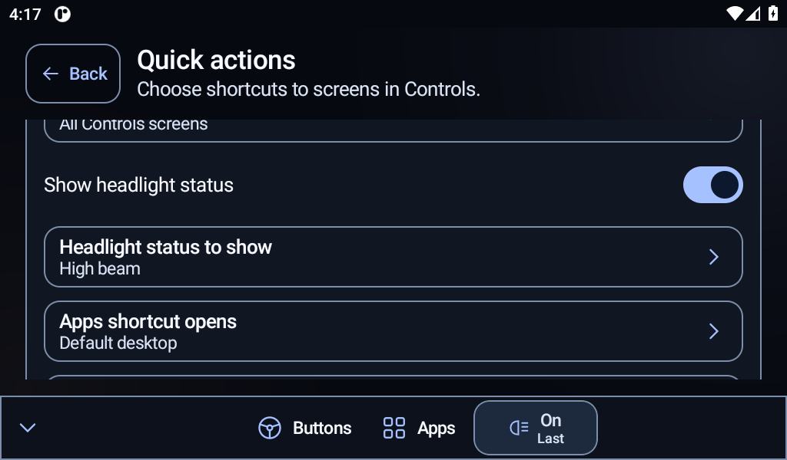

# Headlight mode

Find **Headlight mode** in **Vehicle settings**. On a head unit that exposes a public factory lighting shortcut, **Open factory lighting controls** opens the original screen. The indicator displays a confirmed mode with the time of observation. If the feed becomes unavailable, it labels the stored mode as the last confirmation.

In **Quick actions**, turn on **Show headlight status** and choose **Headlight mode**, **Headlamps**, or **High beam**. The dock shows a live reading, the last confirmed value, or an earlier Android report for the selected signal. The indicator can open Vehicle settings or show **Lighting sources** over the current Controls page.

**Settings → Vehicle → Lighting sources** shows the latest results of the existing read-only observers. It reports the factory light switch, Android light switch, headlamps, and high beam individually. A source can report an unverified vehicle or service, denied access, an unavailable signal, or an active subscription. Confirmed readings store their source locally alongside the value and time. Earlier saved readings still display if the source is unknown.

**Copy report** takes a dated snapshot of the live readings, earlier Android reports and last saved confirmations. It adds the Android build and records requested and granted Automotive permissions separately for the installed Controls APK. It includes the versions and current signing-certificate fingerprints of the three relevant factory packages that Android exposes to Controls. For a readable CAN service base APK of up to 32 MiB, it also records that file's SHA-256. The report lists whether the dedicated factory Lighting and Seats panels resolve through the same checks Controls uses to open them. Everything is copied to the local clipboard. On the parked vehicle, compare the report with the instrument indicators and the stock seat and mirror behavior.



## Factory signal evidence

The inspected H97C factory vehicle screen uses the body controller's feedback for the combined light switch. Its four modes are Automatic, Low beam, Position lights and Off. Automatic is a switch mode. The controller reports dipped beam and position lamp activity separately. See the [VOYAH H97C owner guide](https://m.dsmp.voyah.com.cn/userguide/h97c/h97c-17.html).

In the inspected CAN service, `LAMP_SWITCH_POSITION_FB` is updated from body controller feedback. The stock screen uses these values on this branch.

| Value | Selector mode |
| --- | --- |
| 0 | Automatic |
| 1 | Low beam |
| 2 | Position lights |
| 3 | Off |

The initial getter can return an older preference or the default Automatic value. Controls binds to the exported factory service using its own Android identity and subscribes to controller change notifications. The adapter checks the supported product identifiers and the installed service's component, signing certificate and exact APK before subscribing. It accepts the observed selector callback from that service UID. The service registers observers without a startup replay and reports a changed selector after receiving the body controller's status. The callback has no controller timestamp, so history records the time Controls receives the change.

When the Android service connection drops, Controls switches the live indicator to the last confirmation. It allows the system to restore a temporary connection and makes up to two new binding attempts after a timeout or a terminal transport loss. Each new binding rechecks the factory package. A new controller report is required to mark the mode as current again.

Controls also clears the current mode when Android becomes non-interactive, even if the factory service stays connected. On wake it opens a new subscription and keeps the previous confirmation time until that subscription receives fresh feedback. The app watches Android's device-wide [interactive state](https://developer.android.com/reference/android/os/PowerManager#isInteractive()). Whether a particular head unit signals every vehicle sleep cycle this way still needs hardware verification.

The inspected package is CAN Bus Service 1.2.0 (version code 7). The factory branch corresponds to H97C (`f6802h`), H97Y (`f6805h`) and H97X (`f6811`) in the inspected build. The observer uses no vehicle control operation. The APK and callback evidence establishes compatibility for that implementation. Ordinary-app delivery and behavior after sleep still need verification on the matching head unit.

The H97 service can queue controller data before it dispatches a callback. Replacing the listener at wake rejects deliveries addressed to the old listener. A controller packet still queued inside the service could reach the new listener when the service processes it. The callback has no controller timestamp or sequence number, so a hardware trace is needed to establish how the queue behaves during sleep. The stored H97 time identifies arrival at Controls.

The inspected H97 service publishes the same lighting callback from two caches, including a path that can send an object after an invalid frame. The H97-specific getter can show a change in its cache. Fresh low-beam or position-lamp activity remains unverified on this branch.

### VOYAH FREE 318

VOYAH publishes the FREE 318 manual in its H97D series. In Auto, ambient light can switch the position lamps and dipped beams while the selector stays on Auto. Zone B of the instrument cluster has distinct indicators for position lights, dipped beam, high beam and intelligent high-beam assistance. Confirm lamp readings against the corresponding indicators on the parked vehicle. [FREE 318 lighting controls](https://m.voyah.com.cn/userguide/h97d/h97D-17.html#自动灯光) · [FREE 318 instrument indicators](https://m.voyah.com.cn/userguide/h97d/h97D-6.html#仪表指示灯)

The supplied factory app uses `f6808` as an H97D identifier. The pinned CAN service above supports the separately identified H97C/Y/X branch. Qualifying a FREE 318 requires its actual Android product, optional factory product, build fingerprint and signed CAN package. The Cockpit report can distinguish an unsupported Android product, an absent factory service and a package that fails admission before any observation arrives.

## Standard Android Automotive

On Android 10 or later, Controls uses the Android Automotive library when the device exposes it, the manufacturer grants the relevant permission, and the vehicle advertises the property. **Headlight switch** comes from [`HEADLIGHTS_SWITCH`](https://developer.android.com/reference/android/car/VehiclePropertyIds#HEADLIGHTS_SWITCH). **Headlamps** and **High beam** come from the separate read-only [`HEADLIGHTS_STATE`](https://developer.android.com/reference/android/car/VehiclePropertyIds#HEADLIGHTS_STATE) and [`HIGH_BEAM_LIGHTS_STATE`](https://developer.android.com/reference/android/car/VehiclePropertyIds#HIGH_BEAM_LIGHTS_STATE) properties. One connection reads the available properties independently. Headlamps can report On, Off or Daytime Running Lights. High beam can report On or Off.

Android 10 exposes these properties through `CarPropertyManager` and the `ServiceConnection` overload of `Car.createCar`. Android 11 makes the dedicated `CarServiceLifecycleListener` public, which Controls uses from that version onward. Android 9 lists the lighting properties at the hardware interface level and lacks the public property manager in its app API. [Android 10 public API](https://android.googlesource.com/platform/packages/services/Car/+/android-10.0.0_r1/car-lib/api/current.txt) · [Android 11 public API](https://android.googlesource.com/platform/packages/services/Car/+/android-11.0.0_r1/car-lib/api/current.txt) · [Android 9 public API](https://android.googlesource.com/platform/packages/services/Car/+/android-9.0.0_r61/car-lib/api/current.txt) · [Android 9 vehicle HAL](https://android.googlesource.com/platform/hardware/interfaces/+/android-9.0.0_r8/automotive/vehicle/2.0/types.hal#1965)

An available report timestamped at or after its current subscription can update the live reading. Android can send an older value as the first callback for each property. Where a live or previously confirmed value is absent, Controls shows it as an earlier report. The Vehicle page shows the original report time. This report is kept in memory for the active observation period and leaves history untouched. Loss of a property demotes only that property's live reading. Sleep clears the live and earlier readings until observation resumes. [Android property callbacks](https://developer.android.com/reference/android/car/hardware/property/CarPropertyManager#registerCallback(android.car.hardware.property.CarPropertyManager.CarPropertyEventCallback,int,float)) · [Property timestamps](https://developer.android.com/reference/android/car/hardware/CarPropertyValue#getTimestamp())

A delayed Android Automotive reading can make the property current again only if it is newer than its most recent unavailable status. If a loss arrives without a property timestamp, Controls uses the time it received the loss as the cutoff for that property.

The Android callback revokes the live reading when it accepts a loss. If fresh recovery samples fill the property queue before the monitor can process that loss, an older confirmation can still be saved with its original time as history. The recovered property can become current independently of the other lamps.

A CarService lifecycle transition ends the previous Android connection before the property readers can process a reconnect. Its last confirmations remain eligible for history. Each ready callback starts a new connection, even if Android supplies the same Car object. Late property callbacks from the previous connection are ignored. [Android CarService lifecycle](https://developer.android.com/reference/android/car/Car.CarServiceLifecycleListener)

When both interfaces are available, their selector readers run concurrently. Android Automotive can supply the selector while the factory observer is waiting or disconnected. A live factory confirmation takes priority. When the factory reading becomes unavailable, Controls can use a newer Android Automotive confirmation from the current connection. If neither source has a usable reading, Controls shows the last confirmation. A connected reader can still be waiting for a new report. The headlamp and high-beam readings stay independent of these selector changes.

The Cockpit readiness section records Android's advertised Automotive feature, the `android.car` shared-library declaration, `car_service` visibility to the selected shell and Controls' permission checks independently. `headlight_properties` reports whether the shell sees matching configurations for the switch, headlamps and high beam. The official Android Automotive 13 image advertises all three light properties and puts `android.car.jar` on the boot class path. Package Manager lists no `android.car` shared library on this image. The ordinary Controls APK reports missing permission for each light property. Actual property support for the app and data delivery require the reader and observation events. Hardware delivery on the installed head unit remains unverified. [Cockpit report](PRODUCTION.md#review-a-firmware-candidate)

History is private to the head unit. It keeps the latest confirmation time and value separately for each available reading. Vehicle settings groups the switch position and both lamp states with their individual timestamps. When either lamp has a report, both lamp rows are visible. A missing lamp reading appears as **Reading unavailable**.

The monitor retains availability and the latest confirmed observation independently for the selector, headlamps and high beam. If a signal is lost or its source changes while a confirmation is being saved, that confirmation remains eligible for history. Only confirmations from the active source can appear as current. Updates from either lamp can continue while the other signal is unavailable. The feedback tests delay both the monitor and a history write to exercise signal loss, sleep, and recovery. [Buffered feedback test](../app/src/test/kotlin/org/openvoyah/controls/platform/vehicle/InteractiveHeadlightOverflowTest.kt)

The Vehicle settings page and the visible headlight desktop card share one subscription in the Controls activity. In **Desktop information cards**, choose **Switch position** or **Lamp status** for each desktop. The lamp card marks each historical or unconfirmed reading separately. Enable **Monitor while Controls is open** to keep the subscription across other Controls pages while its window is active. The switch is off by default. Opening the factory light controls from the settings page extends the subscription through the visit, for up to two minutes, so a change there can be stored while Controls is hidden.

With the shortcut bar enabled, turn on **Show headlight status** under **Quick actions**. The indicator uses the **Vehicle** shortcut's position if that shortcut is present. Otherwise it appears after the configured shortcuts. The expanded bar and any open source report share the foreground Controls activity's subscription.



The emulator checks the normal screen and persisted historical state, and exercises the desktop card with a synthetic feedback stream. A test service in a separate process and app UID exercises Android binding, observer registration, filtering out acknowledgments and unrelated properties, saving a confirmed selector mode, and removing the observer at cancellation. A separate scenario runs the same service across two interactive periods and checks that history remains visible until the replacement listener receives a report.

The native Android Automotive test uses Google's Android Automotive 15 x86_64 development image with Google APIs, SDK extension 15, revision 4. It runs the production reader against CarService and temporarily adopts the two exterior-light permissions already granted to the test shell. It also opens the public `ServiceConnection` adapter against that service to check its callback and access to the property manager. On a fresh boot it checks the initial Automatic, On and On values while history is empty. The emulator then supplies simulated property changes. The test checks separate confirmation times and lets the host read the saved preferences from another process before restoring the original history. [Native test](../app/src/androidTest/kotlin/org/openvoyah/controls/platform/vehicle/NativeAutomotiveHeadlightTest.kt) · [Android Automotive emulator](https://developer.android.com/training/cars/testing/emulator) · [Test permission delegation](https://developer.android.com/reference/android/app/UiAutomation#adoptShellPermissionIdentity(java.lang.String...))

To repeat the native test, cold-boot a fresh disposable image and install the debug app and test APK for its foreground driver user. Write a short lowercase run ID to `files/native-headlight-fixture.request` in the app's private files and start `NativeAutomotiveHeadlightTest` through the Android test runner. Wait for the three `subscribed` events and `ControlsAaosFixture phase=initial_values`, then send the following values through the emulator's simulated vehicle properties. After the initial row, change only the value that differs from the preceding row. Wait for the `ControlsAaosFixture` reading event for each row before continuing.

| Sample | Selector | Headlamps | High beam |
| --- | --- | --- | --- |
| 1 | On | Off | On |
| 2 | On | Off | Off |
| 3 | On | On | Off |
| 4 | Automatic | On | Off |
| 5 | Automatic | Off | Off |

After the test reports `phase=stored`, use the selected emulator's app debugger identity to compare `shared_prefs/headlight_history.xml` with `files/native-headlight-fixture.json`, including each timestamp. The receipt's `auto_reports` section contains the two reports generated by Controls after samples 4 and 5. The selector and high-beam confirmations stay unchanged, and the new headlamp confirmation falls between the two capture times. Remove the test receipt after the comparison to let the test restore the original preferences. The Android test runner must then report one passing test.







For a head unit check, start with an explicitly selected device and [record its firmware evidence](PRODUCTION.md#review-a-firmware-candidate). Record the installed Controls version and the exact CAN service package from that report. While parked, open lighting from Controls and use the factory screen to select Automatic, Low beam, Position lights, and Off where the vehicle offers them. Return to Controls and compare each displayed mode and time with the factory selection. Reopen Controls with the switch untouched and record whether it shows history or receives a new notification.

Repeat after a normal vehicle sleep and wake. Keep the selector untouched during the transition and then change it once using the factory screen. Record the mode and its confirmation time before sleep, after wake, and after the manual change. Use the Controls process log under `OpenVoyahControls` to correlate the observations. `headlight_power` records monitor startup and Android screen transitions. `headlight_feedback` records selector mode. `headlight_activity` records independently admitted Android Automotive lamp readings. The `headlight_reader` result identifies why an Android Automotive property is unavailable, such as absent permission, a missing property or a rejected subscription. `subscribed` records registration. The `headlight_source` event with outcome `reader_failed` records the source and error class when that reader stops unexpectedly. The other source can continue updating. Elapsed times use the current Android boot clock. The `qinggan` observer uses the clock when Controls received the event. `android_automotive` uses the event time carried by Android.

## Compare two observations offline

While parked, note the factory selector position and the lamp indicators at the time of each capture. Use **Lighting sources → Copy report** and save each clipboard result as a UTF-8 JSON file. To check independent lamp activity on FREE 318, keep the selector in Auto during both observations and use the dipped-beam indicator in cluster zone B to record On or Off. Keep Controls observing across the interval. [FREE 318 instrument indicators](https://m.voyah.com.cn/userguide/h97d/h97D-6.html#仪表指示灯)

Record the same set of signals at both points. Include `high_beam` when you also observed the high-beam indicator. This example records the selector and dipped beam.

```json
{
  "before": {"selector": "automatic", "headlights": "on"},
  "after": {"selector": "automatic", "headlights": "off"}
}
```

Run the comparison from the Android project directory. It reads the three local files.

```powershell
python tools/compare_cockpit_observations.py before.json after.json observations.json
```

The result shows agreement for each signal and distinguishes a new confirmation from the same active reading at both capture times. It includes history write failures recorded in the snapshot, even when the signal is no longer current or has no saved reading. It reports an independent Auto transition when both active selector readings match Auto and a new headlamp reading between captures matches the observed change.

To corroborate readings with the Controls process log, use a Cockpit event window covering both captures and their source events. Save the collector result as UTF-8 and add `--cockpit cockpit.json`. The comparison describes agreement with the recorded observations. Firmware approval requires a separate review. [Cockpit evidence collector](PRODUCTION.md#review-a-firmware-candidate)
