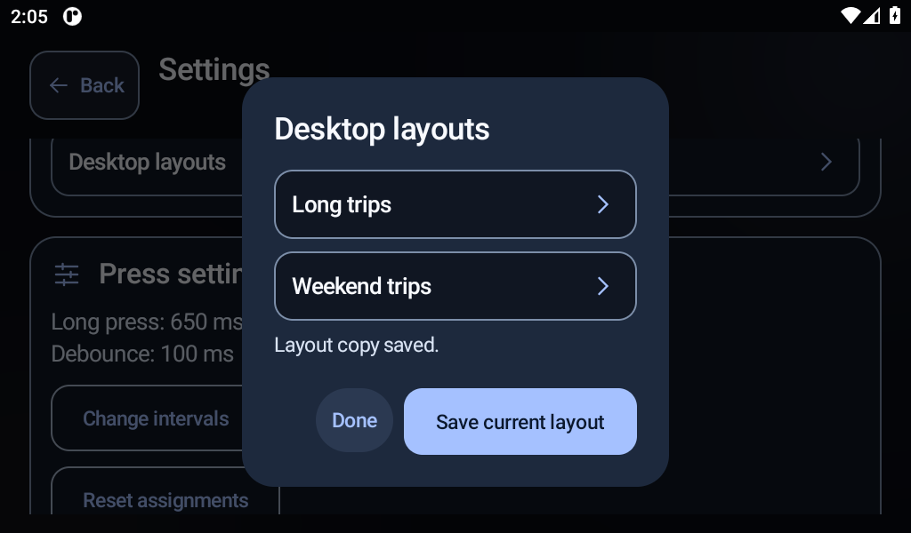
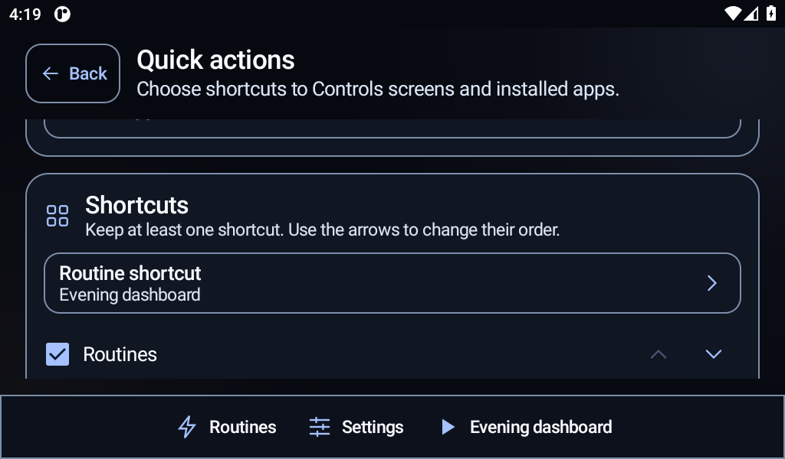
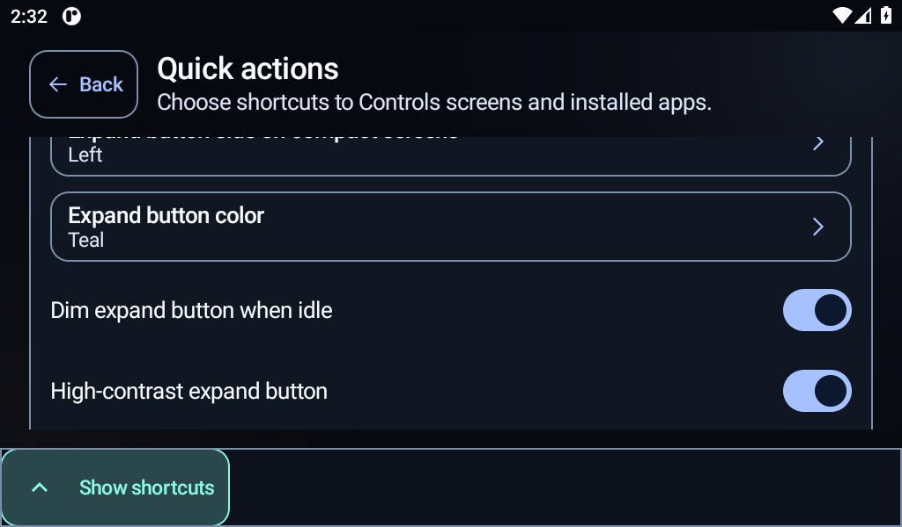
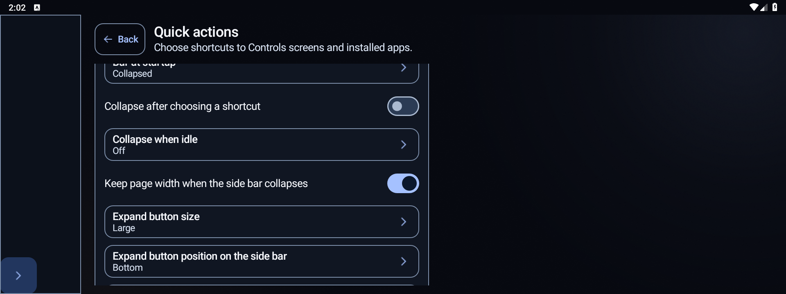
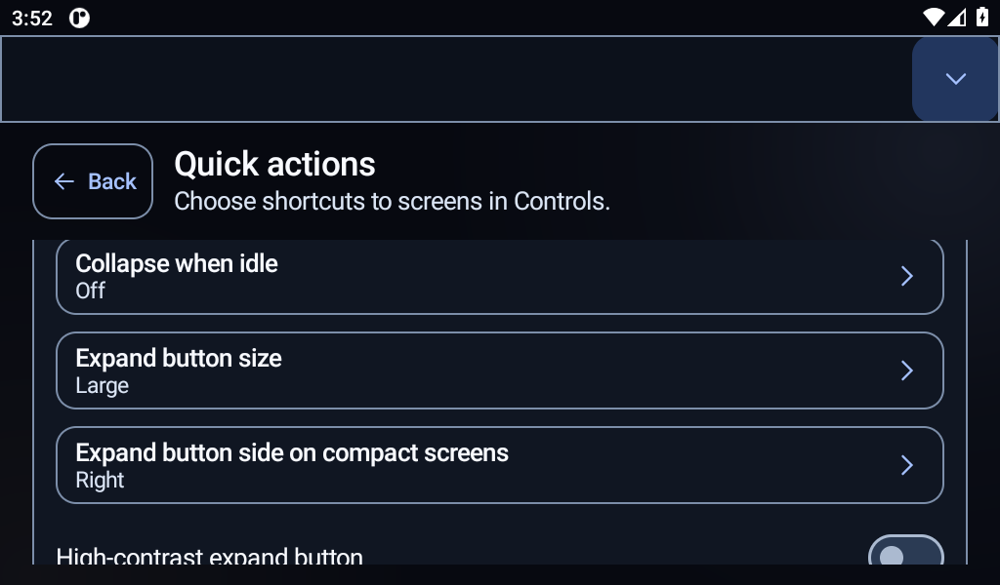
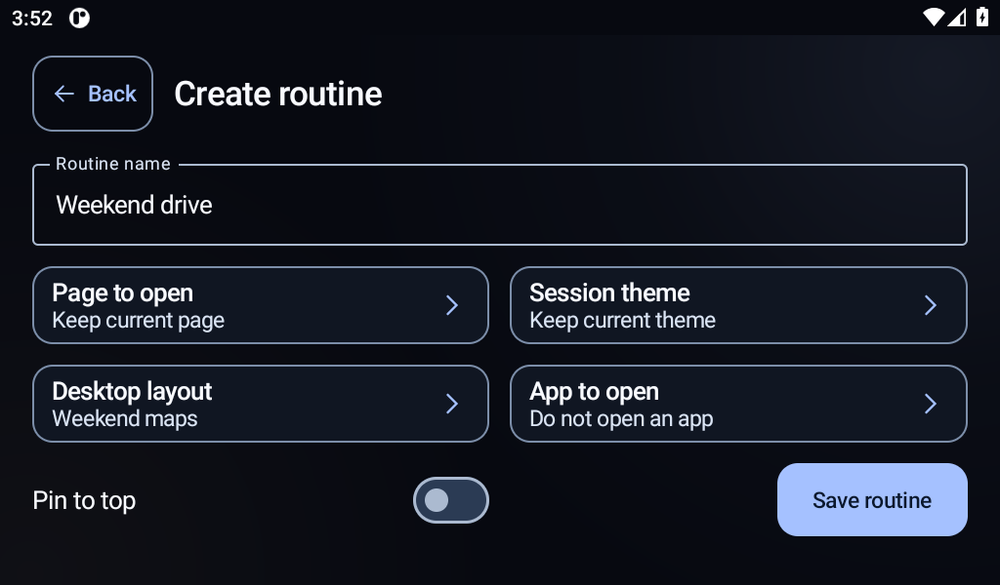

# Saved settings

The inventory counts independently adjustable choices across supported firmware and Android versions. A repeatable choice such as assigning an app or pinning apps on multiple desktops counts once. An enable switch and its separately retained level count individually when either value can change without replacing the other. The installed head unit determines which device integrations are available.

| Area | Saved choices counted | Local | Portable archive section |
| --- | --- | ---: | --- |
| Buttons | Bindings enabled, hold time, debounce time, Android key assignments, panel assignments enabled, panel assignments, steering assignments | 7 | `buttons` (7) |
| Voice | Voice language, default seat levels, extended smoke venting, extended cabin venting, media ducking, spoken feedback, feedback style, speech rate, speech volume, ready sound, ready sound volume, end-of-listening sound, end-of-listening volume, offline voice, app assignments, voice contacts, optional online fallback, maximum listening time, result popup duration, recognized phrase visibility, ready signal style, spoken ready phrase, spoken reply channel | 23 | `voice` (22). Online fallback uses device-bound storage. |
| Windows and displays | Per-app width, per-app DPI, per-app minimum panel margin, per-display default DPI, virtual display DPI, cluster media, navigation feed, window service | 8 | `appWindows`, `appDisplayDpi`, `display` (6). The navigation feed and window-service choice are local. |
| Language | App language, factory screen translation | 2 | `language`, `localization` (2) |
| Updates | Check for updates on startup | 1 | `updates` (1) |
| App grid | Ordered app pins, tile size, system-app visibility, extra desktops, default desktop, icon style, app captions, app sorting, wallpaper, column count, built-in shortcuts, desktop names, desktop card visibility and width, media card style, clock card format, card outlines, desktop paging motion, card placement, Back on favorites desktops, media card source, saved desktop layouts, ordered phone favorites, manual app order, headlight card content, hidden All apps shortcuts, persistent All apps search field, media card tap action, navigation card content, navigation card tap action | 29 | `appGrid`, `desktopWallpapers`, `desktopInfoCards`, `desktopLayouts` (29) |
| Appearance and launch | Screen transitions, transition speed, high contrast, launcher start screen, text size, navigation label size, page title size, spacing, corner style, day or dark palette, accent color, custom wallpaper dimming, font family, backdrop style, bold text, media volume limit at launch enabled, media volume limit at launch level | 17 | `appearance` (17) |
| Virtual display preview | Media visibility, route visibility, playback progress visibility, album artwork visibility, playback controls visibility, preferred media app, pane arrangement, pane order, seek interval, media subtitle, current-road label, next-road label, road-name lettering, turn distance, empty-pane visibility, preview palette, side-by-side pane balance, turn distance units, preview text size, fallback for a selected player | 20 | `displayPreview` (20) |
| Maintenance | Service reminder visibility, distance interval, reminder lead distance, calendar interval, calendar reminder lead time | 5 | `serviceReminder` (5) |
| Quick actions | Dock enabled, side on wide screens, visible shortcut labels, screen coverage, ordered shortcuts, edge in compact windows, collapse after use, idle collapse interval, bar at startup, shortcut labels on compact screens, contrast and accent of the collapsed button, idle button dimming, compact collapsed-button caption, destination of the Apps shortcut, rail width, headlight indicator, headlight indicator content, expand button size, button side on compact screens, collapsed button position on wide screens, ordered installed app shortcuts, rail shortcut position, hide on virtual display, fixed side inset after collapse, headlight indicator tap action, routine shortcut assignment, larger built-in shortcuts | 28 | `quickActions` (28) |
| Seat memory | Open factory Seats when tapping Save or Restore | 1 | `seatMemory` (1) |
| Routines | Saved routines, installed app to open, desktop layout to apply, list sort, routine to run from the launcher, launcher days, launcher time range, pinned routines, launcher frequency, launcher delay, launcher routine enabled | 11 | `routines` (11) |
| Headlights | Observe headlight feedback while Controls is open | 1 | `headlightMonitoring` (1) |
| **Total** | | **153** | **150** |

**Default desktop** selects a desktop within the app grid. **Start screen** selects the page opened by the **Open Controls** shortcut in the Android launcher icon's long-press menu. Tapping the icon or the first app-grid tile opens Settings. The current desktop tab, playback position, last-used driver number and most recent headlight observation are runtime or historical records. The factory vehicle stores seat and mirror positions. The archive can still read older driver label records.

The settings inventory test exports two profiles with different values for each portable setting family and restores them in both directions. It reads each result through a fresh archive instance. The test also checks that restoring either profile preserves the three device-bound settings and the confirmed headlight observations on the receiving device. [Settings inventory test](../app/src/androidTest/kotlin/org/openvoyah/controls/SettingsInventoryAuditTest.kt)

The cold-start test covers all 153 saved choices across four Controls processes on a disposable emulator. Each new process checks the portable profile and the three device-bound settings before importing the next profile. After each import it verifies that the device-bound settings were preserved. The final step restores the emulator's original archive and device-bound values. [Cold-start test](../app/src/androidTest/kotlin/org/openvoyah/controls/SettingsInventoryAuditTest.kt)

To repeat this test on an isolated Android 9 or 11 emulator, arm `SettingsInventoryColdStartTest#testColdProcessStep` through the app's private `files/settings-inventory-cold.request`. Each request contains the same run ID and one step name separated by a space. Run `seed`, `restore-a`, `restore-b`, and then `finish`. Each invocation emits a `files/settings-inventory-cold.json` receipt. After an interrupted run, use `cleanup` with that run ID to restore its saved archive.

The wallpaper setting stores one bounded image rendition for each desktop that has a custom image. Resetting restores the default background. A settings export includes the renditions so the grid can display them after import without access to the original documents. **Wallpaper dimming** adjusts how much of the image shows through. **Accent color** applies to the day and dark palettes, including their high-contrast versions. **Appearance** also controls the font, backdrop and bold text. The size of Settings navigation labels and detail-page titles can follow the general text size or use separate sizes.

In **Appearance**, **Limit media volume on launch** can lower the Android media level once when you choose **Open Controls** from the launcher shortcut menu. The chosen ceiling stays saved when the switch is off. Playback below the ceiling continues at its current level, and you can change the volume manually after launch.

Desktop names, pins, wallpapers and card choices use stable desktop IDs. Available cards show the local time, the media session, service distance, or light feedback. The clock follows the device format or uses a fixed 12-hour or 24-hour format. The media card can prefer an installed player and display its artwork. It returns to automatic source selection when that player's session is unavailable. Choose **Switch position** or **Lamp status** in the headlight card settings for each desktop. In Lamp status, headlamps and high beam show their readings independently. An earlier report from Android Automotive is labeled as such when a current or last confirmed reading is unavailable. Older archives that omit the content choice preserve the current value. Card sizing adapts to the grid columns. **App grid** also controls card outlines, placement, paging motion and whether Android Back on a favorites desktop opens **All apps**.

**App grid → Desktop layouts** keeps up to four named snapshots of the grid, cards and wallpapers. Select a saved layout and choose **Duplicate layout** to save a named copy while the current desktop stays in use. Apply a saved layout to replace the current layout in one operation. The settings archive includes both copies and originals and stores each shared wallpaper image once.

Select **Manual order** under **App order** to arrange ordinary launcher apps. New apps appear after the saved order. Pins and built-in shortcuts keep their priority. Reordering keeps a separate list, and choosing a different sort keeps your manual arrangement. New layouts contain the list. An older layout preserves the saved order when it omits the list.

Turn off **Show in All apps** in an app's shortcut settings to hide it from the All apps grid and search. Its Favorites shortcuts still open the app. **App grid → Hidden app shortcuts** lets you show a shortcut again. Settings archives and new desktop layouts retain the hidden list.

Turn on **Always show search in All apps** to put the search field above the grid. The field waits for a tap before opening the keyboard. Clear the query to show the complete grid again.

In the Media card settings, **When you tap the media card** can open the Controls preview or the player providing the track on the card. If that player cannot open, the card opens the preview. The action can also be disabled.

The optional **Navigation** desktop card uses the same route feed as the virtual display preview. Each desktop can show the next turn alone or include the current road. Tapping the card can open the preview or the navigator selected in Voice settings. The preview is available if that navigator cannot open. Choose **No action** to make the card display only. It waits for route details after a navigation app starts and clears the directions when the route feed ends.

In **Desktop information cards**, add **Phone favorites** and choose up to three of your saved voice contacts for each desktop. Set their order in the card settings. A contact button opens the system dialer with the number filled in. The card stores contact references, and settings archives include the contact records in the Voice section.

The quick-action dock reserves space inside the Controls window. Choose a standard or compact rail on a wide screen. **Keep page width when the side bar collapses** retains the rail's inset so the current page stays in place. On narrow screens the dock can sit along either horizontal edge. **Shortcut labels on compact screens** follows **Show shortcut labels** by default. Choose **Icons only** or **Icons and labels** to override it on narrow screens. **Apps** can open the configured default desktop or **All apps**. **Show headlight status** places a live or labeled historical reading in the expanded dock. Choose the switch mode, headlamps or high beam. Configure the tap to open Vehicle settings or show the lighting sources over the current page.

Under **App shortcuts**, add up to four installed app shortcuts and order them after the Controls shortcuts. An app that is unavailable on the current device appears in the editor so it can be removed. On a wide screen, place the shortcut group at the top, center or bottom of the rail. **Hide on the Virtual display screen** gives the Displays page and its preview the full Controls window.

Under **Shortcuts**, use **Larger shortcuts** to give any built-in shortcut more room to tap. Selected shortcuts grow vertically on a side rail and horizontally on a top or bottom bar. The Vehicle choice also applies to its headlight indicator. The selection follows each shortcut when you hide or reorder it and travels with the settings archive.

Under **Shortcuts**, choose **Routine shortcut** to run a saved routine from the dock in one tap. The separate **Routines** shortcut opens the library. Renaming a routine updates its button. If the routine is removed, the button returns when the same routine is restored. To remove the assignment, choose **None**. The archive includes the assignment and the routine library. Older archives leave the assignment as it was.

**Bar at startup** opens the bar expanded or collapsed. Both choices provide a button for opening and closing the bar manually. **Default** starts the bar collapsed when **Collapse after choosing a shortcut** is enabled and expanded otherwise. **Collapse when idle** can fold the open bar after 10 or 30 seconds of inactivity. The timer defaults to **Off**. The expand button has its own theme, amber or teal accent, optional high contrast and a compact-screen caption. Choose a larger expand button and place it on the left or right of a horizontal bar. The default follows the screen's reading direction.

On wide screens, **Expand button position on the side bar** places the expand button at the top, center or bottom of the reserved rail. The default is the top. When expanded, the close button stays at the top and the shortcut group uses its own alignment setting.

**Dim expand button when idle** softens the collapsed button's fill while keeping its outline, arrow and caption legible. Pressing the button or giving it keyboard focus restores the full colors. This choice is off by default and travels in the settings archive.

Spoken feedback uses an installed offline voice for the chosen recognition language. The voice selected for each language counts as one setting family. Feedback can repeat the command or announce the outcome on the Assistant or Media channel. The ready signal can play a tone or a spoken prompt. The prompt can use a custom phrase for each recognition language. The ready signal and end-of-listening sound have individual volumes. Changing the end-of-listening sound keeps a custom volume. Reset restores the preset volume of the selected sound. **Listening and popup** controls the recording limit, the result display time, and whether the popup includes the recognized phrase.

**Virtual display → Preview details** offers a daylight palette, a separate text size, pane widths and metric or imperial turn distances. Current and next road labels have independent switches. The Latin letters option transliterates supported Cyrillic road names within the preview. A selected media app can fall back to another active player or show only the chosen player.

**Vehicle settings → Service reminder** accepts two odometer readings and the last service date. The driver can set distance and calendar intervals independently. The automatic reminder distance is 10% of the interval, between 1 and 500 km. A fixed lead distance is capped at the distance interval. The calendar warning uses the selected lead time. When both limits are available, the reminder uses the more urgent status. The archive includes the readings and date alongside the reminder choices.

**Routines** can open a Controls screen or desktop and apply a temporary theme. Choose **Desktop layout** to apply a saved app grid, cards and wallpapers as part of the routine. If the selected layout is missing, edit the routine and choose an available layout or select **Keep current layout** to remove the layout action.

A routine applies its desktop layout before opening the selected page or installed app. You can prepare a Controls page to return to after using that app. The archive includes the layout library and each routine's layout selection along with its app, sort order, pins and launcher schedule. Older archives without a layout choice preserve that choice for a matching routine.

On a normal launcher entry, the selected routine can run on specified weekdays during an optional time range, on every eligible launch or once per local day. Choose zero, three or eight seconds before it runs. Pause startup to keep the selected routine and its schedule ready for later. Interacting with the screen or leaving Controls cancels a pending launcher run. A manual run is available any time. A direct theme selection in Appearance ends the temporary theme.

**Vehicle settings → Headlight mode** can keep the existing monitor active across screens while Controls is in the foreground. The archive includes this switch. The last confirmed selector value and supported lamp readings each stay in private local storage.

[LocalSettingsArchive](../app/src/main/java/org/openvoyah/controls/data/settings/LocalSettingsArchive.java) records the portable format. [Archive tests](../app/src/androidTest/java/org/openvoyah/controls/LocalSettingsArchiveTest.java) cover export, restore and old archives. The [transaction tests](../app/src/androidTest/kotlin/org/openvoyah/controls/LocalSettingsArchiveRollbackTest.kt) check rollback after a failed import and export during an in-progress restore. The [screen tests](../app/src/androidTest/kotlin/org/openvoyah/controls/ComposeScreensTest.kt) cover the desktop chooser and the virtual preview on an isolated emulator.
