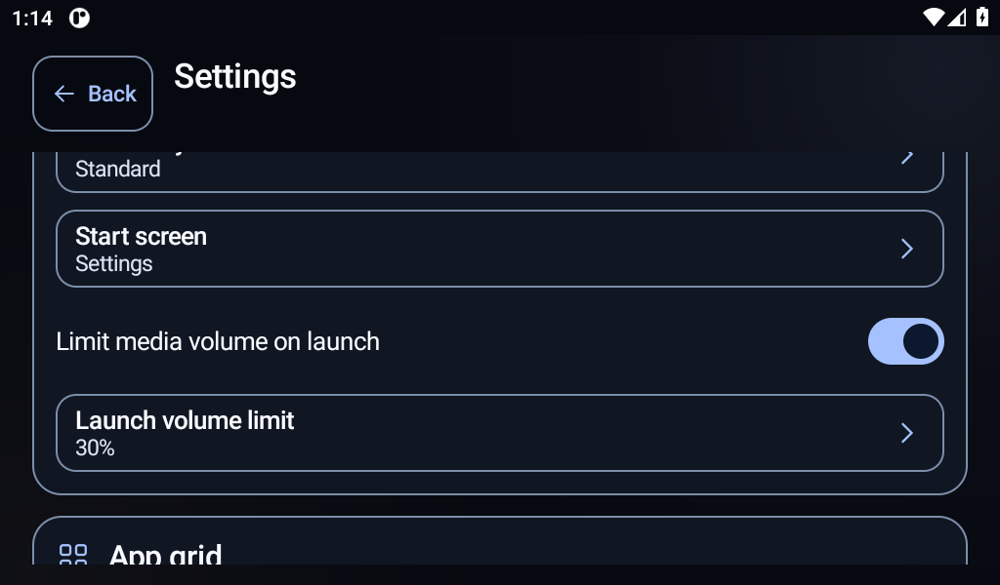
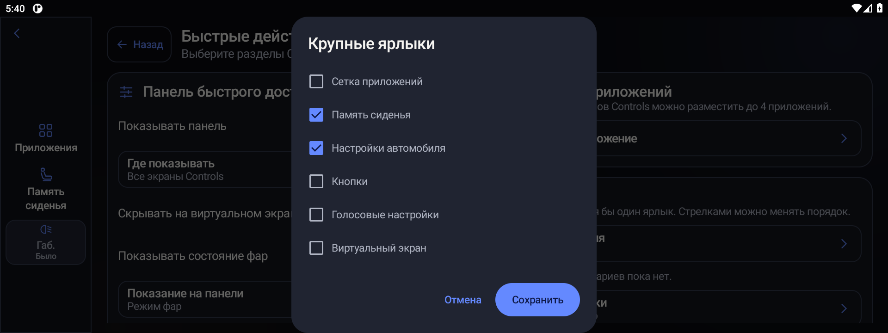
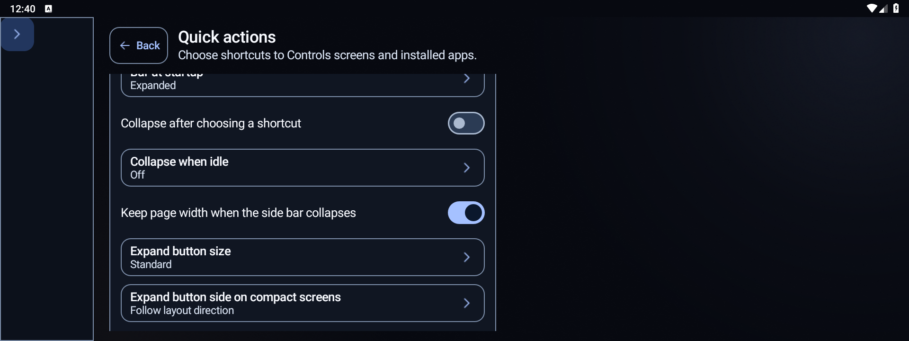
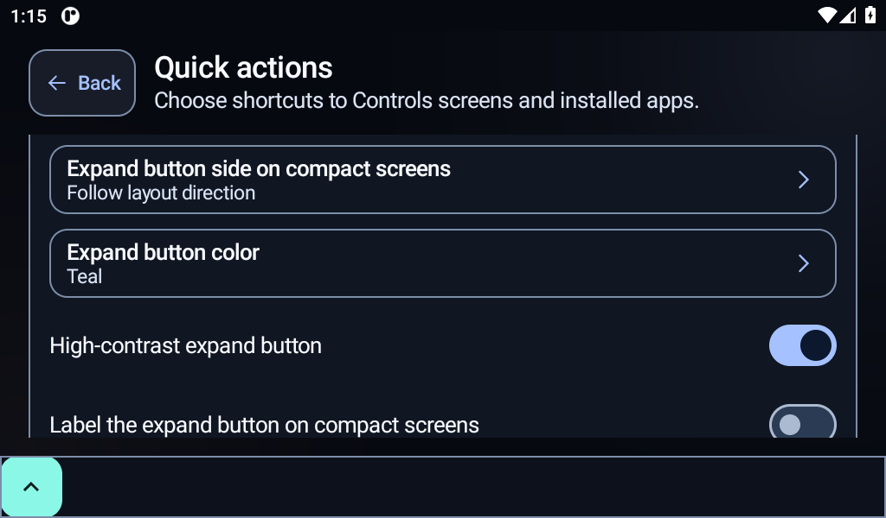

# Saved settings

The inventory counts independently adjustable choices across supported firmware and Android versions. A repeatable choice such as assigning an app or pinning apps on multiple desktops counts once. An enable switch and its separately retained level count individually when either value can change without replacing the other. The installed head unit determines which device integrations are available.

| Area | Saved choices counted | Local | Portable archive section |
| --- | --- | ---: | --- |
| Buttons | Bindings enabled, hold time, debounce time, Android key assignments, panel assignments enabled, panel assignments, Yandex Navigator instead of the Baidu map on the home screen, Navigator widget scale, weather on the home screen, city for the home screen weather, steering assignments | 11 | `buttons` (10). The weather city is local. |
| Voice | Voice language, speech engine, default seat levels, extended driver window venting, extended cabin venting, media ducking while listening, media ducking during calls, media level while lowered, media volume at startup, media volume at startup level, spoken feedback, feedback style, speech rate, speech volume, ready sound, ready sound volume, end-of-listening sound, end-of-listening volume, offline voice, app assignments, voice contacts, optional online fallback, maximum listening time, result popup duration, recognized phrase visibility, ready signal style, spoken ready phrase, spoken reply channel | 28 | `voice` (27). Online fallback uses device-bound storage. |
| Windows and displays | Per-app width, per-app DPI, per-app minimum panel margin, per-display default DPI, window swipe between screens, screen shown after a window swipe, virtual display DPI, cluster media, navigation feed, window service, panel strip reserved by Android (experimental) | 11 | `appWindows`, `appDisplayDpi`, `display` (8). The navigation feed, window-service and reserved-strip choices are local. |
| Language | App language, factory screen translation, factory apps language (text overlays), factory apps with the overlay switched off | 4 | `language`, `localization` (2). The two overlay choices are local: they belong to this head unit's /vendor/overlay. |
| Updates | Check for updates on startup | 1 | `updates` (1) |
| App grid | Ordered app pins, tile size, hide firmware and service apps by default, extra desktops, default desktop, icon style, app captions, app sorting, wallpaper, column count, built-in shortcuts, desktop names, desktop card visibility and width, media card style, clock card format, card outlines, desktop paging motion, card placement, Back on favorites desktops, media card source, saved desktop layouts, ordered phone favorites, manual app order, headlight card content, apps hidden in All apps, apps kept in All apps, persistent All apps search field, media card tap action, navigation card content, navigation card tap action | 30 | `appGrid`, `desktopWallpapers`, `desktopInfoCards`, `desktopLayouts` (30) |
| App icons | Custom picture per app, white background removal per app (experimental; on for Yandex Navigator until turned off) | 2 | `appIcons` (2) |
| Appearance and launch | Screen transitions, transition speed, high contrast, launcher start screen, text size, navigation label size, page title size, spacing, corner style, day or dark palette, accent color, custom wallpaper dimming, font family, backdrop style, bold text, media volume limit at launch enabled, media volume limit at launch level | 17 | `appearance` (17) |
| Virtual display preview | Media visibility, route visibility, playback progress visibility, album artwork visibility, playback controls visibility, preferred media app, pane arrangement, pane order, seek interval, media subtitle, current-road label, next-road label, road-name lettering, turn distance, empty-pane visibility, preview palette, side-by-side pane balance, turn distance units, preview text size, fallback for a selected player | 20 | `displayPreview` (20) |
| Maintenance | Service reminder visibility, distance interval, reminder lead distance, calendar interval, calendar reminder lead time | 5 | `serviceReminder` (5) |
| Quick actions | Dock enabled, side on wide screens, visible shortcut labels, screen coverage, ordered shortcuts, edge in compact windows, collapse after use, idle collapse interval, bar at startup, shortcut labels on compact screens, contrast and accent of the collapsed button, idle button dimming, compact collapsed-button caption, destination of the Apps shortcut, rail width, headlight indicator, headlight indicator content, expand button size, button side on compact screens, collapsed button position on wide screens, ordered installed app shortcuts, rail shortcut position, hide on virtual display, fixed side inset after collapse, headlight indicator tap action, routine shortcut assignment, larger built-in shortcuts | 28 | `quickActions` (28) |
| Seat memory | Open factory Seats when tapping Save or Restore | 1 | `seatMemory` (1) |
| Routines | Saved routines, installed app to open, desktop layout to apply, list sort, routine to run from the launcher, launcher days, launcher time range, pinned routines, launcher frequency, launcher delay, launcher routine enabled | 11 | `routines` (11) |
| Headlights | Observe headlight feedback while Controls is open | 1 | `headlightMonitoring` (1) |
| Vehicle routines | Lighting enabled, Drive action, Park action, actual driving-mode memory enabled | 4 | `vehicleAutomation` (4) |
| Seasonal climate | Scenario enabled, outside threshold, driver temperature, passenger temperature, fan, gear, closed-door requirement, driver seat level, passenger seat level | 9 | `seasonalClimate` (9), each field counted once across presets |
| If–then rules | Saved rules, rule enabled, gear condition, door condition, saved routine, minimum interval | 6 | `conditionalRules` (6), each repeatable field counted once |
| Allowed actions | Allowed, unverified or forbidden for each root operation, Frida agent channel and vehicle voice command | 1 | `actionPermissions` (1) |
| **Total** | | **190** | **183** |

**Default desktop** selects a desktop within the app grid. **Start screen** selects the page opened by the **Open Controls** shortcut in the Android launcher icon's long-press menu. Tapping the icon or the first app-grid tile opens Settings. The current desktop tab, playback position, last-used driver number and most recent headlight observation are runtime or historical records. The factory vehicle stores seat and mirror positions. The archive can still read older driver label records.

## Where the settings are

**Settings** opens with a search field, the places where something was changed last (**Recently changed**, up to four, kept only on this head unit and never exported) and ten sections. A section is one scrolling page with no tabs or pages below it: its groups follow one another under their headings, and pages that used to open from a section (the virtual display, Quick actions, Updates, Allowed actions, the diagnostic log, the keyboard, factory app languages, the cluster translation, the service reminder, driver assistance, routines, if–then rules and seasonal climate) are drawn inside it. Dialogs remain only for pickers and confirmations; the seat memory page stays separate because the steering wheel keys and the factory Seats app open it for a chosen driver. Inside a card the settings share rows: each takes as many columns as its content needs (CockpitGrid), so two, three or more short switches, choices or compact sliders stand side by side on the 1920 × 720 display and a long one spans the card. A narrower window, a larger text size or the lowered screen simply gets fewer columns. A search result opens its section scrolled to the right group. The structure moves only the screens: preference keys, the archive sections and the inventory above are unchanged.

| Section | Parts |
| --- | --- |
| Home screen and apps | App grid; Desktops (desktops, wallpapers, wallpaper dimming, desktop layouts); Desktop cards; Factory home screen (Yandex Navigator card, widget scale, weather) |
| Windows and screens | App windows (window service, Android panel strip, App DPI defaults, Move windows with a swipe; one app's scale stays in its **App settings**); Virtual display and cluster (the virtual display page, drawn in the section) |
| Buttons and quick access | Launcher panel; Steering wheel; Hardware buttons (service, assignments, press timings, reset); Quick action bar (drawn in the section) |
| Voice | The voice settings page |
| Sound and media | Volume at startup (after the head unit starts, and **Limit media volume on launch**); Media ducking; Media access (with a link to **Restart multimedia**) |
| Vehicle | Headlights, cabin and factory menus; Service reminder; Driver assistance (seat and mirror memory opens its own page) |
| Routines and automation | My routines; Lights and driving mode; If–then rules; Seasonal climate |
| Appearance | Theme; Text; Spacing and corners; Transitions |
| Language and input | Interface and input (Controls language, keyboard); Factory apps and Android (factory app languages, Android translation dictionary, cluster translation) |
| System | Maintenance (updates, Android settings); About and restart; Backup; Start screen; Connection (Frida agent); Diagnostics (log, vehicle report); Factory profiles; Allowed actions (the long list, last). **About and restart** holds the build, **Restart Open Voyah Controls**, **Restart multimedia** and **Restart the system** together |

The settings inventory test exports two profiles with different values for each portable setting family and restores them in both directions. It reads each result through a fresh archive instance. The test also checks that restoring either profile preserves the four device-bound settings and the confirmed headlight observations on the receiving device. [Settings inventory test](../app/src/androidTest/kotlin/org/openvoyah/controls/SettingsInventoryAuditTest.kt)

The cold-start test covers all 173 saved choices across four Controls processes on a disposable emulator. Each new process checks the portable profile and the four device-bound settings before importing the next profile. After each import it verifies that the device-bound settings were preserved. The final step restores the emulator's original archive and device-bound values. [Cold-start test](../app/src/androidTest/kotlin/org/openvoyah/controls/SettingsInventoryAuditTest.kt)

To repeat this test on an isolated Android 9 or 11 emulator, arm `SettingsInventoryColdStartTest#testColdProcessStep` through the app's private `files/settings-inventory-cold.request`. Each request contains the same run ID and one step name separated by a space. Run `seed`, `restore-a`, `restore-b`, and then `finish`. Each invocation emits a `files/settings-inventory-cold.json` receipt. After an interrupted run, use `cleanup` with that run ID to restore its saved archive.

The wallpaper setting stores one bounded image rendition for each desktop that has a custom image. Resetting restores the default background. A settings export includes the renditions so the grid can display them after import without access to the original documents. **Wallpaper dimming** adjusts how much of the image shows through. **Accent color** applies to the day and dark palettes, including their high-contrast versions. It colors Controls itself: actions, selection and focus, the outlines of cards and buttons (tinted at the brightness of the default outlines, so they keep their contrast), Android's own widgets in the app such as the time picker, and the startup intro. It does not change the factory apps. Each option in the Appearance dialogs shows a small live sample: the accent as a swatch with a filled and an outlined mini button, the palette as a miniature page, and similar samples for the other choices. **Appearance** also controls the font, backdrop and bold text. The size of Settings navigation labels and detail-page titles can follow the general text size or use separate sizes.

Controls draws its own windows at the density that maps their display onto a canvas of at least 1280 × 480 dp, the size its screens are designed for, and never below Android's own density. The head unit runs its 1920 × 720 central display at 160 dpi, so Controls draws there at 240 dpi and every screen, dialog and the voice popup appear 1.5 times larger than at the display's density. A display that already fits the canvas, such as the 240 dpi emulator, keeps its density. **Text size**, **Spacing**, the tile size and the column count apply on top of this scale and keep their saved values. The display and other apps keep their density: **Settings → Windows and screens → App windows → App DPI defaults** and **App scale (DPI)** apply only to the apps that the window service opens.

Each option in the Appearance dialogs shows a small live sample beside its name: the accent as a swatch with a filled and an outlined mini button, the palette as a miniature page, the backdrop, the wallpaper dimming over a stand-in picture, the text sizes and fonts as "Aa", the spacing, the corner style, the transition speed as a dot moving at that speed, the start screen as its icon and the media limit as a volume bar.

In **Sound and media → Volume at startup**, **Limit media volume on launch** can lower the Android media level once when you choose **Open Controls** from the launcher shortcut menu. The chosen ceiling stays saved when the switch is off. Playback below the ceiling continues at its current level, and you can change the volume manually after launch.

Desktop names, pins, wallpapers and card choices use stable desktop IDs. Available cards show the local time, the media session, service distance, or light feedback. The clock follows the device format or uses a fixed 12-hour or 24-hour format. The media card can prefer an installed player and display its artwork. It returns to automatic source selection when that player's session is unavailable. Choose **Switch position** or **Lamp status** in the headlight card settings for each desktop. In Lamp status, headlamps and high beam show their readings independently. An earlier report from Android Automotive is labeled as such when a current or last confirmed reading is unavailable. Older archives that omit the content choice preserve the current value. Card sizing adapts to the grid columns. **App grid** also controls card outlines, placement, paging motion and whether Android Back on a favorites desktop opens **All apps**.

**Home screen and apps → Desktops → Desktop layouts** keeps up to four named snapshots of the grid, cards and wallpapers. Select a saved layout and choose **Duplicate layout** to save a named copy while the current desktop stays in use. Apply a saved layout to replace the current layout in one operation. The settings archive includes both copies and originals and stores each shared wallpaper image once.

Select **Manual order** under **App order** to arrange ordinary launcher apps, or use **Move** in an app's **App settings** to drag apps on the grid itself; moving an app there switches **App order** to **Manual order** and keeps the other apps where they were, so a move made while another order is chosen starts the manual order from what the grid showed. New apps appear after the saved order. Pins and built-in shortcuts keep their priority. Reordering keeps a separate list, and choosing a different sort keeps your manual arrangement. New layouts contain the list. An older layout preserves the saved order when it omits the list.

**Home screen and apps → App grid → Built-in shortcuts** chooses which Controls shortcuts appear in the grid: Voice assistant, Buttons, Virtual display, Vehicle settings, Vehicle routines, Voice settings, Updates and Install local APK. A new grid shows none of them. The **Open Voyah Controls** tile opens Settings, which links to the same screens. Voice assistant and Install local APK have no row in Settings, so turn those two shortcuts on to use them from the grid. A grid whose shortcut choice was never changed follows this default after an update. A saved choice stays as it is, including one kept in a desktop layout or a settings archive.

**Home screen and apps → App grid → Tile size** offers Compact, Standard and Large. A new grid uses Large, which follows the factory launcher's own app grid: on the central display it shows six columns and two rows of 80 dp icons with 19 sp captions (120 px icons and 28 px captions on the head unit's display). Large tiles share the grid's visible height between whole rows, so no part of a third row shows below the second. When the grid is too short for two whole rows, for example under the search field with a large text size, the tiles keep their least height and the grid scrolls. Compact and Standard keep their fixed heights. **Grid columns** stays Automatic by default, which fits six Large tiles beside the launcher panel. A grid whose tile size was never changed follows this default after an update. A saved size stays as it is, including one kept in a desktop layout or a settings archive.

Each app has a **Hide from the app list** choice, in its **App settings** and in **Home screen and apps → App grid → Hidden apps**. A hidden app leaves the All apps grid and search; its Favorites shortcuts still open it, and a pin keeps an app that is only hidden by default. Until you choose, the default applies: the firmware's own apps and internal actions, apps in the head unit maker's namespaces, keyboards, service apps such as Google Play services or microG, and extra launcher entries of an app start hidden. Your choice replaces the default in either direction, and **Back to defaults** forgets all choices. **Hide firmware and service apps by default** turns the default off for every app; apps you hid yourself stay hidden. Every list where you choose an app (panel buttons and steering keys, voice command targets, routines, quick-action shortcuts and the Favorites picker) follows the same choice: it leaves out hidden apps and offers an app you showed; the Favorites picker also keeps apps already pinned to that desktop so you can unpin them. Turn on **Show firmware and hidden apps** in that list for the rare case; the switch appears only when it would add apps and resets each time the list opens. Settings archives and new desktop layouts keep the choices (`hiddenApps`, `shownApps`) and the default switch (`hideByDefault`). Older archives and layouts that lack them keep the current values; the former **Show system apps** value (`showSystemApps`) is ignored on import, because it was nearly always its unchanged default.

Turn on **Always show search in All apps** to put the search field above the grid. The field waits for a tap before opening the keyboard. Clear the query to show the complete grid again.

In the Media card settings, **When you tap the media card** can open the Controls preview or the player providing the track on the card. If that player cannot open, the card opens the preview. The action can also be disabled.

The optional **Navigation** desktop card uses the same route feed as the virtual display preview. Each desktop can show the next turn alone or include the current road. Tapping the card can open the preview or the navigator selected in Voice settings. The preview is available if that navigator cannot open. Choose **No action** to make the card display only. It waits for route details after a navigation app starts and clears the directions when the route feed ends.

In **Desktop information cards**, add **Phone favorites** and choose up to three of your saved voice contacts for each desktop. Set their order in the card settings. A contact button opens the system dialer with the number filled in. The card stores contact references, and settings archives include the contact records in the Voice section.

The quick-action dock reserves space inside the Controls window. Choose a standard or compact rail on a wide screen. **Keep page width when the side bar collapses** retains the rail's inset so the current page stays in place. On narrow screens the dock can sit along either horizontal edge. **Shortcut labels on compact screens** follows **Show shortcut labels** by default. Choose **Icons only** or **Icons and labels** to override it on narrow screens. **Apps** can open the configured default desktop or **All apps**. **Show headlight status** places a live or labeled historical reading in the expanded dock. Choose the switch mode, headlamps or high beam. Configure the tap to open Vehicle settings or show the lighting sources over the current page.

Under **App shortcuts**, add up to four installed app shortcuts and order them after the Controls shortcuts. An app that is unavailable on the current device appears in the editor so it can be removed. On a wide screen, place the shortcut group at the top, center or bottom of the rail. **Hide on the Virtual display screen** gives the Virtual display page and its preview the full Controls window.

Under **Shortcuts**, use **Larger shortcuts** to give any built-in shortcut more room to tap. Selected shortcuts grow vertically on a side rail and horizontally on a top or bottom bar. The Vehicle choice also applies to its headlight indicator. The selection follows each shortcut when you hide or reorder it and travels with the settings archive.

Under **Shortcuts**, choose **Routine shortcut** to run a saved routine from the dock in one tap. The separate **Routines** shortcut opens the library. Renaming a routine updates its button. If the routine is removed, the button returns when the same routine is restored. To remove the assignment, choose **None**. The archive includes the assignment and the routine library. Older archives leave the assignment as it was.

**Bar at startup** opens the bar expanded or collapsed. Both choices provide a button for opening and closing the bar manually. **Default** starts the bar collapsed when **Collapse after choosing a shortcut** is enabled and expanded otherwise. **Collapse when idle** can fold the open bar after 10 or 30 seconds of inactivity. The timer defaults to **Off**. The expand button has its own theme, amber or teal accent, optional high contrast and a compact-screen caption. Choose a larger expand button and place it on the left or right of a horizontal bar. The default follows the screen's reading direction.

On wide screens, **Expand button position on the side bar** places the expand button at the top, center or bottom of the reserved rail. The default is the top. When expanded, the close button stays at the top and the shortcut group uses its own alignment setting.

**Dim expand button when idle** softens the collapsed button's fill while keeping its outline, arrow and caption legible. Pressing the button or giving it keyboard focus restores the full colors. This choice is off by default and travels in the settings archive.

Spoken feedback uses an installed offline voice for the chosen recognition language. The voice selected for each language counts as one setting family. Feedback can repeat the command or announce the outcome on the Assistant or Media channel. The ready signal can play a tone or a spoken prompt. The prompt can use a custom phrase for each recognition language. The ready signal and end-of-listening sound have individual volumes. Changing the end-of-listening sound keeps a custom volume. Reset restores the preset volume of the selected sound. **Listening and popup** controls the recording limit, the result display time, and whether the popup includes the recognized phrase.

**Settings → Windows and screens → Virtual display → Preview details** offers a daylight palette, a separate text size, pane widths and metric or imperial turn distances. Current and next road labels have independent switches. The Latin letters option transliterates supported Cyrillic road names within the preview. A selected media app can fall back to another active player or show only the chosen player.

**Settings → Vehicle → Service reminder** accepts two odometer readings and the last service date. The driver can set distance and calendar intervals independently. The automatic reminder distance is 10% of the interval, between 1 and 500 km. A fixed lead distance is capped at the distance interval. The calendar warning uses the selected lead time. When both limits are available, the reminder uses the more urgent status. The archive includes the readings and date alongside the reminder choices.

**Routines** can open a Controls screen or desktop and apply a temporary theme. Choose **Desktop layout** to apply a saved app grid, cards and wallpapers as part of the routine. If the selected layout is missing, edit the routine and choose an available layout or select **Keep current layout** to remove the layout action.

A routine applies its desktop layout before opening the selected page or installed app. You can prepare a Controls page to return to after using that app. The archive includes the layout library and each routine's layout selection along with its app, sort order, pins and launcher schedule. Older archives without a layout choice preserve that choice for a matching routine.

On a normal launcher entry, the selected routine can run on specified weekdays during an optional time range, on every eligible launch or once per local day. Choose zero, three or eight seconds before it runs. Pause startup to keep the selected routine and its schedule ready for later. Interacting with the screen or leaving Controls cancels a pending launcher run. A manual run is available any time. A direct theme selection in Appearance ends the temporary theme.

**Settings → Vehicle → Headlight mode** can keep the existing monitor active across screens while Controls is in the foreground. The archive includes this switch. The last confirmed selector value and supported lamp readings each stay in private local storage.

**Settings → Routines and automation** adds three optional archive sections: `vehicleAutomation` for Drive/Park lighting and driving-mode-memory preferences, `seasonalClimate` for both seasonal presets, and `conditionalRules` for gearbox/door conditions with the selected existing routine. All three are validated before any archive write and participate in interrupted-restore recovery. Older archives without these sections preserve the current settings. A changed or deleted routine pauses its dependent rule until its current actions are selected again.

Seasonal presets keep their threshold, Park/Drive condition, closed-door requirement, driver/passenger temperatures, fan level and driver/passenger seat levels. Zero seat level means **No change**. Summer uses seat ventilation; winter uses seat heating. Configurations are off by default. Physical requests skip any command forbidden in **Settings → System → Allowed actions**, and manual application needs explicit confirmation. Actual driving-mode history records firmware identity, source and confirmation time locally and is excluded from exports. [Qualification and signal limits](VEHICLE_AUTOMATION.md)

**Settings → Language and input → Keyboard** chooses the on-screen keyboard of the central display. The choice is an Android setting of this head unit, kept in its secure settings, so it is not counted above and not part of a settings export: the receiving car may not have that keyboard installed. Android must bind the chosen keyboard before the page keeps the choice, and **Factory keyboard** returns to the firmware's own choice. See [Firmware: keyboard of the central display](FIRMWARE.md#keyboard-of-the-central-display).

## About and restart

**Settings → System → About and restart** names the build and offers the restarts, the multimedia restart beside the system reboot; **Settings → Sound and media** only links there. None of them is a saved setting.

- **Version**: the version name and code, the build (`release`, `debug`, `local-vehicle` for the owner's car build, or `debug · emulator`), the short commit the APK was built from (`+` when tracked files had uncommitted changes; `BuildConfig.GIT_COMMIT`, empty without git) and when this APK was installed or updated. The text is selectable, and **Copy version** puts all lines on the clipboard for a bug report.
- **Restart Open Voyah Controls** opens a short-lived `:restart` process (`AppRestartActivity`) that covers the window, so Android stops the old activity and writes its pending preferences. It then ends the old app process and opens Controls again. The car agents, the root channel and the boot activation live outside the app process and keep running. Android rebinds the button accessibility service and the media listener by itself. The journal records `app_restart` as `requested` and `relaunched`.
- **Restart multimedia** closes the factory media center `com.qinggan.media` and the factory music, radio and video players (`com.qinggan.app.music`, `.radio`, `.video`) through the authorized root channel. The media center is a persistent system app, so Android starts it again; the page waits up to 12 seconds and reports how many processes stopped and whether the media center is back. The launcher, the passenger screen, the cluster media card and the music app reconnect to its media browser services. Car services (CAN, vehicle, cluster), the launcher, the OEM audio policy and Android's audio and media servers are never touched. It is the allowed action `media-restart`; the journal records `media_restart`.
- **Restart the system** reboots the whole head unit with `svc power reboot` after a confirmation. Like the T-Box restart, it first asks the CAN agent to confirm Park (`ParkingPreflight`) and is refused otherwise. The car agents start again after the boot as usual. It is the allowed action `system-reboot`; the journal records `system_reboot`.

Both root operations are allowed by default, like every other action. **Settings → System → Allowed actions** can mark either one unverified (its confirmation then says so) or forbid it; a forbidden one answers **This action is forbidden in Settings → System → Allowed actions**. A row in `verified-operations.tsv` only adds the **Verified on this firmware** mark. The Park check before a reboot and both confirmations stay. [Restart scripts](../app/src/main/kotlin/org/openvoyah/controls/data/frida/SystemRestartScripts.kt)

## Allowed actions

**Settings → System → Allowed actions** lists every action that reaches the vehicle or the root channel, in three groups: root operations (window service, passenger screen scale, window moves between screens, the two CAN steering key protocols, Driver A/B/C, cluster settings, T-Box restart, multimedia restart, system reboot), Frida agent channels (cluster navigation and the four factory app translations) and every vehicle voice command of the catalog. Each has three states:

- **Allowed**, the default for everything. Nothing has to be reviewed first.
- **Unverified**: runs, carries the mark in the list, writes `event=action_unverified_use action=<key>` to the journal on every use, and an action with a confirmation (multimedia restart, system reboot, cluster settings) adds **This action is marked unverified** to it.
- **Forbidden**: refused before anything is sent. A forbidden voice command is also skipped by routines, seat memory, seasonal climate and automation; a forbidden agent channel is left out at the next Frida connection.

**Allow everything** returns every item to the default. **Settings → Voice → Vehicle commands** is a shortcut for the voice group: switching a command off forbids it. The switches saved there by earlier versions become Forbidden once. Only changed items are stored (`action_permissions`, keys such as `operation.media-restart`, `agent.navigation`, `voice.LowBeam`); they travel in the `actionPermissions` archive section, and an archive without it keeps the current choices.

A review row is optional metadata now: an operation row in `verified-operations.tsv` or a command in `verified-commands.json` for this exact firmware shows **Verified on this firmware**. When both CAN protocols are allowed, the one marked verified is used, otherwise the short/long press protocol. What does not change is described in [Head unit qualification: what still guards the root channel](PRODUCTION.md#allowed-actions-and-what-still-guards-the-root-channel).

[LocalSettingsArchive](../app/src/main/java/org/openvoyah/controls/data/settings/LocalSettingsArchive.java) records the portable format. [Archive tests](../app/src/androidTest/java/org/openvoyah/controls/LocalSettingsArchiveTest.java) cover export, restore and old archives. The [transaction tests](../app/src/androidTest/kotlin/org/openvoyah/controls/LocalSettingsArchiveRollbackTest.kt) check rollback after a failed import and export during an in-progress restore. The [screen tests](../app/src/androidTest/kotlin/org/openvoyah/controls/ComposeScreensTest.kt) cover the desktop chooser and the virtual preview on an isolated emulator.
