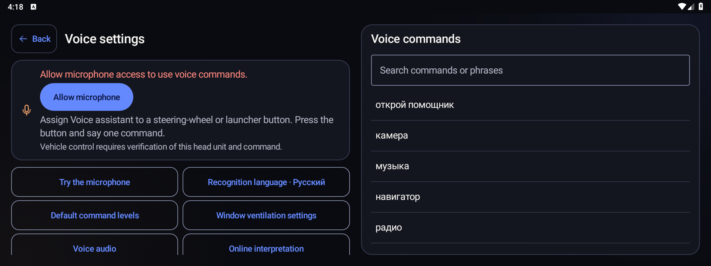
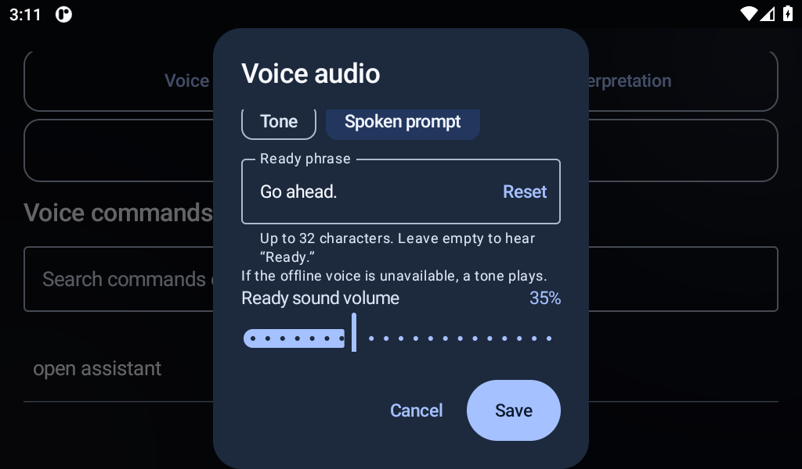

# Voice commands

A short press of the steering-wheel voice key opens **Voice assistant** by default on a supported vehicle profile. You can also assign it to another steering-wheel or launcher button. To keep the factory voice key, choose the factory action for it under **OEM steering wheel buttons**, or use **Restore factory buttons**. Press the button and say one command. A small Android dialog opens over the current app and starts the microphone. It briefly shows the result and returns to the underlying app. A second press closes an active dialog.

The app recognizes 138 command IDs in English and Russian. The recognition language is separate from the interface language. **Voice settings** contains the command catalog and app assignments.

- [English catalog](../core/src/main/resources/voice-catalog-en.tsv)
- [Russian catalog](../core/src/main/resources/voice-catalog.tsv)

Android asks for microphone permission on the first request. Once the microphone starts, Vosk listens for up to four seconds by default. Set the limit to three, four, or six seconds in **Voice audio → Listening and popup**. Offline actions need a final catalog match that passes the decoder confidence check. Silence and unfinished phrases end the capture. When the speech is not a confident command, Vosk makes one more local pass over the same audio without the command grammar. The popup then shows what it heard and **No matching command** below it, or a short **Command not recognized** when nothing was heard clearly. A heard phrase is only shown; it never runs an action. The popup keeps one size from listening to the result. The app keeps the last model warm for 90 seconds between requests.

Voice settings shows whether physical vehicle commands have been reviewed for the current build. The shipped approval catalog starts empty. App, media, and dialer commands are available independently. Each physical command requires approval for the exact build, a fresh Park and standstill check, and the current request protocol at both ends.

The result distinguishes a vehicle service acknowledgment from a change confirmed by fresh telemetry. If feedback is partial or the outcome is unknown, the app ends the request and shows that result. Vehicle qualification also checks who can submit requests on the reviewed firmware and what happens when feedback or power is lost during motion.

“Driver one/two/three” (Russian: “водитель один/два/три”) selects the corresponding **driver seat and mirror memory** slot 1/2/3. For a reviewed firmware and slot, direct recall requires **P (Park)** and zero speed. The service reply acknowledges the request. On other firmware, the phrase opens the numbered Restore instructions and the recall is finished in the factory seat controls. Save positions through the factory seat controls. See the [driver-memory guide](DRIVER_MEMORY.md).

“Driver A/B/C” concerns separate OEM accounts. Those commands do not select the numbered memory slots. Overseas account switching remains unavailable; see [OEM account-record recovery limits](ACCOUNT_RECOVERY.md) for the distinct account and recovery boundaries.

## Apps and media

To assign an installed app, select a command and choose **App…**. Music, navigation, radio, and camera use your assignments. **Open assistant** uses the Android assistant unless you choose another app for that command. **Controls settings** opens this app's settings.

Playback keys and volume use Android media controls. Say “volume fifty percent” in English or “громкость пятьдесят процентов” in Russian to set a percentage from 0 to 100. Ratings require media session access and a supported rating type in the active player.

Say “make it louder” or “сделай громче” for a volume step. Say “restart navigation” or “перезапусти навигатор” to clear and reopen the task for the assigned navigation app. Music restart works the same way. Assign the target through the **Music** or **Navigator** command in the catalog.

## Optional online interpretation

Open **Voice settings → Online interpretation** to enable OpenRouter with your own API key. Exact catalog phrases still run locally. For a completed phrase outside the grammar, the result of the local pass without the grammar is sent to OpenRouter only if it meets the confidence check, and only its short text. A phrase cut off by the listening limit is never sent.

The free router can return one of four actions: raise volume, lower volume, restart the assigned music app, or restart the assigned navigation app. Only a validated choice from the list triggers an action. Free model availability and rate limits can vary. Android Keystore protects the API key, and app settings exports omit it.

## Voice audio and climate

In **Voice audio**, you can lower media while the microphone is listening. Android releases that audio focus when the request ends. Spoken feedback reads back the command using an installed offline Android voice in the recognition language. Set the rate and volume, or choose a specific installed voice and play a sample. Controls remembers the choice independently for English and Russian. Automatic selection uses a compatible installed voice when the chosen voice is unavailable.

Choose whether feedback repeats the recognized command or announces its result. The result distinguishes an accepted request from a confirmed vehicle response. **Spoken reply channel** selects Android's Assistant or Media audio channel for feedback and voice samples. The optional **Ready signal** plays a tone or a short spoken prompt before recording. In spoken mode, set a custom ready phrase for the current recognition language or restore its built-in phrase. A tone plays if the offline voice is unavailable. The optional end sound plays after the microphone is released and before spoken feedback, with its own volume. **Listening and popup** controls how long the result stays visible and whether it includes the recognized phrase.

On the inspected H97 branch with front climate on, use **driver temperature**, **passenger temperature**, or **fan speed** with a value. Temperature accepts 16–30 °C, and the fan accepts 1–8. The popup shows the result and, by default, the recognized phrase. Other branches need separate verification.

## Contacts, backup, and recovery

Add local contacts under **Voice settings and recovery**. A matched contact command opens the Android dialer with the selected number. Export or import voice settings independently of button assignments, or use the main screen to back up the app settings together. Use **Restore** to return to the previous settings or to restore the bundled speech model.

The app checks vehicle commands before making changes. A lost response does not cause it to replay an action. Compatibility with the vehicle's systems remains unverified. See [Firmware and profiles](FIRMWARE.md).
