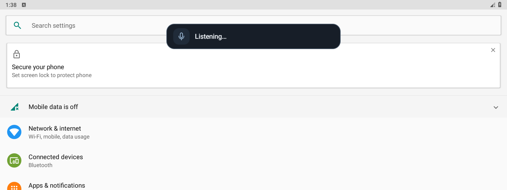
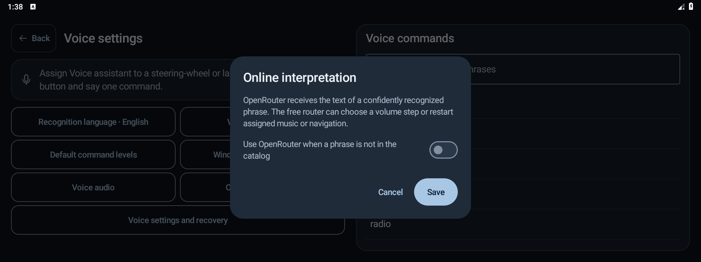
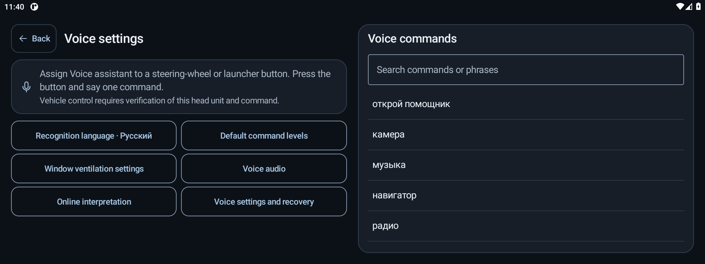
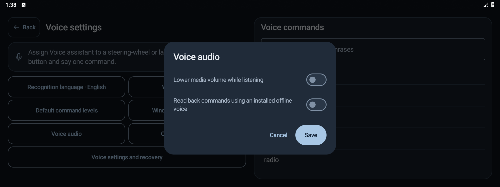

# Voice commands

Assign **Voice assistant** to a supported steering-wheel or launcher button. Press the button and say one command. A small Android dialog opens over the current app and starts the microphone. It briefly shows the result and returns to the underlying app. A second press closes an active dialog.

The app recognizes 138 command IDs in English and Russian. The recognition language is separate from the interface language. **Voice settings** contains the command catalog and app assignments.

- [English catalog](../core/src/main/resources/voice-catalog-en.tsv)
- [Russian catalog](../core/src/main/resources/voice-catalog.tsv)

Android asks for microphone permission on the first request. Once the microphone starts, Vosk listens for up to four seconds. Offline actions need a final catalog match that passes the decoder confidence check. Silence and unfinished phrases end the capture. The app keeps the last model warm for 90 seconds between requests.

Voice settings shows whether physical vehicle commands have been reviewed for the current build. The shipped approval catalog starts empty. App, media, and dialer commands are available independently. Each physical command requires approval for the exact build, a fresh Park and standstill check, and the current request protocol at both ends.

The result distinguishes a vehicle service acknowledgment from a change confirmed by fresh telemetry. If feedback is partial or the outcome is unknown, the app ends the request and shows that result. Vehicle qualification also checks who can submit requests on the reviewed firmware and what happens when feedback or power is lost during motion.

## Apps and media

To assign an installed app, select a command and choose **App…**. Music, navigation, radio, and camera use your assignments. **Open assistant** uses the Android assistant unless you choose another app for that command. **Controls settings** opens this app's settings.

Playback keys and volume use Android media controls. Say “volume fifty percent” in English or “громкость пятьдесят процентов” in Russian to set a percentage from 0 to 100. Ratings require media session access and a supported rating type in the active player.

Say “make it louder” or “сделай громче” for a volume step. Say “restart navigation” or “перезапусти навигатор” to clear and reopen the task for the assigned navigation app. Music restart works the same way. Assign the target through the **Music** or **Navigator** command in the catalog.

## Optional online interpretation

Open **Voice settings → Online interpretation** to enable OpenRouter with your own API key. Exact catalog phrases still run locally. For a completed phrase outside the grammar, Vosk makes one local dictation pass. If the result meets the confidence check, the app sends only its short text to OpenRouter.

The free router can return one of four actions: raise volume, lower volume, restart the assigned music app, or restart the assigned navigation app. Only a validated choice from the list triggers an action. Free model availability and rate limits can vary. Android Keystore protects the API key, and app settings exports omit it.

## Voice audio and climate

In **Voice audio**, you can lower media while the microphone is listening. Android releases that audio focus when the request ends. You can also have the app read back the command using an installed offline Android voice in the recognition language.

On the inspected H97 branch with front climate on, use **driver temperature**, **passenger temperature**, or **fan speed** with a value. Temperature accepts 16–30 °C, and the fan accepts 1–8. The popup shows the recognized phrase and the result. Other branches need separate verification.

## Contacts, backup, and recovery

Add local contacts under **Voice settings and recovery**. A matched contact command opens the Android dialer with the selected number. Export or import voice settings independently of button assignments, or use the main screen to back up the app settings together. Use **Restore** to return to the previous settings or to restore the bundled speech model.

The app checks vehicle commands before making changes. A lost response does not cause it to replay an action. Compatibility with the vehicle's systems remains unverified. See [Firmware and profiles](FIRMWARE.md).
