# Open Voyah Controls for Android

Open Voyah Controls is an offline-first utility for Voyah head units. It opens directly to an app grid with installed apps and Controls shortcuts. Use an assigned **Voice assistant** button for one voice request, or **Virtual display** for media and navigation. The app also supports button assignments, factory seat and lighting shortcuts, translation, and instrument cluster backup and recovery.

The APK requires Android 9 (API 28) or newer. The firmware adapters require a reviewed head unit build running Android 9 or 11. See [Head unit qualification and recovery](docs/PRODUCTION.md) for release signing, firmware evidence, and PC rollback.

## Screenshots

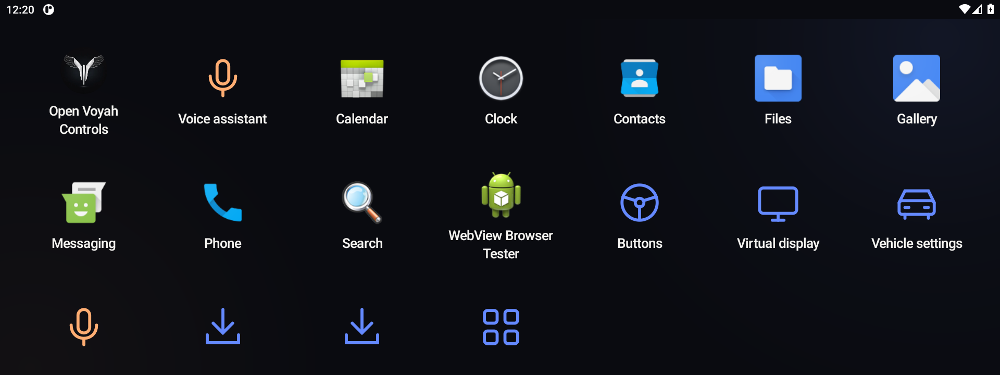

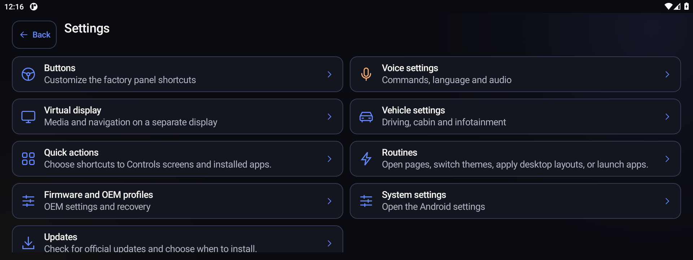

## Build

Use JDK 17 or 21, Android SDK Platform 35 and Build Tools 35.0.0, Node.js with npm, and Python 3. From this directory, set `JAVA_HOME` and `ANDROID_HOME` to your local installations and run the following commands.

```powershell
python tools/prepare_voice_model.py --language ru
python tools/prepare_voice_model.py --language en
npm ci
.\gradlew.bat :app:assembleDebug :app:lintDebug :core:test
npm test
```

The APK is written to `app/build/outputs/apk/debug/app-debug.apk`. On Linux or macOS, use `./gradlew`. The Gradle wrapper pins Gradle 8.11.1. The hook build bundles the pinned Frida Java bridge, and the voice preparation scripts verify the upstream Vosk archives. Both voice models and all agents are bundled for offline use.

The separate [YouTube Web app](../youtube-web/) has its own Gradle wrapper. The Controls build also keeps the `:youtube-web` tasks available. See [YouTube on the head unit](docs/YOUTUBE.md) for the build and APK paths.

## Button assignments

- For Android hardware keys, the accessibility service must be connected; setup enables it. **Enable button service** on the Buttons screen enables it again through the installer's local channel, which matters on firmware that has no Accessibility settings screen. Some firmware also drops the service from Android's list on every boot; Controls restores it after boot when setup added it. Then capture the desired key. Assign a tap action before adding a hold action. A missing target or a hold-only mapping leaves the whole gesture to Android. When only a tap is assigned, releasing a held key runs that action.
- Use **Install** in the Windows installer. It verifies the APK (a release, or an owner build whose certificate you trust) and runtime, saves the original startup script on the PC, provisions authenticated local Telnet through the OEM logcat startup entry, restarts the head unit by itself and confirms that the agents start on their own. Android uses that channel to start Frida; `su` is not required. The first-run screen checks the app connection, offline speech model, microphone permission, Accessibility connection, and each enabled reviewed handler.
- In the app, choose an app for a panel button and select **Connect Frida**. On the supported panel, the selected app supplies the icon and opens on a tap. On launchers with the foreground callback, the assigned icon highlights when its activity is active on that display. Hold the button to open its original action. Clear an assignment to restore the factory icon and tap action. The radio button is passenger position 4 on the inspected layout.
- With reviewed panel assignments enabled, a short press on the central lower-left menu button opens the Controls app grid by default. Holding it keeps the native launcher action. The grid opens without a Back button, sidebar or page header; Settings and other Controls tools are tiles.
- **OEM steering wheel buttons** supports reviewed Android 9/11 QG callbacks, with separate press and hold assignments for voice, custom and camera keys. A pinned CAN service APK can supply either short/long terminal events or down/up gestures; **Settings → System → Allowed actions** chooses between them. The down/up mode requires both targets to be available before capture and never replays a consumed physical gesture after a late failure. **Restore factory buttons** clears the assignments. Android hardware key bindings remain available through Accessibility. See the [adapter limits](docs/FIRMWARE.md#steering-and-display-adapters) and [JavaScript agent guide](docs/FRIDA_AGENTS.md).

The worker waits for Android and a stable system process before attaching. It reattaches when the target changes and can be stopped from the app. Connection status shows panel, voice, and optional hook readiness separately. The [boot and firmware guide](docs/FIRMWARE.md) covers the optional init entry and rollback.

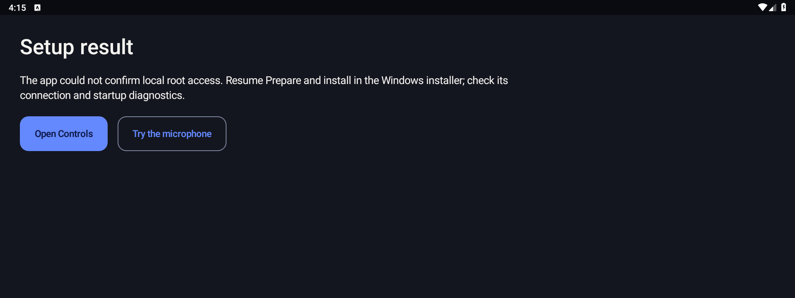

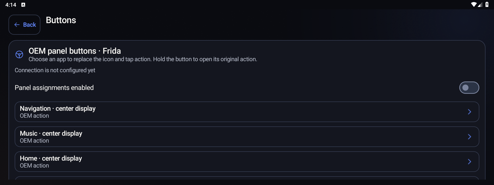

## Apps and displays

- The startup animation plays once per Android boot when the configured central panel is ready and the factory home screen is visible during startup. The vehicle's navigation menu opens the Controls app grid. The first tile, **Open Voyah Controls**, opens Settings, as does the app icon in the Android launcher. Android's system settings are available from **Settings → System → About and restart → System settings**.
- Tap an app tile in the root grid to open it. Touch and hold to open **App settings**, which contains width, DPI, permissions, display selection, **Hide from the app list** and **Close app**. Use the **Settings**, **Buttons**, **Voice settings** and other Controls tiles to open their pages in the same app window. On supported Android 9 and 11 firmware, the window service leaves room for the navigation panel on central display launches, including apps without saved settings. The [firmware guide](docs/FIRMWARE.md#steering-and-display-adapters) describes the launch and display scope. An [experimental option](docs/FIRMWARE.md#letting-android-reserve-the-panel-strip-experimental) lets Android itself reserve that room for every window instead; it is off by default and not yet verified on a head unit.
- **Settings → Windows and screens → App windows → Move windows with a swipe** turns on a two- or three-finger sideways swipe over an open app on the central screen. Left sends the app to the instrument cluster, which shows it in its navigation view; right sends it to the passenger screen. A left swipe on the passenger screen, a right swipe over the home screen or **Return windows** brings it back. It is on by default with three fingers and needs the window service on Android 11 and a firmware review of the operation. See [Moving windows between screens](docs/FIRMWARE.md#moving-windows-between-screens).
- The grid turns sideways page by page; dots below it show the page and open one on a tap. Select **Move** in **App settings** to drag apps to new places, across pages by holding an app at the screen edge, or tap the place for the picked app. A move keeps the order manual and is saved with the other grid settings.
- Select **Pin to app grid** in **App settings** to keep an app ahead of the other installed apps. Pinned apps retain their order and appear in search results.
- All apps starts without the firmware's own apps and internal actions, keyboards, service apps such as microG, and extra launcher entries of an app. Turn **Hide from the app list** on or off in an app's **App settings**, or for any app in **Settings → Home screen and apps → App grid → Hidden apps**; your choice wins over that default in both directions. **Hide firmware and service apps by default** turns the default off for every app at once. App pickers elsewhere (buttons, steering keys, voice, routines, quick actions, Favorites) offer the same apps, with **Show firmware and hidden apps** for the rest.
- **Settings → Home screen and apps → App grid** controls tile size, columns, shortcuts, app visibility, icon colors, captions and ordering. Select **Manual order** to arrange ordinary apps. The grid can add two named Favorites desktops with independent pins and a saved default. Choose a wallpaper, navigation and other information cards, phone favorites and a preferred media-card source for each desktop. **Desktop layouts** saves and reapplies the grid, cards and wallpapers together. Back can return from Favorites to **All apps**.
- **Settings → Appearance** controls transitions, text sizes, spacing, corner style, day or dark palette and contrast. Navigation labels and page titles can use separate sizes. **Settings → System → Start screen** chooses the page of **Open Controls**, and **Settings → Sound and media → Volume at startup** can lower the media volume when you use it.
- **Settings → Buttons and quick access → Quick action bar** configures the optional navigation dock. It reserves space in the Controls window and can keep the page width fixed as the side bar folds. Add **Seat memory**, **Routines**, **Vehicle routines**, or installed app shortcuts and choose where **Apps** opens. Use **Larger shortcuts** to give selected Controls buttons more room to tap. **Routine shortcut** runs a chosen routine in one tap. The headlight badge can show its source report over the current page. The Virtual display screen can use the full window.
- **Settings → Routines and automation → My routines** can apply a saved desktop layout, select a Controls page, use a temporary theme, and open an installed app. Pin routines you use often and choose when they run from the **Open Controls** shortcut. Pause automatic launches while keeping the schedule.
- **Install local APK** opens Android's local file picker. Controls verifies a bounded private copy before submitting the selected package to Android for confirmation. The Controls APK itself must use Updates or the Windows installer.
- **YouTube** is a separate app built from this repository: YouTube's touch site in the system WebView, for head units without Google services. Once installed it is an ordinary tile with its own window, DPI and **Hide** settings, pauses when its window is hidden and exposes a media session. See [YouTube on the head unit](docs/YOUTUBE.md).
- The **Permissions** section lists an app's runtime permissions and special accesses. For an app installed on top of the firmware, from Controls, Windows or another store, switches grant or revoke a runtime permission and turn display over other apps, modifying system settings, installing unknown apps, all files access and usage access on or off. The authorized local channel applies each change and reads Android's state back to confirm it, since Android does not tell an ordinary app another app's special access; Android keeps the result across normal reboots. Firmware and maker apps, the launcher, the keyboard and Controls itself are shown read-only. **Android app info** and other Android settings pages appear only where the firmware has them.
- **Uninstall** removes such an app with its data after a confirmation, through the same local channel, and the grid drops it at once; firmware and maker apps, the launcher, the keyboard and Controls itself offer no **Uninstall**.
- **Close app** force-stops such an app after a confirmation, the way Android's app info would. It is offered only while Android reports the app as running, and never for firmware apps, the launcher, the keyboard, Controls itself, or an app with an enabled accessibility or notification service, because a force stop would turn that service off for good on a firmware without the settings screen to turn it on again.
- **Virtual display** creates a private display with its own DPI. Grant media access to show the current track and configure album art, progress and playback controls. Choose the pane arrangement, preferred player and seek interval. Route options include current and next roads, Latin lettering and distance units. Instrument cluster media sharing and navigation require the matching OEM cluster service.

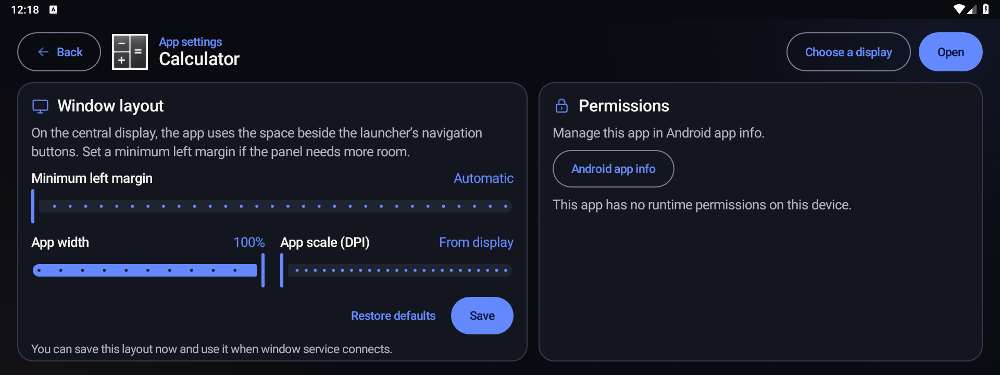

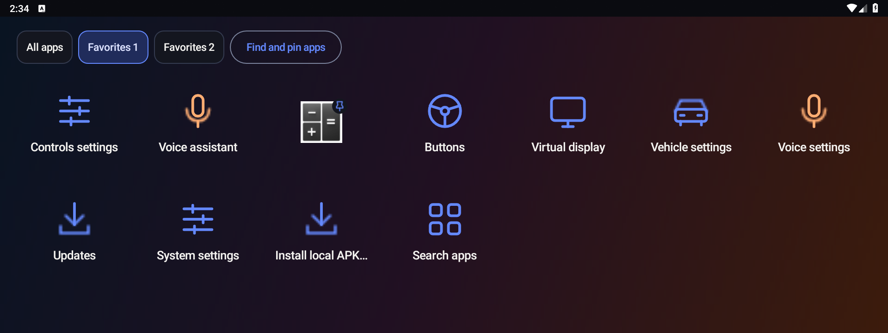

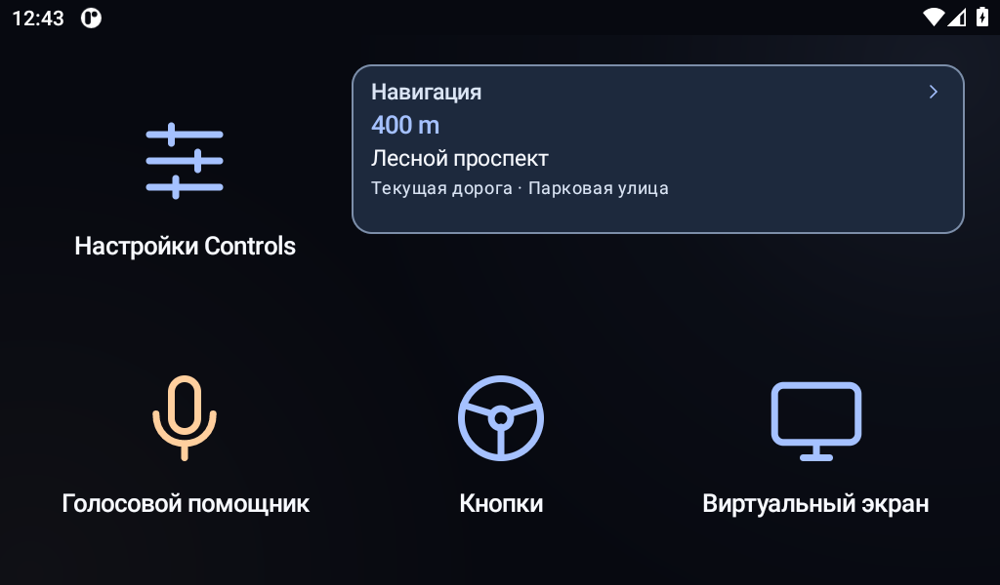

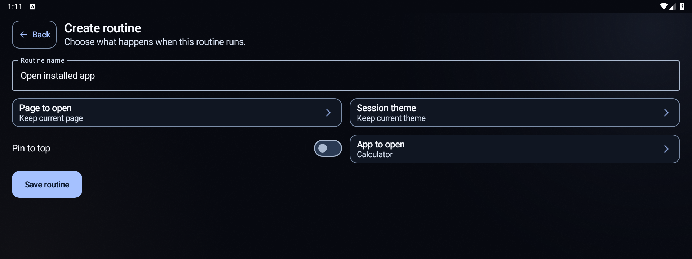

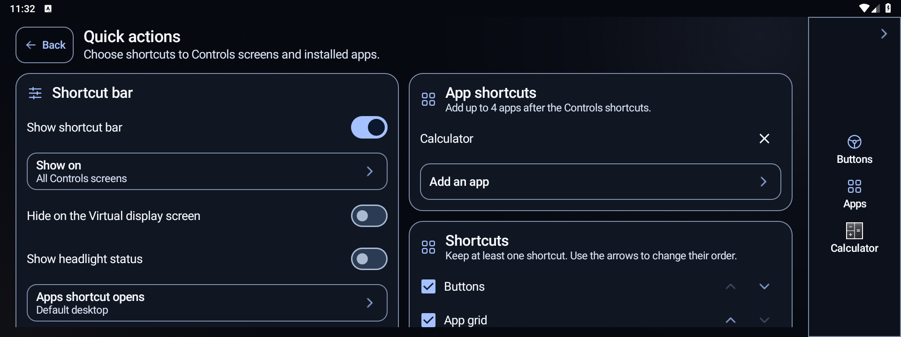

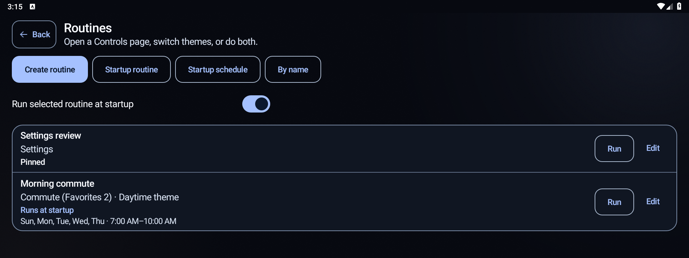

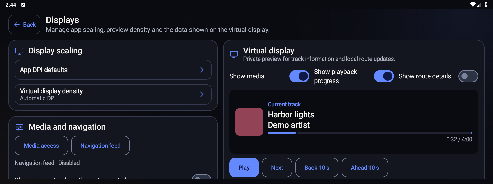

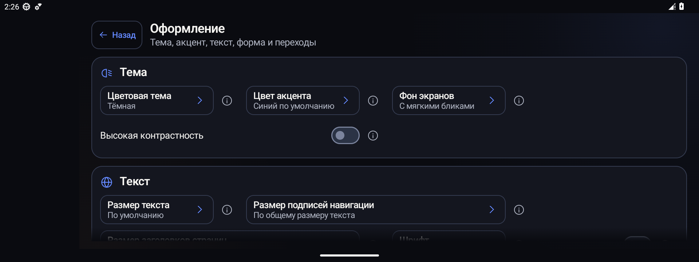

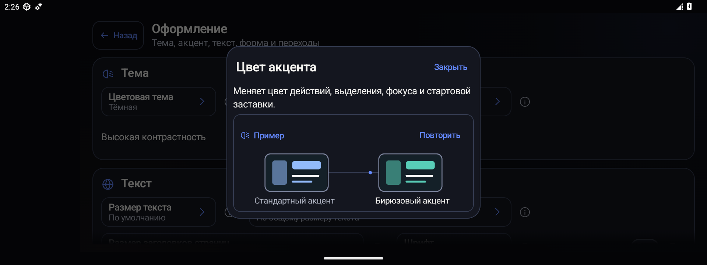

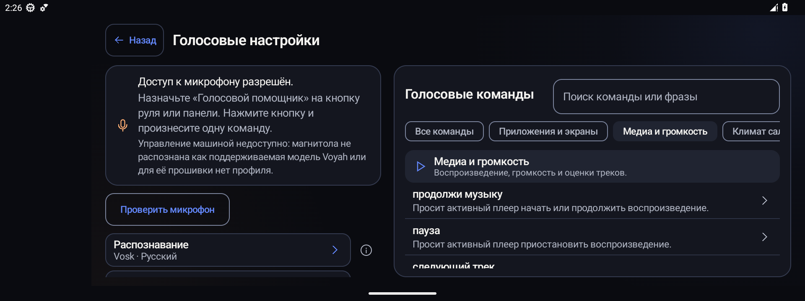

## Keyboard

**Settings → Language and input → Keyboard** replaces the factory keyboard of the central display with an installed one, such as Yandex Keyboard, and **Factory keyboard** brings it back in one tap. The firmware selects its own keyboard by language and ignores Android's choice, so the window service keeps the selection, and the page keeps a choice only after Android has bound that keyboard. A keyboard that is removed, switched off or keeps crashing gives way to the factory one. The passenger display keeps its factory keyboard. See [Firmware: keyboard of the central display](docs/FIRMWARE.md#keyboard-of-the-central-display).

## App updates

Open **Settings → System → Updates** to check official releases, see the installed version, or disable the default startup check. Downloads and installation require **Download and install**. Controls verifies the APK and positively checks that its runtime is paused before Android asks for installation approval. Interrupted attempts remain recoverable without automatic resubmission. See [App updates](docs/UPDATES.md) for the verification and recovery behavior.

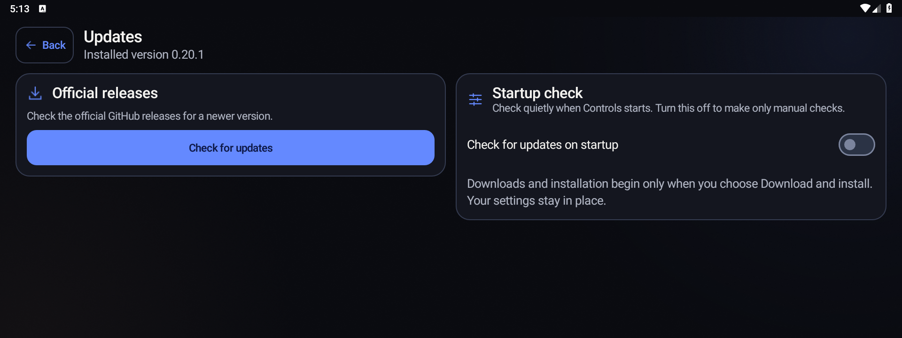

## Diagnostic log

Open **Settings → System → Diagnostics → Diagnostic log** to read what Controls recorded on this head unit: connection attempts, update checks, refused operations and failures, newest first. The log can be limited to warnings and errors, copied, saved to a file or cleared; the app sends it nowhere. Entries name operations, outcomes and error types and never contain voice phrases, contacts, media titles or keys. See [Diagnostics and logging](docs/DIAGNOSTICS.md).

## About and restart

**Settings → System → About and restart** shows the version, build type, commit and install date, which can be selected or copied for a bug report. **Restart Open Voyah Controls** reopens the app while the car agents keep running. **Restart multimedia** restarts the factory media center and the music, radio and video players without touching car services. **Restart the system** reboots the head unit after a confirmation and only in Park. Both root restarts are allowed by default and can be marked unverified or forbidden in **Settings → System → Allowed actions**, which lists every root operation, Frida agent channel and vehicle voice command with **Allowed**, **Unverified** or **Forbidden**. See [Saved settings: About and restart](docs/SETTINGS.md#about-and-restart) and [Allowed actions](docs/SETTINGS.md#allowed-actions).

## Vehicle settings and maintenance

Open **Settings → Vehicle** for the original driving, cabin and infotainment menus. A shortcut appears when Android offers a public launcher entry from the matching built-in app. Use the factory panel when a shortcut is unavailable. The driver uses the original controls to enable and use driving assistance, including Apollo on applicable models. The page also links to the [VOYAH owner manuals](https://www.voyah-global.com/service).

**Firmware and OEM profiles** groups compatibility, translation and recovery. The cluster screen separates package inspection, backup, and confirmed installation or restoration. See [Instrument cluster localization](docs/CLUSTER.md).

**Settings → Vehicle → Seat and mirror memory** shows three cards for **Driver 1** through **Driver 3**. Each card has a large seat illustration with **Restore** and **Save** below it. An optional switch opens the dedicated factory Seats screen in one tap where the shortcut is available. Save through the factory seat controls and wait for the car's confirmation. On firmware without reviewed direct recall, saying a driver number opens the instructions for that slot. Direct recall requires individually reviewed firmware, Park and zero speed. See [Driver seat and mirror memory](docs/DRIVER_MEMORY.md).

The **Headlight mode** card in **Vehicle settings** opens the factory lighting screen where the shortcut is available. Controls can show the selector and its last confirmation. On Android Automotive with the manufacturer's read permission, it also shows and remembers the separate headlamp and high-beam readings. Choose either set of readings for the headlight desktop card. Enable **Monitor while Controls is open** to keep observing on other Controls pages. See [Headlight mode](docs/HEADLIGHT_STATUS.md).

**Settings → Routines and automation** configures headlight actions for Drive/Park, summer and winter climate presets, actual driving-mode memory and **If–then rules** that run an existing saved routine. The page also shows the admitted gear, speed, outside temperature and door readings with their receipt time; an expired or unqualified value is never displayed as current. Open the page directly from its **Vehicle routines** tile in the app grid or from **Controls settings**. Climate presets retain outside-temperature thresholds, gear and door conditions, zone temperatures, fan level and optional seat heating or ventilation. Enabled automation continues while Controls is closed through its existing Accessibility service; without that service it runs while Controls is visible. Both owners share one runtime. Initial readings, reconnects and expired signals never replay a saved action. Settings can be configured without the vehicle; physical actions still require the exact firmware and individual command approval.

**Settings → Vehicle → Apollo and driving assistance** offers the factory assistance page and the general vehicle menu when the head unit makes them available. Guest users can open the same shortcuts and read Apollo diagnostics. **Answer for the factory page** lets Controls reply inside the factory settings app: **Show Apollo controls in Guest** gives the page its own subscribed answer while the switch is on and takes it back when it is off, with nothing written to the vehicle. **Send the assistance state to the controller** asks once, only while the car is in Park and stopped, and is never repeated by a neighbouring switch; **Use the Baidu equipment branch** is experimental too. Both ask before they start and cannot be undone from the head unit. An accepted request is not a confirmed controller state, and a report from an older switch position is not shown as current. Write what the factory page shows into **What the factory page showed** and it is saved with the report as your own note. **Copy support details** copies the head unit's Android build and available factory settings package details for a support request. The factory app handles account, training and service access. The FREE 318 guide explains the factory setup and assistance indicators. **Read-only diagnostics** copies firmware identity, source results, existing light history and the specific signals still needed for H97D qualification. See [Vehicle automation and H97D qualification](docs/VEHICLE_AUTOMATION.md) and [Apollo controls in Guest and factory eligibility](docs/APOLLO_GUEST_DIAGNOSTICS.md).

An [alternative Apollo activation candidate](docs/APOLLO_CANDIDATE.md) has a separate reversible fixture trial and exact admission policy. The normal APK can inspect installed package identities and explicitly read the 18 named factory request-cache fields, then save a diagnostic report. Cached requests do not prove controller state or provide a rollback. There is no production activation adapter or approved vehicle operation. Complete backup, independent restoration of all affected controller fields and native asynchronous completion remain unverified on H97D.

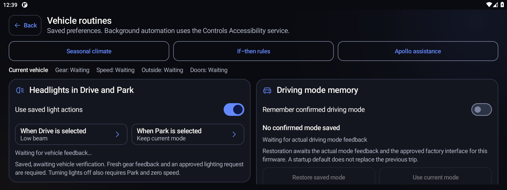

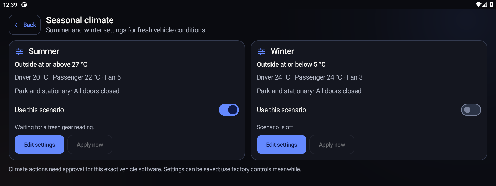

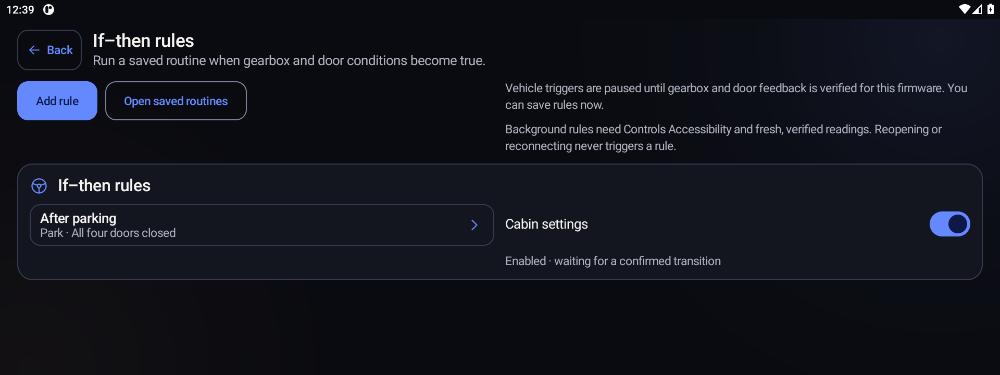

**Settings → Vehicle → Service reminder** calculates the next service odometer reading and the remaining distance from the mileage and interval you enter. Choose how many kilometers before service to show the reminder. Settings backups include the service plan and readings.

The [OEM account-record recovery limits](docs/ACCOUNT_RECOVERY.md) describe account A/B/C and the narrower saved-record recovery scope.

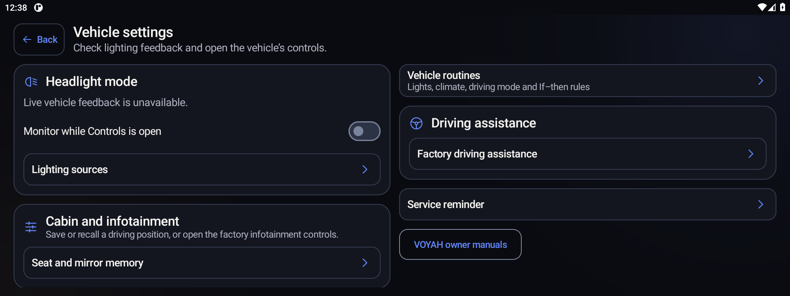

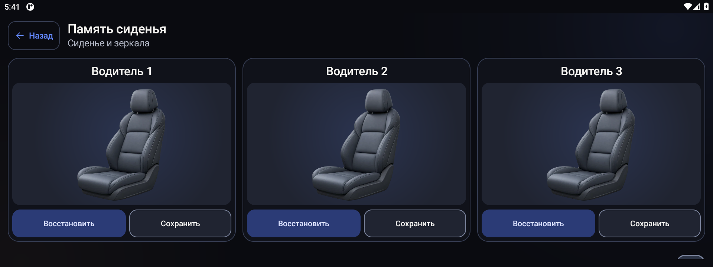

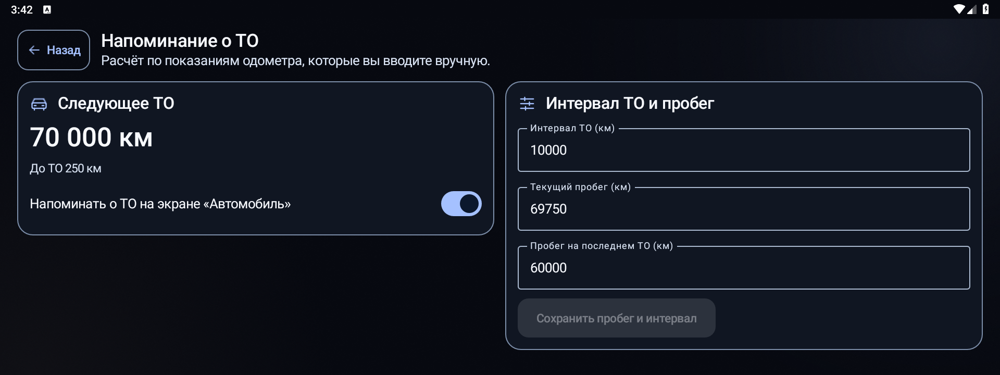

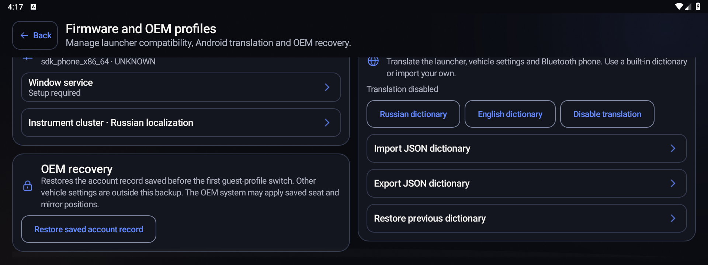

## Settings backup

Use **Export app settings** to save button assignments, voice options and contacts, display settings, app window profiles, desktops and named layouts, appearance, reminders, quick actions, routines and vehicle preferences in one file. Vehicle routine settings, seasonal presets and conditional rules are included. **Import app settings** validates the file before applying it and accepts earlier full or button-only exports. Preferences introduced after the file was created keep their current values. If a restore is interrupted, the app restores the previous local settings at the next start. The vehicle stores seat and mirror positions. Confirmed lamp and actual driving-mode history stays in private local storage; an import never becomes vehicle telemetry. See the [saved settings inventory](docs/SETTINGS.md).

## Where Frida runs

Controls itself is an ordinary app and never runs as root. A one-time setup from the PC adds two guarded entries to the OEM boot script, which already runs as root. One starts the authenticated local channel on `127.0.0.1:2323`, the other starts the reviewed boot worker. Through that channel the app deploys the bundled agents and the pinned Frida injector to `/data/adb/open-voyah-controls`. One supervisor per target waits for its process and runs the injector as root. The injector loads the JavaScript agent into the launcher or `system_server`, where it runs with that process's identity and permissions.

There is no Frida server. The app reaches the agents only through `Settings.Global` keys, and reads their replies from the `hook.log` lines through the same channel. Dashed boxes are optional targets, deployed only for reviewed packages. See [JavaScript agents and the root boundary](docs/FRIDA_AGENTS.md) and [injection targets](docs/INJECTION_MAP.md).

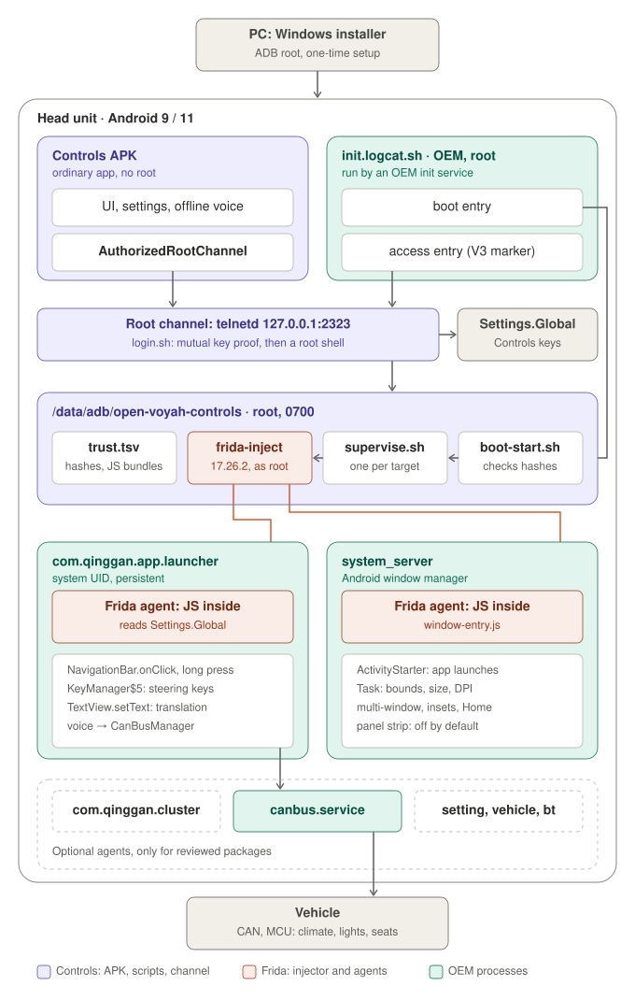

## Code layout

The existing Gradle modules contain logical MVVM and Clean Architecture layers. `youtube-web` is a separate app with no dependency on the others. `core` owns Android-free command rules, button timing, typed display events and ports. Within `app`, presentation ViewModels expose immutable StateFlow state, data adapters own preferences, document serialization and Frida gateways, and platform adapters handle Android intents, permissions, media, input, audio and job events.

`MainActivity` hosts the app grid and normal Compose routes for Settings, Buttons, voice settings, display, vehicle, firmware, cluster and updates. `QuickVoiceActivity` is the foreground popup; `SetupActivity` handles the installer and first-run handshake. Both have permission-protected external entry points. Android owns file pickers, permission and installation dialogs, system settings and the native virtual-display surface. The injected Qinggan bus adapter lives under `hooks`. See [Compose routes and motion](docs/COMPOSE_UI.md) for lifecycle and rendering boundaries.

## Documentation

- [Voice commands and settings](docs/VOICE.md)
- [Driver seat and mirror memory](docs/DRIVER_MEMORY.md)
- [Firmware, profiles, and text localization](docs/FIRMWARE.md)
- [Head unit qualification and recovery](docs/PRODUCTION.md)
- [Injection targets, screens and button mappings](docs/INJECTION_MAP.md)
- [Factory launcher home screen map](docs/HOME_SCREEN_MAP.md)
- [JavaScript agents and the root boundary](docs/FRIDA_AGENTS.md)
- [Compose screens and motion](docs/COMPOSE_UI.md)
- [Diagnostics and logging](docs/DIAGNOSTICS.md)
- [Instrument cluster packages, backup, and recovery](docs/CLUSTER.md)
- [YouTube on the head unit](docs/YOUTUBE.md)
- [OEM account-record recovery limits — technical appendix](docs/ACCOUNT_RECOVERY.md)
- [Third-party dependencies and licenses](THIRD_PARTY.md)
