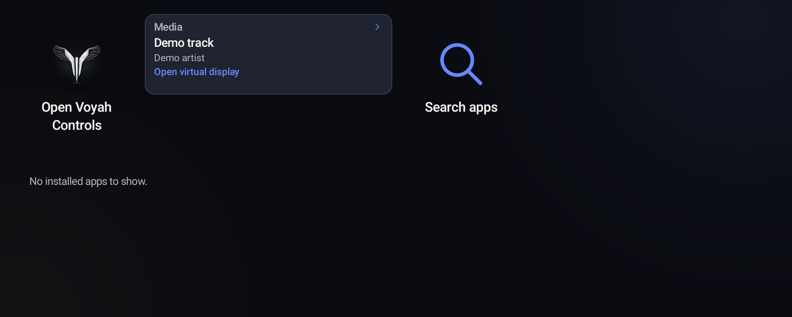
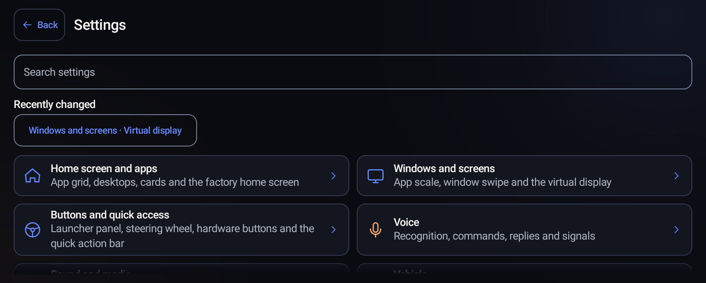

# Open Voyah Controls for Android

**Interface languages — English, Russian and Kazakh.** [README на русском](README.md)

Customize the widgets on OVC Home, including the music widget and its source on each desktop. Arrange your apps, save layouts, assign buttons, and use offline voice recognition. Russian recognition is built in on ARM64. English, Kazakh, and a backup Russian model are available to download.

| Home with the music widget | Settings |
| --- | --- |
|  |  |

**Companion apps** include [YouTube Web](https://github.com/siarheisinelnikau/youtube-web), [Voyah Music](https://github.com/siarheisinelnikau/voyah-music), and [Voyah Radio](https://github.com/siarheisinelnikau/voyah-radio).

[Project overview](../../README_EN.md) · [Releases](https://github.com/siarheisinelnikau/open-voyah-controls/releases) · [GPLv3](../../LICENSE)
