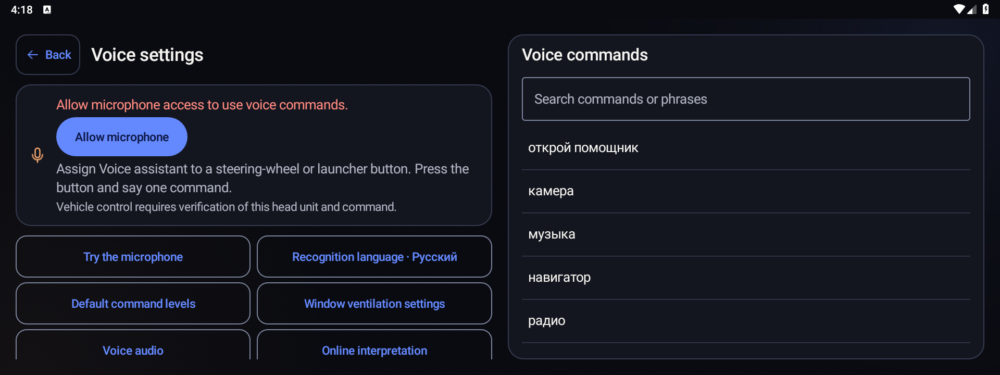
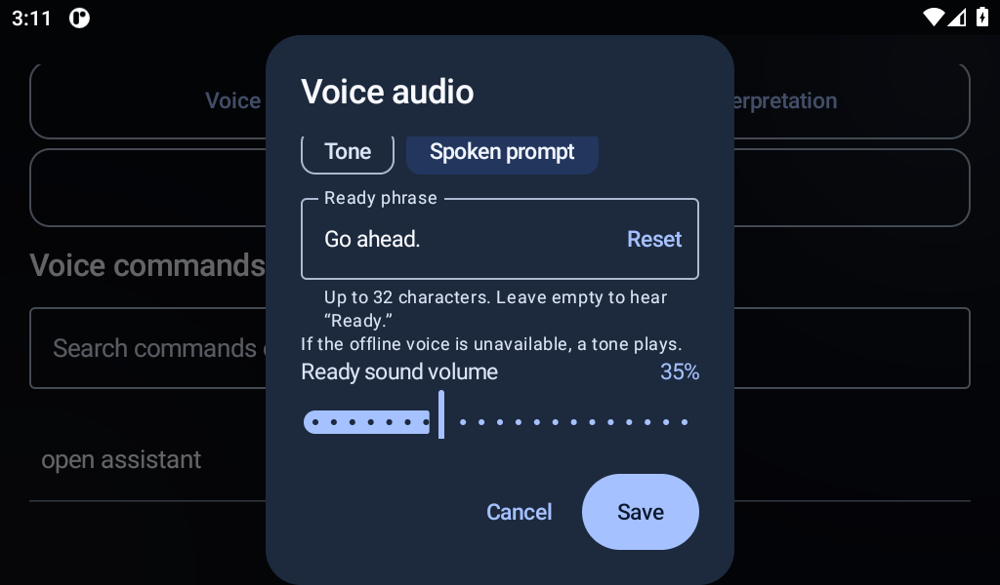

# Voice commands

A short press of the steering-wheel voice key opens **Voice assistant** by default on a supported vehicle profile. You can also assign it to another steering-wheel or launcher button. To keep the factory voice key, choose the factory action for it under **OEM steering wheel buttons**, or use **Restore factory buttons**. Press the button and say one command. A small Android dialog opens over the current app and starts the microphone. It briefly shows the result and returns to the underlying app. A second press closes an active dialog.

The app recognizes 138 command IDs in English, Russian and Kazakh. The recognition language is separate from the interface language. **Voice settings** contains the command catalog and app assignments. **Settings → Voice → Recognition** groups the speech engine, the recognition language, the downloadable models and the optional online interpretation.

- [English catalog](../core/src/main/resources/voice-catalog-en.tsv)
- [Russian catalog](../core/src/main/resources/voice-catalog.tsv)
- [Kazakh catalog](../core/src/main/resources/voice-catalog-kk.tsv)

## Engines, languages and models

Both engines run on the head unit without internet.

| Engine | Languages | Model | How it recognizes a command |
| --- | --- | --- | --- |
| Vosk | Russian, English, Kazakh | Russian and English ship in the APK; Kazakh `vosk-model-small-kz-0.42` is downloaded (60 MB) | Decodes only the catalog phrases and accepts a phrase when every word reaches 0.65 confidence |
| Zipformer | Russian | `sherpa-onnx-zipformer-ru-int8-2025-04-20` with the Silero voice activity detector, downloaded (74 MB) | Silero ends the phrase after 0.5 s of silence. The Zipformer decodes it with the catalog phrases as hotwords, and the text must be at least 85% similar to one catalog phrase, closer to it than to any other |

In an offline comparison on synthetic Russian speech with cabin noise, both recognized about nine commands in ten. Vosk acted on about a quarter of phrases that only resemble a command, and the Zipformer on none. The comparison is a ranking, not the accuracy to expect in the car. A choice of Zipformer applies to Russian; English and Kazakh keep Vosk. Without its model on the device, the app uses Vosk. If the Zipformer cannot start on the head unit, the same request continues with Vosk and the popup says **Listening with Vosk: Zipformer did not start**. Recognition then names the error under Zipformer, and the diagnostic journal records `event=voice_engine_fallback`. Voice keeps using Vosk until Zipformer is chosen again or its model is downloaded again. On the supported Android 11 unit, loading the Zipformer takes about 13 s the first time; afterwards it is prepared in the background at start like Vosk.

**Download** fetches a model from its publisher at a fixed revision: Hugging Face and the sherpa-onnx releases on GitHub for the Zipformer, Alpha Cephei for Vosk Kazakh. Every file must match its pinned SHA-256 and size before the model is installed; a cancelled, interrupted or changed download installs nothing. The download continues when the section closes and needs free space for the unpacked model. **Delete the model** removes it; the app then returns to Vosk for that language. The diagnostic journal records `event=voice_model_download` with the model, its outcome, the bytes received and the elapsed time.

The Kazakh catalog was written for this app and still needs a review by a native speaker. Download the Vosk model beside **Қазақша** under **Settings → Voice → Recognition**, then select that language. It works offline after the download. The Controls interface language is a separate choice under **Settings → Language and input**. Kazakh number words are passed to the vehicle agent in their Russian form for the sunroof, sunshade and charge-level commands. Spoken feedback in Kazakh needs an installed Kazakh text-to-speech voice.

Building the APK needs `dist/sherpa-onnx-2.0.2.aar` from the [sherpa-onnx v2.0.2 release](https://github.com/k2-fsa/sherpa-onnx/releases/tag/v2.0.2) (Apache-2.0). Gradle checks its pinned SHA-256. Only its arm64-v8a JNI library and onnxruntime are packaged (about 28 MB), so the Zipformer runs on arm64 head units only.



Android asks for microphone permission on the first request. Once the microphone starts, the app listens for up to four seconds by default. Set the limit to three, four, or six seconds in **Voice audio → Listening and popup**. Offline actions need a final catalog match that passes the decoder confidence check. Silence and unfinished phrases end the capture. When the speech is not a confident command, Vosk makes one more local pass over the same audio without the command grammar. The popup then shows what it heard and **No matching command** below it, or a short **Command not recognized** when nothing was heard clearly. A heard phrase is only shown; it never runs an action. The popup keeps one size from listening to the result. The app prepares the speech model and the command recognizer for the selected engine and language in the background when its process starts, for example after boot, and keeps them loaded, so the first press of the voice key starts listening at once. This happens only after the microphone is allowed and never opens the microphone. One model is loaded at a time: changing the engine, the language, contacts or restored settings prepares the new set and frees the previous model first; so does a finished download for the selected engine. A request made while the model is still loading waits for that load. The diagnostic journal records each step as `event=voice_model_prepare` with `model` (`vosk:ru`, `zipformer:ru`, …), `trigger` (`startup`, `settings`, `download`, `repair`, `setup` or `request`), `outcome` (`ready`, `reused`, `failed` or `skipped`) and `elapsed_ms`.

Every vehicle command is allowed by default on a supported Voyah head unit (a product listed in [Firmware](FIRMWARE.md), Android 9 or 11, arm64); **Settings → System → Allowed actions** can mark a command unverified or forbid it. App, media, and dialer commands are not part of that list. Commands that are safe while driving (lighting that keeps the road lit, screen brightness, climate, seat and wheel comfort, windows and roof, drive, energy and regeneration modes) run in any gear. Lights off and position lights, doors, trunk, filler flaps, seat memory, service modes, accounts and any new command need a fresh Park and standstill check. On a head unit that is not a supported product it answers **Vehicle control is unavailable: this head unit is not a supported Voyah model or its firmware has no identity profile**; see [Vehicle commands on your own head unit](#vehicle-commands-on-your-own-head-unit).

A recognized vehicle command is sent as soon as the phrase is decoded; the spoken readback runs alongside it, not before it. The phrase is decoded while the end sound plays. The request goes to the launcher agent in one root call that checks the agent, publishes the request and waits for the agent's reply, which is looked for every 0.1 s. The installed APKs are hashed once per app process, while the first popup is still listening; every command still checks that their paths and file stamps are unchanged, and a change makes the next command hash them again. On the supported Android 11 unit this takes the time from the end of speech to the vehicle request from about 7–9 s down to roughly 1.5–2 s (to be confirmed on the car).

The result distinguishes a vehicle service acknowledgment from a change confirmed by fresh telemetry. If feedback is partial or the outcome is unknown, the app ends the request and shows that result. Vehicle qualification also checks who can submit requests on the reviewed firmware and what happens when feedback or power is lost during motion.

“Driver one/two/three” (Russian: “водитель один/два/три”) selects the corresponding **driver seat and mirror memory** slot 1/2/3. Direct recall requires **P (Park)** and zero speed. The service reply acknowledges the request. When the recall command is forbidden in **Settings → System → Allowed actions**, the phrase opens the numbered Restore instructions instead and the recall is finished in the factory seat controls. Save positions through the factory seat controls. See the [driver-memory guide](DRIVER_MEMORY.md).

“Driver A/B/C” concerns separate OEM accounts. Those commands do not select the numbered memory slots. Overseas account switching remains unavailable; see [OEM account-record recovery limits](ACCOUNT_RECOVERY.md) for the distinct account and recovery boundaries.

## Vehicle commands on your own head unit

The app and the launcher agent both allow every vehicle command on a supported product. The app refuses a command forbidden in **Settings → System → Allowed actions** before anything is sent, with **This command is forbidden in Settings → System → Allowed actions**; an Unverified command runs and leaves `event=action_unverified_use action=voice.<ID>` in the journal. The agent keeps every safety check below.

`app/src/main/assets/voice/verified-commands.json` (shipped empty) and, in a local-vehicle debug build (`-Povc.localVehicle=<folder>`), an optional `verified-commands.json` in that folder only mark commands as **Verified on this firmware** in Settings. Gradle refuses to package a build with local rows as release. A row looks like this:

```json
{
  "schema": 1,
  "headUnits": [
    {
      "product": "f6802h",
      "fingerprint": "<ro.build.fingerprint, exactly>",
      "sdk": 30,
      "abi": "arm64-v8a",
      "profile": "FREE_REST",
      "commands": ["GetFromMemoryCellOne"]
    }
  ]
}
```

- `product`, `fingerprint`, `sdk` and `abi` must equal `Build.PRODUCT`, `ro.build.fingerprint`, the SDK level and the first ABI of the unit. After a firmware update the marks disappear; the commands keep running.
- `profile` is the app's family for that product (`Firmware.identify`), for example `FREE_REST` for `f6802h`.
- `commands` uses the command IDs from the first column of the [catalog](../core/src/main/resources/voice-catalog.tsv). List one head unit once. A malformed row or a second row for the same unit stops the build.

Mark a command verified after it has done the right thing on that car:

1. Optionally set it to **Unverified** in **Settings → System → Allowed actions** while you test, so each use is journaled.
2. With the vehicle in **P**, say the command. Expect **The vehicle accepted the request.** and check the physical result yourself: the message confirms only that the request was accepted, not the final state. The diagnostic journal records `event=voice_vehicle_dispatch command=<ID> outcome=<result>`, and the launcher worker's `hook.log` the agent's `OVC_VOICE_RESULT`.
3. For a Park-only command, select **D** with the brake held and say it again: it must be refused with **Shift to Park to use this command** and nothing may move. A command allowed while driving should do the same thing in **D**.
4. If both results are right, add the command to the local `verified-commands.json` and rebuild (installing revokes boot activation, so provision the unit again). Otherwise set it to **Forbidden**.

**Settings → Voice → Vehicle commands** is a shortcut to the voice group of **Settings → System → Allowed actions**: every vehicle command of the catalog with a switch, on by default. Switching one off forbids it for voice, seat memory, vehicle routines and seasonal climate; a forbidden driver-memory phrase opens the numbered Restore instructions again. Switching it on again keeps an Unverified mark. **Switch all on** and **Switch all off** change the whole list. The choices are part of the settings export (`actionPermissions`); switches saved by earlier versions become Forbidden once.

The agent decides which commands need Park (`MOTION_COMMANDS` in `hooks/voice-safety.js` lists the ones that do not). For the others it reads the live gear and speed within 500 ms before every write, whatever the catalog says.

## Apps and media

To assign an installed app, select a command and choose **App…**. Music, navigation, radio, and camera use your assignments. Without an app chosen here, music and its restart open the app of the central music panel button (`navbar02`), navigation and its restart the app of the central navigation button (`navbar01`), and radio the app of the passenger radio position (`navbar14`, standard layout), when that button has an app assigned. Otherwise the command asks you to assign an app, as before. **Open assistant** uses the Android assistant unless you choose another app for that command. **Controls settings** opens this app's settings.

Playback keys and volume use Android media controls. Say “volume fifty percent” in English or “громкость пятьдесят процентов” in Russian to set a percentage from 0 to 100. Ratings require media session access and a supported rating type in the active player.

Say “make it louder” or “сделай громче” for a volume step. Say “restart navigation” or “перезапусти навигатор” to clear and reopen the task for the assigned navigation app. Music restart works the same way. Assign the target through the **Music** or **Navigator** command in the catalog.

## Optional online interpretation

Open **Settings → Voice → Recognition → Online interpretation** to enable OpenRouter with your own API key. OpenRouter never receives audio. Exact catalog phrases still run locally. For a completed phrase outside the grammar, the result of the local pass without the grammar is sent to OpenRouter only if it meets the confidence check, and only its short text. A phrase cut off by the listening limit is never sent.

The free router can return one of four actions: raise volume, lower volume, restart the assigned music app, or restart the assigned navigation app. Only a validated choice from the list triggers an action. Free model availability and rate limits can vary. Android Keystore protects the API key, and app settings exports omit it.

## Voice audio and climate

In **Voice audio**, you can lower media while the microphone is listening and during phone calls. Both switches are on by default, and **Media level while lowered** keeps 35 %, 20 % (default) or 10 % of the current media level, or silences it. Media fades down in about a tenth of a second when the ready signal starts and fades back in about half a second when the microphone closes and no call is active, so a volume command such as “louder” runs at your own level. A call is followed through the head unit's Bluetooth phone (`Settings.Global phone_call_status`), and listening that overlaps a call keeps media low until both have ended. Controls does not undo the Bluetooth phone's own mute during a call. If you change the volume while media is lowered, by hand or with a volume command, your level wins and nothing is restored over it; a relative command such as “quieter” steps from your level before the duck. The level from before the duck is saved first, so if Controls is stopped while media is low, the next start of Controls fades it back, unless the volume was changed since. Listening also requests ducking audio focus, which the head unit's focus engine may ignore. **Media volume at startup** (on, 10 % by default) sets the media level once per head unit boot, as a share of the maximum. Controls applies it when it starts with the boot broadcast and records the boot count, so restarting Controls later in the same boot leaves your level alone, and it skips the boot entirely if Controls starts more than three minutes after it. The startup level also replaces a level that a stopped Controls had saved while media was lowered, so an older level is never restored over it. Spoken feedback reads back the command using an installed offline Android voice in the recognition language. Set the rate and volume, or choose a specific installed voice and play a sample. Controls remembers the choice independently for English and Russian. Automatic selection uses a compatible installed voice when the chosen voice is unavailable.

Choose whether feedback repeats the recognized command or announces its result. The result distinguishes an accepted request from a confirmed vehicle response. **Spoken reply channel** selects Android's Assistant or Media audio channel for feedback and voice samples. The optional **Ready signal** plays a tone or a short spoken prompt before recording. In spoken mode, set a custom ready phrase for the current recognition language or restore its built-in phrase. A tone plays if the offline voice is unavailable. The optional end sound plays after the microphone is released and before spoken feedback, with its own volume. **Listening and popup** controls how long the result stays visible and whether it includes the recognized phrase.



On the inspected H97 branch with front climate on, use **driver temperature**, **passenger temperature**, or **fan speed** with a value. Temperature accepts 16–30 °C, and the fan accepts 1–8. The popup shows the result and, by default, the recognized phrase. Other branches need separate verification.

## Contacts, backup, and recovery

Add local contacts under **Voice settings and recovery**. A matched contact command opens the Android dialer with the selected number. Export or import voice settings independently of button assignments, or use the main screen to back up the app settings together. Use **Restore** to return to the previous settings or to restore the bundled speech model.

The app checks vehicle commands before making changes. A lost response does not cause it to replay an action. Compatibility with the vehicle's systems remains unverified. See [Firmware and profiles](FIRMWARE.md).
