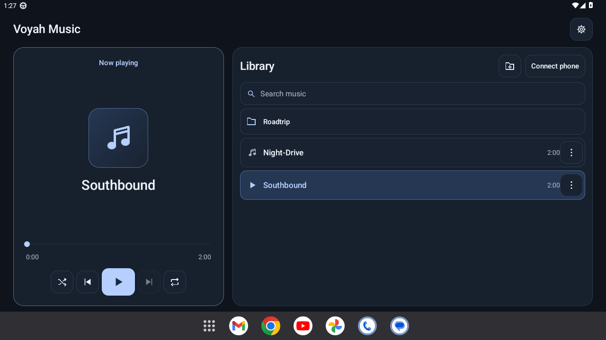
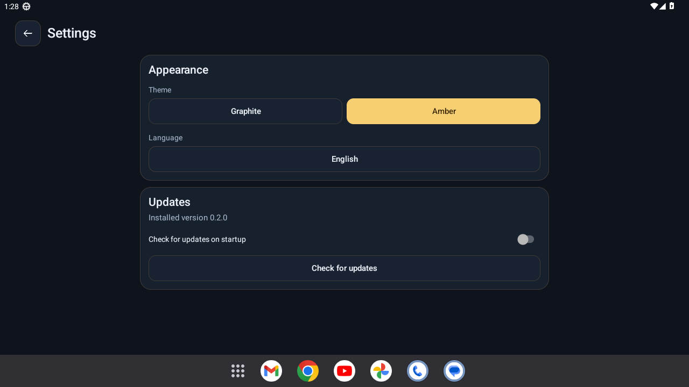
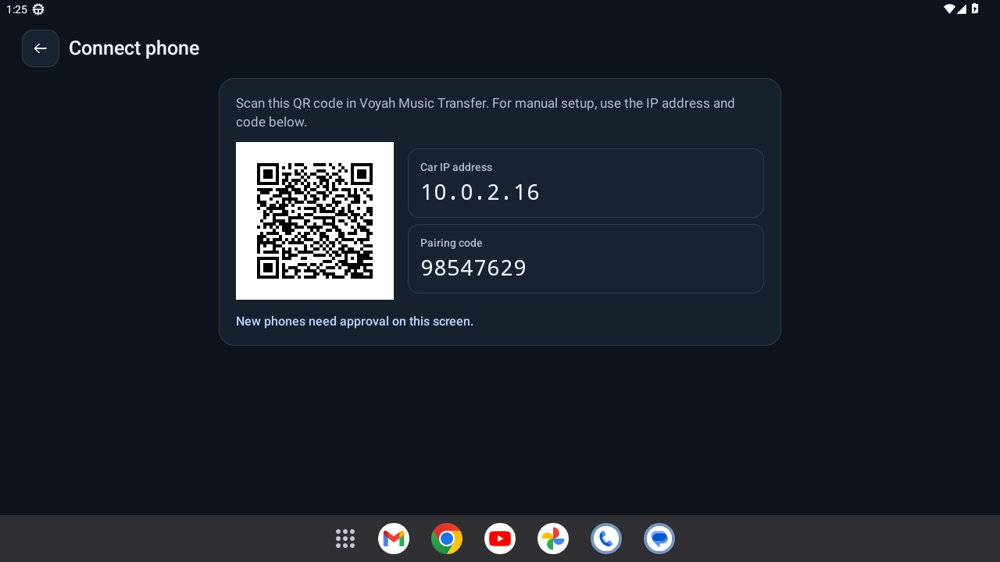
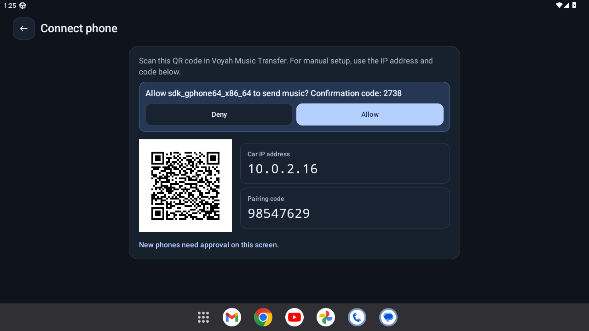
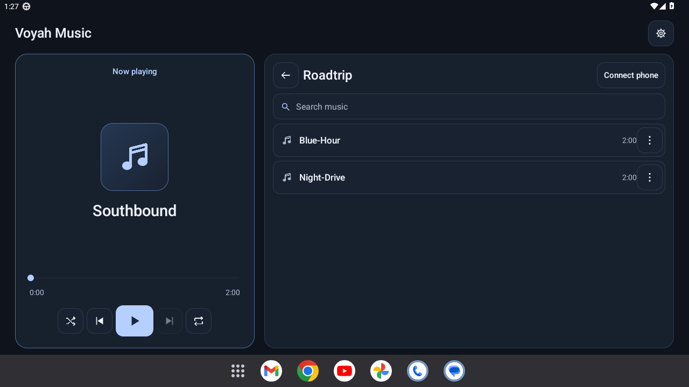

# Voyah Music

Voyah Music plays local music on the car's Android display. Its companion, **Voyah Music Transfer**, sends audio files from an Android phone over the car's Wi-Fi. Both apps support Android 9 or later, English, Russian, and Kazakh, with the graphite and amber palettes from Voyah Radio.

## Connect a phone

1. Install **Voyah Music** on the car's head unit and **Voyah Music Transfer** on your phone. Use v0.2.0 or later on both devices. The v0.2.0 transfer protocol requires both apps to be upgraded together.
2. Connect the phone to the car's Wi-Fi. You can also put both devices on the same Wi-Fi access point.
3. On the head unit, tap **Connect phone**. In Voyah Music Transfer, tap **Scan QR code** and point the camera at the car screen. **Enter IP and code** provides a manual option with the address and eight-digit code displayed beside the QR.
4. Compare the four-digit confirmation on the phone and the car screen, then tap **Allow** in the car. After approval, return to the library. The phone displays its connection at the top of the screen.

Voyah Music Transfer remembers one car. **Disconnect** pauses the connection and cancels any active transfer. **Connect** resumes without another approval as long as the car still trusts the phone and its address is the same. On the car's connection screen, **Trusted phones** can remove access to individual phones.

## Send and organize music

Use the folder-plus button in the car library to create a top-level folder. The root library can hold both folders and tracks. Tracks that were already on the head unit stay in the root when upgrading. Choose **Move to folder** in a track's menu to organize existing files.

In Voyah Music Transfer, choose a destination under **Send files to**, select one or more audio files, and tap **Send to car**. Keep Voyah Music open on the head unit during sending. Select a track to play it, and use the position slider to seek. The player also supports previous and next, shuffle, repeat, background playback, and system media controls.

Audio is stored privately on the head unit and remains available when the phone disconnects. The library shows embedded tags when available and supports search by title, artist, album, or filename. The root search also finds tracks inside folders. Identical audio is kept once across the library. To change the location of an existing copy, move it from the track's menu.

The file picker accepts MP3, M4A, AAC, FLAC, Ogg, Opus, WAV, MKA, and AMR filenames. Playback depends on the audio encoding and head unit support. Files can be up to 2 GiB each. Partially transferred files are excluded from the library.

The apps use a direct TLS connection over local IPv4 Wi-Fi on TCP port 47477. The QR includes the car's local address and certificate fingerprint. The phone stores the approved credential and full fingerprint for later connections. New phones can request access while **Connect phone** is open, and each request expires after 45 seconds. Music transfer and playback work without internet access. Settings provides a separate internet-based update check, enabled at startup by default.

## Screenshots

| Voyah Music | Head unit settings |
| --- | --- |
|  |  |

| QR pairing | First-time approval |
| --- | --- |
|  |  |



| Voyah Music Transfer | Phone settings |
| --- | --- |
|  |  |

Screenshots were captured on Android 13 emulators. The v0.2.0 end-to-end test used two emulators on the same Wi-Fi and fed the car's rendered QR code into the phone emulator's virtual camera. Tests covered first-time denial and approval, manual pairing by IP and code, reconnection without a new prompt, access revocation, uploading into a folder with identical SHA-256 on both devices, and moving an existing v0.1.0 track from the root to the folder. The physical Voyah head unit and installation of a newer GitHub release remain untested.

## Build

With an Android SDK containing platform 35 and a JDK compatible with Gradle 8.11, run from this directory:

```powershell
.\gradlew.bat :player:assembleDebug :transfer:assembleDebug :shared:testDebugUnitTest :player:lintDebug :transfer:lintDebug
```

| App | APK | Package |
| --- | --- | --- |
| Voyah Music | `player/build/outputs/apk/debug/player-debug.apk` | `app.voyahmusic.player` |
| Voyah Music Transfer | `transfer/build/outputs/apk/debug/transfer-debug.apk` | `app.voyahmusic.transfer` |

For release builds, set `VOYAH_MUSIC_KEYSTORE` to the signing keystore path and `VOYAH_MUSIC_STORE_PASSWORD` to its password. The default alias is `voyah-music`. Set `VOYAH_MUSIC_KEY_ALIAS` and `VOYAH_MUSIC_KEY_PASSWORD` if the keystore uses different values. Build both modules with `:player:assembleRelease :transfer:assembleRelease`.

The apps look for `VoyahMusic-vVERSION.apk` and `VoyahMusicTransfer-vVERSION.apk` in stable Open Voyah Controls GitHub Releases. Use the same signing key for successive releases and increment the Android version code. The updater verifies the package name, version, signing certificate, and the release SHA-256 when provided, then opens the Android installer for confirmation.
