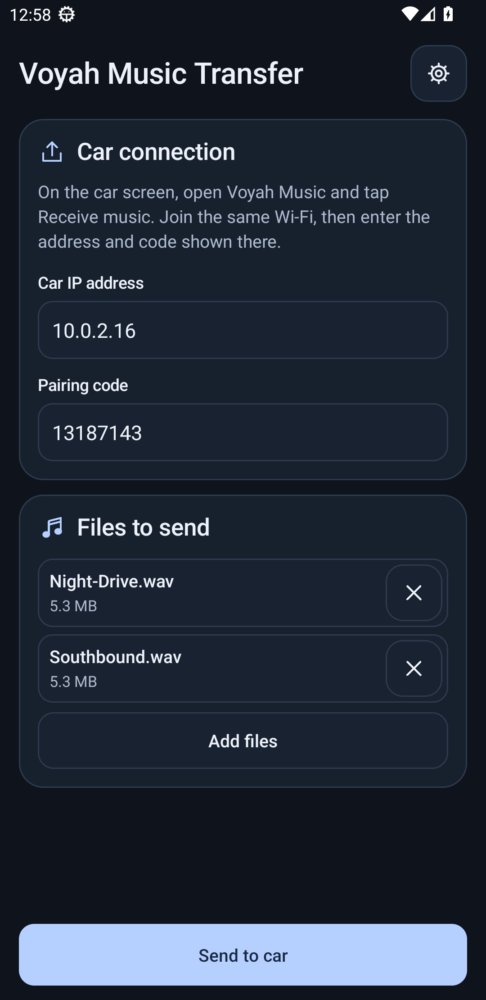
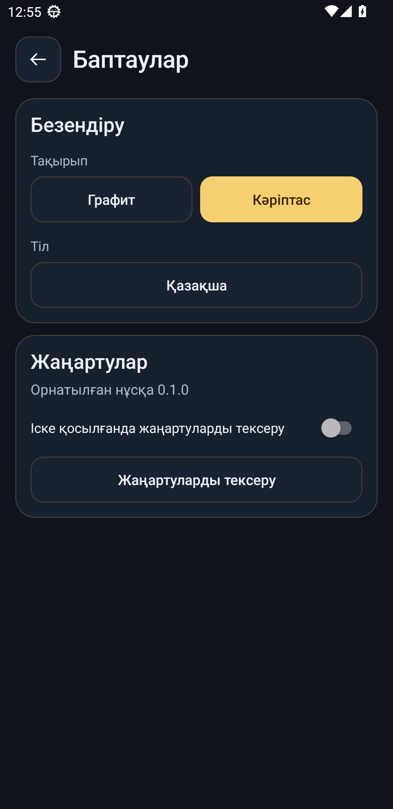

# Voyah Music

Voyah Music plays local music on the car's Android display. Its companion, **Voyah Music Transfer**, sends audio files from an Android phone over the car's Wi-Fi. Both apps support Android 9 or later, English, Russian, and Kazakh, with the graphite and amber palettes from Voyah Radio.

## Send and play music

1. Install **Voyah Music** on the car's head unit and **Voyah Music Transfer** on your phone.
2. Connect the phone to the car's Wi-Fi. You can also put both devices on the same Wi-Fi access point.
3. On the head unit, tap **Receive music**. In the phone app, enter the displayed IP address and eight-digit code.
4. Tap **Choose audio files** to select one or more files, then tap **Send to car**. Keep the receive screen open until the phone displays the result.
5. Return to the library and select a track. Use the progress slider to seek. The player also supports previous and next, shuffle, repeat, background playback, and media controls.

Audio is stored privately on the head unit and remains available when the phone disconnects. The library shows embedded tags when available, supports search by title, artist, album, or filename, and skips identical files on repeated sends. The track menu deletes a local copy after confirmation. The app can reopen the last track at the saved position.

The file picker accepts MP3, M4A, AAC, FLAC, Ogg, Opus, WAV, MKA, and AMR filenames. Playback depends on the audio encoding and head unit support. Files can be up to 2 GiB each. Partially transferred files are excluded from the library.

The code is generated when the receive screen opens and is valid for up to 20 minutes. Closing or leaving that screen ends the session. The apps use a direct IPv4 connection over local Wi-Fi on TCP port 47477. The transfer protocol is unencrypted. Music transfer and playback work without internet access. Settings provides a separate internet-based update check, enabled at startup by default.

## Screenshots

| Voyah Music | Head unit settings |
| --- | --- |
|  |  |


| Voyah Music Transfer | Phone settings |
| --- | --- |
|  |  |

Screenshots were captured on Android 13 emulators. The end-to-end test used two emulators on the same Wi-Fi. It covered multiple-file selection and transfer, SHA-256 verification on the receiving device, incorrect codes, duplicate files, playback after disconnecting the phone, seeking, and background media controls. The physical Voyah head unit and installation of a newer GitHub release remain untested.

## Build

With an Android SDK containing platform 35 and a JDK compatible with Gradle 8.11, run from this directory:

```powershell
.\gradlew.bat :player:assembleDebug :transfer:assembleDebug :shared:testDebugUnitTest :player:lintDebug :transfer:lintDebug
```

| App | APK | Package |
| --- | --- | --- |
| Voyah Music | `player/build/outputs/apk/debug/player-debug.apk` | `app.voyahmusic.player` |
| Voyah Music Transfer | `transfer/build/outputs/apk/debug/transfer-debug.apk` | `app.voyahmusic.transfer` |

For release builds, set `VOYAH_MUSIC_KEYSTORE` to the signing keystore path and `VOYAH_MUSIC_STORE_PASSWORD` to its password. The default alias is `voyah-music`. Set `VOYAH_MUSIC_KEY_ALIAS` and `VOYAH_MUSIC_KEY_PASSWORD` if the keystore uses different values. Build both modules with `:player:assembleRelease :transfer:assembleRelease`.

The apps look for `VoyahMusic-vVERSION.apk` and `VoyahMusicTransfer-vVERSION.apk` in stable Open Voyah Controls GitHub Releases. Use the same signing key for successive releases and increment the Android version code. The updater verifies the package name, version, signing certificate, and the release SHA-256 when provided, then opens the Android installer for confirmation.
