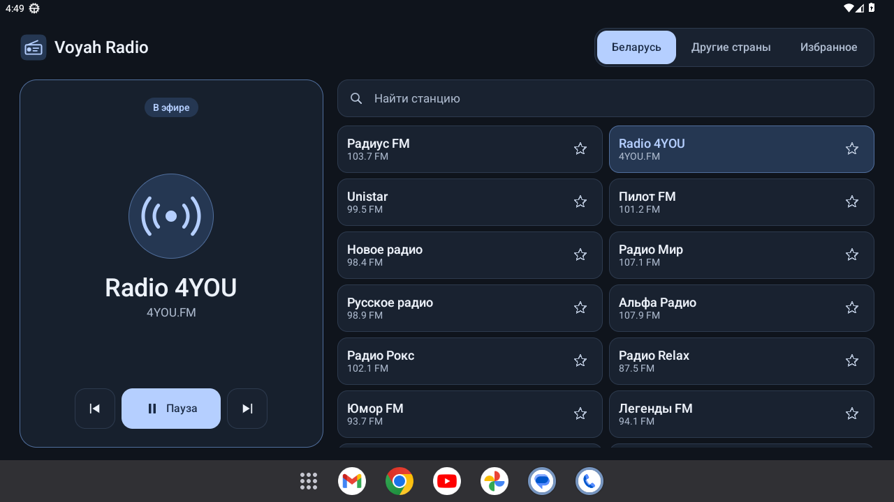

# Voyah Radio

Internet radio for the Voyah Free center display. The dark graphite theme uses a cool blue accent and large controls. The landscape layout adapts to narrower Android screens. It supports Android 9 and later and provides English and Russian interface text.



## Install and listen

Open the signed `VoyahRadio-v0.1.0.apk` from `dist/` with the head unit's Android package installer. The head unit needs internet access to play stations.

The built-in catalog has 48 stations, including Radius FM and Radio 4YOU in the Belarus tab. Tap a station to listen or tap its star to save it to Favorites. Search accepts station names, common aliases and frequencies. The app remembers the last station and resumes only when you press Play. Android's media session carries the current station and playback controls while you switch apps. The player tries the next stream URL when a station has an alternate and its first connection fails.

## Build

Use JDK 17 and Android SDK Platform 35. Set `ANDROID_HOME` or set `sdk.dir` in a local `local.properties` file. Run the debug build and lint checks from this directory.

```powershell
.\gradlew.bat :app:assembleDebug :app:lintRelease
```

For a signed release build, set `VOYAH_RADIO_KEYSTORE` to the absolute path of a PKCS#12 keystore with the alias `voyah-radio` and set `VOYAH_RADIO_STORE_PASSWORD`. Run `.\gradlew.bat :app:assembleRelease`. Subsequent APKs installed over an existing copy must use the same signing key.

The player reads `app/src/main/assets/stations.json` and connects directly to the public broadcaster URLs listed there. The bundled catalog is supplemented by the [Radio Browser directory](https://docs.radio-browser.info/).

## Verification

The signed APK was installed on an Android 13 emulator with a 1280 × 720 landscape display. Live streams tested were Radius FM (AAC), Radio MIR and Russkoe Radio Moscow (HLS), and Radio 4YOU and France Inter (MP3). The emulator also verified background playback, system pause, search, and saved favorites after restarting the app. The Voyah Free head unit remains untested.
