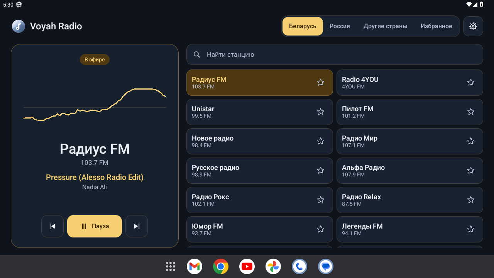
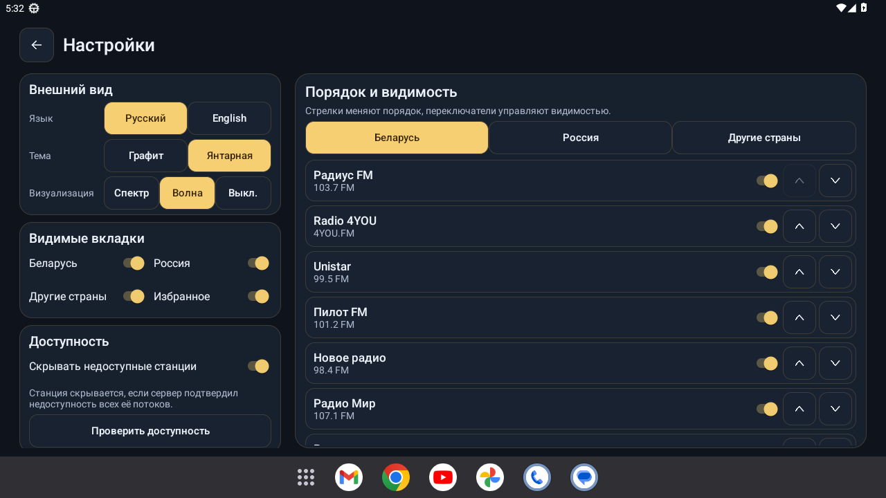

# Voyah Radio

Internet radio for the Voyah Free center display. The app uses large touch controls and keeps the interface dark in both the graphite and amber themes. The landscape layout adapts to narrower Android screens. Android 9 and later are supported. The interface starts in Russian and can be switched to English in Settings.






## Install and listen

Open the signed `VoyahRadio-v0.2.0.apk` from `dist/` with the head unit's Android package installer. The head unit needs internet access to play stations.

The built-in catalog has 59 stations with separate Belarus, Russia, International and Favorites tabs. Tap a station to listen or tap its star to save it. Search accepts station names, aliases and frequencies. The app remembers the last station and starts playback when you press Play. Android's media session carries playback controls and the current track while you switch apps.

Track titles and artists come from stream metadata. Selected Belarusian stations, including Radius FM, also use the public [RadioPlayer Belarus feed](https://radioplayer.by/). The player displays a status when track details are unavailable and a progress indicator while connecting, buffering or reconnecting. The spectrum and waveform use decoded playback audio and stop drawing when the player leaves the screen.

## Settings

Toggle each catalog tab under Visible tabs. In Order and visibility, choose a region, use the station switches to show or hide rows, and use the arrows to save a new order. Settings also offers the graphite and amber themes and the choice of spectrum, waveform or no visualization.

Hide unavailable stations uses confirmed responses from all of a station's stream URLs. Connection loss, timeouts and inconclusive responses preserve the station's visibility. Run Check availability from Settings to check the full catalog. Confirmed reports are kept for 24 hours and can be cleared sooner by a successful check or playback.

## Build

Use JDK 17 and Android SDK Platform 35. Set `ANDROID_HOME` or set `sdk.dir` in a local `local.properties` file. Run the debug build and lint checks from this directory.

```powershell
.\gradlew.bat :app:assembleDebug :app:testReleaseUnitTest :app:lintRelease
```

For a signed release build, set `VOYAH_RADIO_KEYSTORE` to the absolute path of a PKCS#12 keystore with the alias `voyah-radio` and set `VOYAH_RADIO_STORE_PASSWORD`. Run `.\gradlew.bat :app:assembleRelease`. Subsequent APKs installed over an existing copy must use the same signing key.

The player reads `app/src/main/assets/stations.json` and connects directly to the public stream URLs listed there. The catalog is supplemented by the [Radio Browser directory](https://docs.radio-browser.info/).

## Verification

The signed APK was installed on an Android 13 emulator with a 1280 × 720 landscape display. Checks covered live metadata for Radius FM, Radio 4YOU and Nashe Radio, regional visibility, manual order, language changes, both visualizations, background playback and loss of connectivity. The Voyah Free head unit remains untested.
