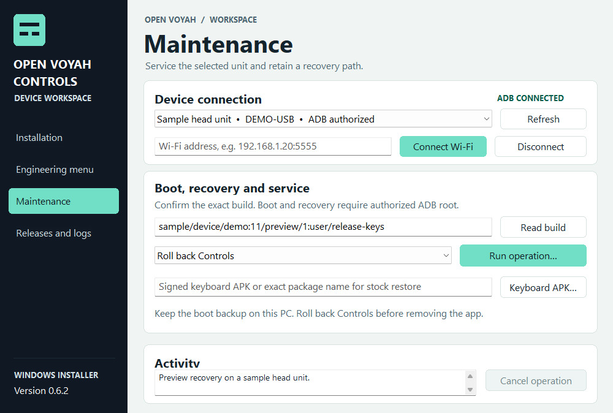

# Open Voyah Controls Installer for Windows

The installer connects to an explicitly selected Android head unit over USB or Wi-Fi. **Prepare and install** prepares startup access, installs the signed app and verified runtime, and waits for the Android first-run result. Separate APK installation, maintenance and PC recovery remain available.

## Set up the installer

1. Keep the portable `android-sdk` and `support` directories beside the executable. The kit includes matching Platform-Tools and Build-Tools, a Java runtime for signature verification, and the pinned ARM64 injector. A standalone development executable can use a local SDK and JDK instead.
2. Enable USB debugging on the head unit and accept the Android authorization prompt. Connect by USB and select **Refresh**, or enter the head unit's ADB address and select **Connect Wi-Fi**. The default port is 5555. The device must already accept TCP ADB for Wi-Fi connections.
3. Select the head unit and open **Device status**. Check its identity and the recovery state before changing it. Use **Browse APK** to select the signed release, or check **Releases and logs** for official downloads. The installer validates the package, signature, release certificate pin, and installed version. A same-certificate update keeps app data.

Choose **Prepare and install** for first setup. It requests the firmware's ADB root service, exports the original logcat startup script to the PC, prepares a writable mount, stages the verified injector, and installs a local authenticated Telnet service. It binds only to `127.0.0.1:2323`; the Android app does not need `su`. If remount requires a verified-boot change, setup performs at most one restart and verifies the same hardware and build after reconnection. App data and other Accessibility services are preserved.

Setup requires Android 9 or 11 on ARM64, owner user 0, ADB root support, SELinux Enforcing, a root-owned BusyBox with standalone Telnet, shell and `flock`, and an existing OEM init entry invoking `/system/etc/init.logcat.sh` as root. Setup checks shell descriptor inheritance; the access supervisor uses the verified BusyBox shell to retain its lock on Android 9. Missing prerequisites stop setup. **APK only** does not prepare these services. See [Head unit qualification and recovery](../android/docs/PRODUCTION.md).

Before changing startup, the installer reads a bounded init configuration graph and checks the actual service command and configured user. Comments, non-root services and ambiguous definitions cannot establish this prerequisite. Unknown configuration constructs require separate review. This inspection does not establish cold-boot execution or SELinux permission in the OEM service domain.

The Android first-run check proves app-side root access and loads the selected offline speech model. On a reviewed firmware it also waits for every enabled handler. An unreviewed firmware is reported separately and keeps vehicle operations disabled. The check does not certify microphone audio quality, physical actions, a cold boot or sleep/wake behavior.

APK installation and launch are separate from handler readiness. Check the panel, windows, and voice status in Controls after connecting. For APKs installed in a batch from Windows, touch and hold the app in the Controls app grid to change its permissions or close it; firmware without Android's permission screens does not need them.

## How Prepare and install works


The installer works only over ADB. It checks every input on the PC before it changes the head unit: the injector against `android/dist/FRIDA_RUNTIME.json`, and the Controls APK's package, release certificate pin, version and `apksigner` result. A debuggable or split APK stops here, so a local debug build of Controls cannot be installed with this tool.

Before the first device change, the original `/system/etc/init.logcat.sh` is saved to `%LOCALAPPDATA%\OpenVoyahControlsInstaller\backups\boot-backup-<time>\` on the PC. The installer then installs the APK with `adb install -r --user 0`, pushes the injector to `/data/adb/open-voyah-controls`, writes the root channel to `/data/adb/open-voyah-controls-access` and adds the V3 entry to `init.logcat.sh`. It does not push the Frida agents. During the first-run check on reviewed firmware, Controls writes them, `supervise.sh`, `boot-start.sh` and `trust.tsv` to `/data/adb/open-voyah-controls` through the root channel.

**APK only** runs the APK checks and installs Controls without the root channel or boot entry. **Install APK folder…** runs `adb install -r` for each standalone APK in a folder and refuses Controls and split APKs. Use it for companion apps such as the YouTube web app; they do not affect boot activation.

`trust.tsv` records the hash of the installed Controls APK. After any Controls update the supervisor writes `recovery.blocked` and deletes `enabled`, and nothing is injected after the next reboot. To update, run **Prepare and install** with the new APK: it rolls back the old deployment, installs, rearms and repeats the first-run check. **APK only** refuses to replace an installed Controls until **Roll back Controls** has run.

## Back up and recover from the PC

**Prepare and install** creates the verified PC backup before changing startup. Keep that folder. **Back up boot script to PC** and the older worker-only **Install optional boot entry** remain available as separate maintenance operations.

**Roll back Controls** stops our deployment and local listener, restores a verified on-device original and removes only Accessibility access added by setup. **Restore Controls from PC backup** can recover a recognized V1, V2 or V3 boot entry when the device copy is unavailable. Both actions check the selected unit and build and work without the APK. If recovery requires a reboot to restore visuals, use **Restart head unit** separately and check the reported state before removing the APK.

**Remove app** preserves app data. Use **Remove old app for signer migration** after a verified settings export and PC rollback when replacing an APK signed by a different certificate. Both removal paths detach only the Controls Accessibility component before removing its package, preserving other services. The first-run check requires an observed service connection; an enabled Accessibility toggle alone is not treated as readiness.

Use **Allow fresh Controls setup** after rollback when beginning a new setup on the reviewed build. Keep the backup and recovery tools available even when the Android app is absent.

## Maintain a head unit

The OEM maintenance operations check the selected unit and reviewed build before sending writes. Keep the vehicle parked with stable power while performing maintenance.

- **Reset vehicle settings with backup** uses ADB root and saves the database and available SQLite journals to the PC before moving the originals aside on the device. **Restore vehicle settings backup** moves the originals back on the same head unit.
- Use **Restart head unit** separately when a verified recovery requires a reboot.
- **Install signed OEM keyboard update** accepts a local compatible APK for either `com.qinggan.app.qgime` or `com.qinggan.app.qgime.second`. For **Restore stock OEM keyboard**, enter the exact package name. Stock restoration requires package-specific support in Android. OEM packages are supplied separately.
- **Collect logs** saves an on-device diagnostic snapshot as a local ZIP with a summary of unavailable reports. Android's access controls determine which logs are readable. **Open logs folder** shows saved reports.

## Engineering menu

Open **Engineering menu** for yesterday's, today's, and tomorrow's codes relative to the current date in Beijing. Use the date shown on the head unit if its clock differs. Select any code to copy it. This tool works offline without a connected head unit.

For early firmware, **Load local codes** opens up to four case-sensitive codes from a private JSON list in the form `[{"label":"My head unit","code":"EXAMPLE_ONLY"}]`. To include a local list in a build, set `OPEN_VOYAH_LEGACY_CODES_FILE` to its absolute path before running Cargo. Keep this file outside version control.

## Build and test

Use Rust 1.96 and the Windows SDK with the MSVC build tools. From this directory run:

```powershell
cargo build --release --locked
cargo test --release --locked
```

Build production releases with `OPEN_VOYAH_RELEASE_CERT_SHA256` set to the same public certificate fingerprint as the Android release. Sign `OpenVoyahControlsInstaller-v0.6.2.exe` with the release team's Windows code-signing certificate. The **Releases and logs** panel checks the project's stable GitHub releases for versioned `OpenVoyahControlsInstaller-vVERSION.exe` and `OpenVoyahControls-vVERSION.apk` assets. It requires a SHA-256 digest from the release. Startup checks are enabled by default and can be disabled from the same panel.

Prepare the runtime with `python ../android/tools/prepare_runtime.py`. Run `./tools/prepare-portable.ps1 -SdkRoot C:/Android/Sdk -BuildToolsVersion 35.0.0 -JavaHome <JDK>` after the signed release build. Use a complete JDK with `jlink` and `jmods`; a stripped IDE runtime is insufficient. The packager checks the Authenticode signature, Android certificate pin and runtime digest, builds a compact Java runtime, and verifies that the bundled APK verifier starts. Keep `android-sdk` and `support` beside the executable. Use `-Development` for a separately labeled unsigned bench kit. That switch does not bypass the signed-APK or certificate-pin requirements in **Prepare and install**.

The packager checks the selected ADB executable's reported version against `source.properties`, requires protocol 1.0.41 or newer and transport-ID support, then repeats the checks on the copied five-file tool set and compares every digest. These bounded `version` and `help` calls do not contact an ADB server. Run `python tools/test_platform_tools.py` for the offline packaging regressions.

For a private bench kit signed with a local certificate, explicitly pass `-LocalSignerSha256 <Windows-certificate-SHA256>`. This separate mode verifies the embedded CMS signature, Windows PE digest and exact certificate without changing the system trust store. It rejects unsigned files, content changes and an unexpected signer, and labels the output `portable-local-signed`. Windows can still warn about an unknown publisher. The normal portable mode continues to require a trusted Authenticode signature.

The [0.19.1 validation record](../android/dist/VALIDATION_0.19.1.json) covers installer 0.6.2, native rendering, filtered diagnostic properties and portable account evidence. The portable evidence collector records the observed tracking-provider owner and account-file metadata without collecting account contents. Diagnostic-only package records do not approve firmware or account writes. See the [local change notes](../android/docs/releases/0.19.1.md) and [account recovery boundaries](../android/docs/ACCOUNT_RECOVERY.md). The previous [0.19.0 record](../android/dist/VALIDATION_0.19.0.json) retains boot/init recovery and portable tool verification. Exact head-unit qualification remains pending; no Oversea account write is enabled.

## Screenshots

These client-area captures come from the Windows release build. Installation shows a sample device and APK. The engineering preview uses an example date and masks the early-firmware codes.





