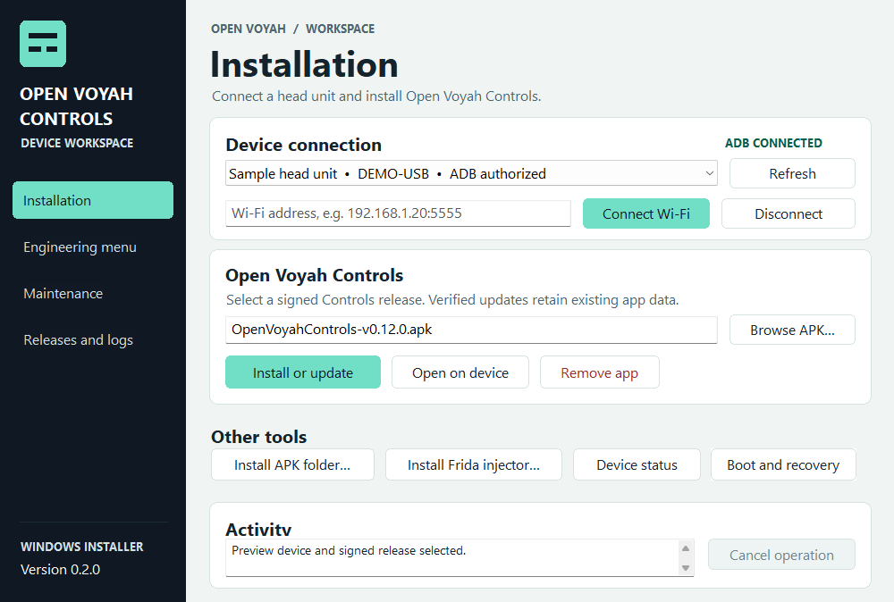
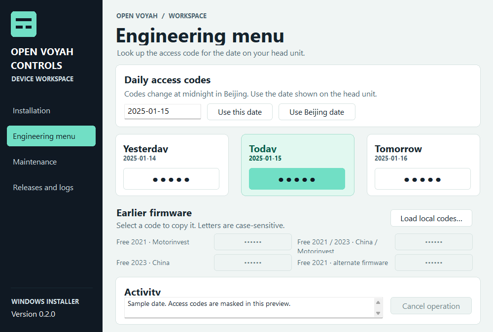
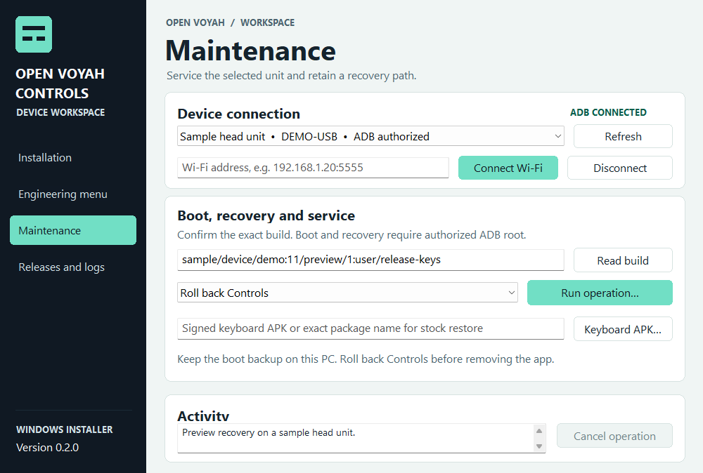
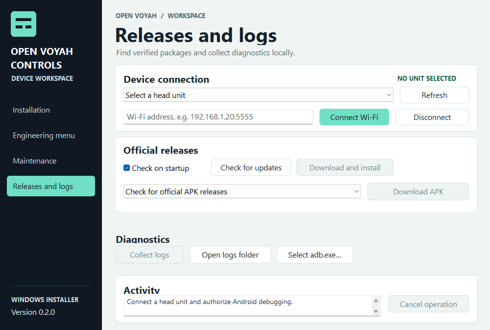

# Open Voyah Controls Installer for Windows

The installer connects to an explicitly selected Android head unit over USB or Wi-Fi. It separates signed APK installation, runtime setup, optional boot changes, and PC rollback. It can also install a folder of standalone APKs and collect diagnostic logs.

## Set up the installer

1. Use the portable SDK directory or install [Android SDK Platform-Tools](https://developer.android.com/tools/releases/platform-tools) and Android SDK Build-Tools in the same SDK directory. Keep `adb.exe`, `AdbWinApi.dll`, and `AdbWinUsbApi.dll` from one installation together. A local JDK supplies Java for the SDK APK signature verifier. Set `JAVA_HOME` or provide a compatible JDK under `android-sdk/jre`.
2. Enable USB debugging on the head unit and accept the Android authorization prompt. Connect by USB and select **Refresh**, or enter the head unit's ADB address and select **Connect Wi-Fi**. The default port is 5555. The device must already accept TCP ADB for Wi-Fi connections.
3. Select the head unit and open **Device status**. Check its identity and the recovery state before changing it. Use **Browse APK** to select the signed release, or check **Releases and logs** for official downloads. The installer validates the package, signature, release certificate pin, and installed version. A same-certificate update keeps app data.

Use **Verify production firmware** to compare the build and reviewed OEM APKs. **Install Frida injector** accepts the ARM64 binary prepared by [the Android runtime script](../android/tools/prepare_runtime.py). This step verifies the staged bytes and uses the already authorized root connection. The Android app uses the head unit's existing owner-authorized local privilege broker. See [Head unit qualification and recovery](../android/docs/PRODUCTION.md).

APK installation and launch are separate from handler readiness. Check the panel, windows, and voice status in Controls after connecting. APKs installed in a batch from Windows use Android's system-managed permission screens. Use the user-confirmed installer inside Controls to establish its installation receipt for direct runtime permission controls.

## Back up and recover from the PC

For reviewed firmware that already invokes the OEM logcat script, use **Back up boot script to PC** and keep the verified original and metadata folder. Then use **Install optional boot entry** with that folder once the Controls launcher worker is ready.

**Roll back Controls** stops our deployment and restores a verified on-device original. **Restore Controls from PC backup** can recover an exact recognized boot entry when the device copy is unavailable. Both actions check the selected unit and build. If the result requires a reboot to restore visuals, use **Restart head unit** separately and check the reported state before removing the APK.

**Remove app** preserves app data. Use **Remove old app for signer migration** after a verified settings export and PC rollback when replacing an APK signed by a different certificate.

Use **Allow fresh Controls setup** after rollback when beginning a new setup on the reviewed build. Keep the backup and recovery tools available even when the Android app is absent.

## Maintain a head unit

The OEM maintenance operations check the selected unit and reviewed build before sending writes. Keep the vehicle parked with stable power while performing maintenance.

- **Reset vehicle settings with backup** uses ADB root and saves the database and available SQLite journals to the PC before moving the originals aside on the device. **Restore vehicle settings backup** moves the originals back on the same head unit.
- Use **Restart head unit** separately when a verified recovery requires a reboot.
- **Install signed OEM keyboard update** accepts a local compatible APK for either `com.qinggan.app.qgime` or `com.qinggan.app.qgime.second`. For **Restore stock OEM keyboard**, enter the exact package name. Stock restoration requires package-specific support in Android. OEM packages are supplied separately.
- **Collect logs** saves an on-device diagnostic snapshot as a local ZIP with a summary of unavailable reports. Android's access controls determine which logs are readable. **Open logs folder** shows saved reports.

## Engineering menu

Open **Engineering menu** for yesterday's, today's, and tomorrow's codes relative to the current date in Beijing. Use the date shown on the head unit if its clock differs. Select any code to copy it. This tool works offline without a connected head unit.

For early firmware, **Load local codes** opens up to four case-sensitive codes from a private JSON list in the form `[{"label":"My head unit","code":"EXAMPLE_ONLY"}]`. To include a local list in a build, set `OPEN_VOYAH_LEGACY_CODES_FILE` to its absolute path before running Cargo. Keep this file outside version control.

## Build and test

Use Rust 1.96 and the Windows SDK with the MSVC build tools. From this directory run:

```powershell
cargo build --release --locked
cargo test --release --locked
```

Build production releases with `OPEN_VOYAH_RELEASE_CERT_SHA256` set to the same public certificate fingerprint as the Android release. Sign `OpenVoyahControlsInstaller-v0.2.0.exe` with the release team's Windows code-signing certificate. The **Releases and logs** panel checks the project's stable GitHub releases for versioned `OpenVoyahControlsInstaller-vVERSION.exe` and `OpenVoyahControls-vVERSION.apk` assets. It requires a SHA-256 digest from the release. Startup checks are enabled by default and can be disabled from the same panel.

Run `./tools/prepare-portable.ps1 -SdkRoot C:/Android/Sdk -BuildToolsVersion 35.0.0` after the signed release build. The packager checks the existing Authenticode signature and Android certificate pin. It copies the executable, SDK tools, and support scripts into `dist`. Keep the `android-sdk` and `support` directories with the executable. Use `-Development` to prepare a separately labeled unsigned bench kit.

## Screenshots

These client-area captures come from the Windows release build. Installation shows a sample device and APK. The engineering preview uses an example date and masks the early-firmware codes.








