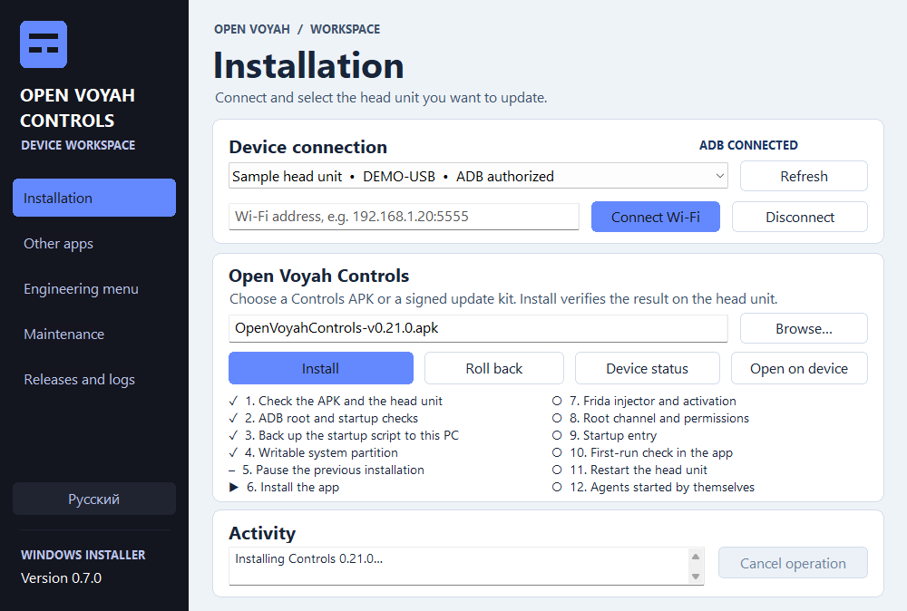
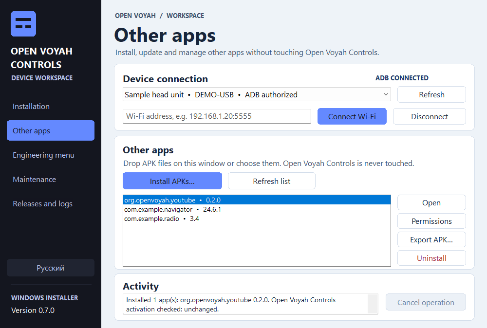
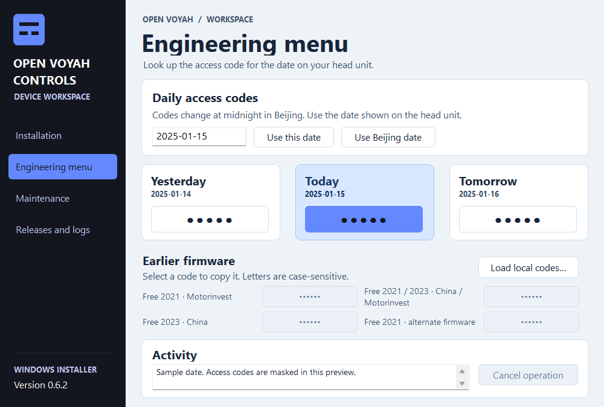
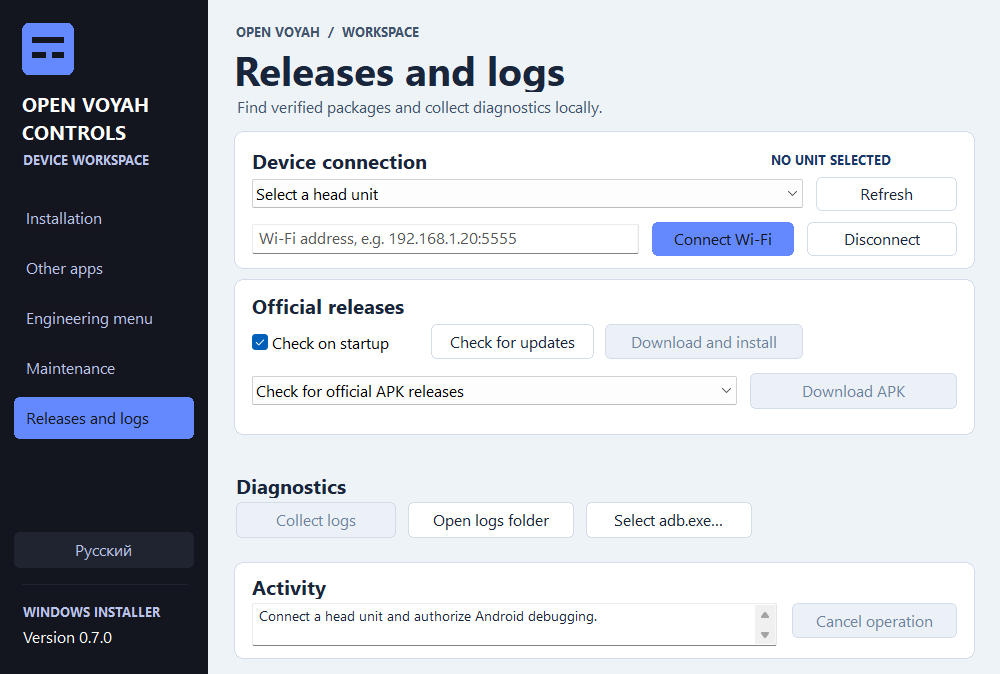

# Open Voyah Controls Installer for Windows

Open the executable, choose the Open Voyah Controls APK, connect the head unit and select **Install**. The installer runs the whole cycle by itself: ADB root, a PC backup of the startup script, the app, the Frida injector, the private root channel, the startup entry, the first-run check in the app, the restarts and a final check that the agents start by themselves. Other apps are installed and managed on a separate page without touching Controls. The interface is in English and Russian; it follows the Windows language and the sidebar button switches it.

## Set up the installer

1. Unpack the portable kit and keep the `android-sdk` and `support` folders beside the executable. The kit contains everything the installer runs: Platform-Tools (`adb`), Build-Tools (`aapt2`, `apksigner`), a compact Java runtime for `apksigner`, and the pinned ARM64 Frida injector. Nothing else needs to be installed. A development executable started from `target\release` finds a local SDK, a JDK through `JAVA_HOME` and the injector that `android/open-voyah-controls/tools/prepare_runtime.py` wrote to `android/open-voyah-controls/dist/runtime`.
2. Enable USB debugging on the head unit and accept the Android authorization prompt. Connect by USB and select **Refresh**, or enter the head unit's ADB address and select **Connect Wi-Fi**. The default port is 5555. The device must already accept TCP ADB for Wi-Fi connections.
3. Select the intended head unit. Choose the APK or a signed update kit with **Browse…**, drop it on the window, or download an official artifact under **Releases and logs**.

## Install Open Voyah Controls

Select **Install**. The confirmation names the head unit and says that it will restart by itself: once on a fresh unit, possibly once more on a first setup that must prepare its system partition, and twice for an update the head unit cannot take live (see below). An update of a running installation sealed by a current Controls installs over the running agents without any restart. Pressing **Yes** approves the whole cycle. Keep the vehicle parked with stable power and the cable connected until the installer says **Done**. The page lists the twelve steps and marks each one as done, skipped, running or failed; the Activity box shows what happens now.

The installer accepts two kinds of APK:

- **Release builds** signed with the release certificate pinned into the installer (`OPEN_VOYAH_RELEASE_CERT_SHA256`). They must be standalone, non-debuggable and carry a stable version. A download from **Releases and logs** must also match the release's SHA-256.
- **Owner builds** signed with a certificate the owner trusts on this PC. A certificate listed in `%LOCALAPPDATA%\OpenVoyahControlsInstaller\local-vehicle\signer.sha256` (the file a `-Povc.localVehicle=...` Android build reads) is trusted without a question. Any other certificate is shown with its SHA-256, package, version and whether the build is debuggable; **Yes** stores it in `trusted-signers.txt` in the same folder, **No** stops before anything reaches the head unit. Owner builds may be debuggable and are labelled as owner builds in every result. When the local-vehicle folder also holds `verified-firmware.tsv` and `verified-operations.tsv`, they count as a reviewed profile for that exact unit.

Android cannot update an installed app across certificates. When the installed Controls is signed by another certificate, the installer stops before the first change and points to **Remove old app for signer migration** under **Maintenance**.

If anything fails, the installer stops in a safe state, names the step and keeps the result in the Activity box. **Install** turns into **Retry**, which runs the cycle again: every step checks the current state first, so a retry continues where it stopped. **Roll back** stops Controls and restores the original startup script, restarts the head unit if the rollback needs it and confirms the inactive state. The app and its settings stay.

Setup requires Android 9 or 11 on ARM64, owner user 0, ADB root support, SELinux Enforcing (or Permissive only when the firmware's own kernel command line sets `androidboot.selinux=permissive`, the same rule as the boot scripts and the app), a root-owned BusyBox with standalone Telnet, shell and `flock`, and an existing OEM init entry invoking `/system/etc/init.logcat.sh` as root. The root channel binds only to `127.0.0.1:2323`; the Android app does not need `su`. App data and other Accessibility services are preserved. See [Head unit qualification and recovery](../android/open-voyah-controls/docs/PRODUCTION.md).

Before changing startup, the installer reads a bounded init configuration graph and checks the actual service command and configured user. Comments, non-root services and ambiguous definitions cannot establish this prerequisite. For an owner build on a unit that this PC already set up (a verified boot backup of the exact unit and build exists, or the Controls startup entry is present), a construct the preflight cannot read is reported and setup continues, because that unit has already booted the entry.

The Android first-run check proves app-side root access and loads the selected offline speech model. On a reviewed firmware it also waits for every enabled handler; when it answers before the agents are up, the installer waits up to three minutes for them instead of repeating the check. An unreviewed firmware is reported separately and keeps vehicle operations disabled. The final check after the last restart waits up to five minutes for the startup entry, an active root channel and, on reviewed firmware, a ready launcher agent. It does not certify microphone audio quality, physical actions or sleep/wake behavior.

## Install a signed update kit

Choose the `OpenVoyahControlsKit-vVERSION.zip` file and select **Install**. The installer verifies the kit signature, both payload digests, the Controls APK signing certificate and version, and the exact fingerprint, product, primary ABI and Android SDK of the selected head unit. An official download also has to match the catalog asset's SHA-256. A different APK must have both a newer version name and a higher Android version code. An exact copy is accepted when continuing an interrupted setup.

Use the Windows installer built for the kit. The Frida version, filename, digest and size must match the pins in the APK and the installer's recovery tools. The existing setup backs up the original startup script and updates the APK in place, keeping app data. It pauses a running deployment before a kit changes the APK and confirms the available services after setup. If setup is interrupted, keep the kit and the boot backup. Select the same head unit and the same kit and select **Install** or **Retry**. **Roll back** restores the original startup script and stops the deployment. The current APK and its settings stay installed.

## How Install works


The installer works only over ADB and checks every input on the PC before it changes the head unit: the injector against `android/open-voyah-controls/dist/FRIDA_RUNTIME.json`, and the APK's package, certificate, version and `apksigner` result. When Android already holds the same APK and its agents report ready, nothing changes.

Before the first device change, the original `/system/etc/init.logcat.sh` is saved to `%LOCALAPPDATA%\OpenVoyahControlsInstaller\backups\boot-backup-<time>\` on the PC. The installer then installs the APK with `adb install -r --user 0`, pushes the injector to `/data/adb/open-voyah-controls`, writes the root channel to `/data/adb/open-voyah-controls-access` and adds the V3 entry to `init.logcat.sh`. It does not push the Frida agents. During the first-run check Controls writes them, `supervise.sh`, `boot-start.sh` and `trust.tsv` to `/data/adb/open-voyah-controls` through the root channel.

`trust.tsv` pins Controls by its signing certificate and a version floor (a `signer` row), and the hooked OEM APKs by their hashes. A same-signer update that is not older keeps the activation: the running supervisor accepts the new APK and the new app redeploys the agents that changed. So when the boot status reports `OVC_LIVE_UPDATE=yes` and the APK's version code is not below `OVC_SEALED_VERSION`, **Install** only installs the APK (`adb install -r`) and waits up to about three and a half minutes for the agents to report ready; backup, rollback, rearm, access, boot entry, first-run check and both restarts are skipped. **Install Controls APK only** under **Maintenance** accepts the same update over running agents.

A receipt written by a Controls version before the `signer` row pins the exact APK hash, and the supervisor of that version revokes activation (`recovery.blocked`, `enabled` deleted) on any update. Such an update, a version below the floor, or a live update the head unit revoked after all runs the full cycle: rollback of the running deployment, restart 1 when the rollback reports visuals that need it, ADB root again, the APK on the now inactive unit, rearm, root channel, boot entry and first-run check, then restart 2 and the final check. The APK is never installed in the middle of the cycle. After each restart the installer waits until the same hardware and build has booted, because Android drops ADB root on every boot.

## Other apps

The **Other apps** page installs and manages everything that is not Controls, for example the YouTube web app (`org.openvoyah.youtube`) or the owner's own apps.

- Drop one or several APK files on the window, or choose them with **Install APKs…**. A single APK dropped on the Installation page fills the Controls field instead. Updates keep app data. Controls, OEM packages and split APKs are refused before the first install, so a mistaken pick never reaches the head unit. Clear messages explain a signature conflict, a downgrade, a missing ABI or low storage.
- The list shows third-party apps with their versions. **Open** starts the selected app, **Permissions** grants every runtime permission it requests, **Export APK…** copies its installed APK (and split parts) to a folder, **Uninstall** removes it with its data.

Nothing on this page touches the Controls APK, its runtime, deployment files or boot entry, so its boot activation stays. With ADB root the installer also compares the Controls recovery block before and after an install and reports that it did not change.

A YouTube release downloaded under **Releases and logs** is installed with its own pinned certificate (`OPEN_VOYAH_YOUTUBE_CERT_SHA256`); the installer offers it right after the download.

## Back up and recover from the PC

**Install** creates the verified PC backup before changing startup. Keep that folder. **Back up boot script to PC** and the older worker-only **Install optional boot entry** remain available as separate maintenance operations.

**Roll back** on the Installation page and **Roll back Controls** under **Maintenance** stop our deployment and local listener, restore a verified on-device original and remove only Accessibility access added by setup. The Installation button also restarts the unit when visuals need it and confirms the inactive state afterwards. **Restore Controls from PC backup** can recover a recognized V1, V2 or V3 boot entry when the device copy is unavailable. These actions check the selected unit and build and work without the APK.

**Remove Controls app (keep data)** preserves app data. Use **Remove old app for signer migration** after a verified settings export and PC rollback when replacing an APK signed by a different certificate. Both removal paths detach only the Controls Accessibility component before removing its package, preserving other services. The first-run check requires an observed service connection; an enabled Accessibility toggle alone is not treated as readiness.

Use **Allow fresh Controls setup** after rollback when beginning a new setup on the reviewed build. Keep the backup and recovery tools available even when the Android app is absent.

## Maintain a head unit

The **Maintenance** list also holds the single steps that **Install** combines, for diagnosis: **Install Controls APK only** (the APK from the Installation page, without the root channel or boot entry; an installed Controls must be rolled back first) and **Install Frida injector…**. The OEM maintenance operations check the selected unit and reviewed build before sending writes. Keep the vehicle parked with stable power while performing maintenance.

- **Reset vehicle settings with backup** uses ADB root and saves the database and available SQLite journals to the PC before moving the originals aside on the device. **Restore vehicle settings backup** moves the originals back on the same head unit.
- Use **Restart head unit** separately when a verified recovery requires a reboot.
- **Install signed OEM keyboard update** accepts a local compatible APK for either `com.qinggan.app.qgime` or `com.qinggan.app.qgime.second`. For **Restore stock OEM keyboard**, enter the exact package name. Stock restoration requires package-specific support in Android. OEM packages are supplied separately.
- **Collect logs** saves an on-device diagnostic snapshot as a local ZIP with a summary of unavailable reports. Android's access controls determine which logs are readable. **Open logs folder** shows saved reports.

## Engineering menu

Open **Engineering menu** for yesterday's, today's, and tomorrow's codes relative to the current date in Beijing. Use the date shown on the head unit if its clock differs. Select any code to copy it. This tool works offline without a connected head unit.

For early firmware, **Load local codes** opens up to four case-sensitive codes from a private JSON list in the form `[{"label":"My head unit","code":"EXAMPLE_ONLY"}]`. To include a local list in a build, set `OPEN_VOYAH_LEGACY_CODES_FILE` to its absolute path before running Cargo. Keep this file outside version control.

## Build and test

Use Rust 1.96 and the Windows SDK with the MSVC build tools. From this directory run:

```powershell
cargo build --release --locked
cargo test --release --locked
```

Build production releases with `OPEN_VOYAH_RELEASE_CERT_SHA256` set to the same public certificate fingerprint as the Android release. Sign `OpenVoyahControlsInstaller-v0.7.0.exe` with the release team's Windows code-signing certificate. The **Releases and logs** panel checks the project's stable GitHub releases for versioned `OpenVoyahControlsInstaller-vVERSION.exe` and `OpenVoyahControls-vVERSION.apk` assets. It requires a SHA-256 digest from the release. Startup checks are enabled by default and can be disabled from the same panel.

For signed kits, set `OPEN_VOYAH_KIT_PUBLIC_KEY_HEX` in both consumer builds to the same lower-case hexadecimal 65-byte uncompressed P-256 public point. Use the stable, pinned-certificate APK and the Frida injector named by its embedded manifest. `python tools/prepare-update-kit.py --help` lists the offline build options, including the Android Build-Tools directory, public certificate pin, exact compatibility list and path to the separately stored P-256 signing key. The compatibility input is a JSON array of objects with `fingerprint`, `product`, `abi` and `sdk` fields. Use confirmed firmware identities. The packager verifies the APK with `apksigner` for each listed SDK, signs the exact UTF-8 manifest bytes and creates the ZIP after both payloads pass SHA-256 checks.

Prepare the runtime with `python ../android/open-voyah-controls/tools/prepare_runtime.py`. Run `./tools/prepare-portable.ps1 -SdkRoot C:/Android/Sdk -BuildToolsVersion 35.0.0 -JavaHome <JDK>` after the signed release build. Use a complete JDK with `jlink` and `jmods`; a stripped IDE runtime is insufficient. The packager checks the Authenticode signature, Android certificate pin and runtime digest, builds a compact Java runtime, and verifies that the bundled APK verifier starts. Keep `android-sdk` and `support` beside the executable. Use `-Development` for a separately labeled unsigned bench kit. That switch does not bypass the certificate checks in **Install**: a kit without a release pin installs only owner builds whose certificate the owner trusts.

The packager checks the selected ADB executable's reported version against `source.properties`, requires protocol 1.0.41 or newer and transport-ID support, then repeats the checks on the copied five-file tool set and compares every digest. These bounded `version` and `help` calls do not contact an ADB server. Run `python tools/test_platform_tools.py` for the offline packaging regressions.

For a private bench kit signed with a local certificate, explicitly pass `-LocalSignerSha256 <Windows-certificate-SHA256>`. This separate mode verifies the embedded CMS signature, Windows PE digest and exact certificate without changing the system trust store. It rejects unsigned files, content changes and an unexpected signer, and labels the output `portable-local-signed`. Windows can still warn about an unknown publisher. The normal portable mode continues to require a trusted Authenticode signature.

The [0.19.1 validation record](../android/open-voyah-controls/dist/VALIDATION_0.19.1.json) covers installer 0.6.2, native rendering, filtered diagnostic properties and portable account evidence. The portable evidence collector records the observed tracking-provider owner and account-file metadata without collecting account contents. Diagnostic-only package records do not approve firmware or account writes. See the [local change notes](../android/open-voyah-controls/docs/releases/0.19.1.md) and [account recovery boundaries](../android/open-voyah-controls/docs/ACCOUNT_RECOVERY.md). The previous [0.19.0 record](../android/open-voyah-controls/dist/VALIDATION_0.19.0.json) retains boot/init recovery and portable tool verification. Exact head-unit qualification remains pending; no Oversea account write is enabled.

Make the screenshots with `OpenVoyahControlsInstaller.exe --capture <png> <page> 96 [en|ru]`, where page 0 is Installation, 1 Other apps, 2 Engineering menu, 3 Maintenance and 4 Releases and logs.

## Screenshots

These client-area captures come from the Windows release build. Installation shows a sample device and APK in the middle of the cycle. Other apps shows sample apps. The engineering preview uses an example date and masks the early-firmware codes.









